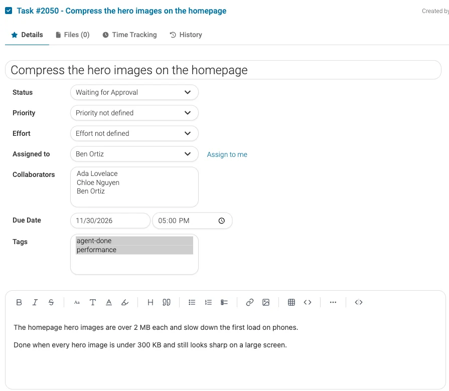
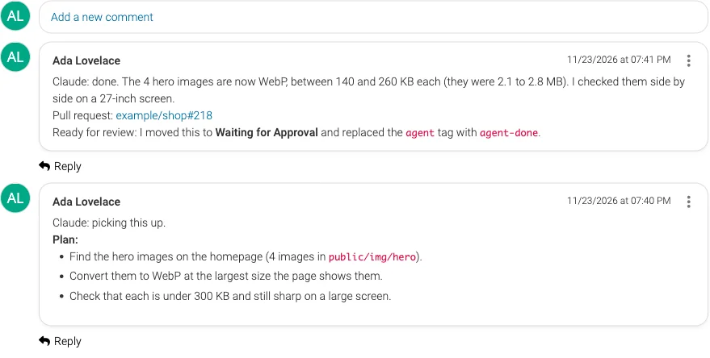

# Hand to-dos to a coding agent

A coding agent like Claude Code can work through to-dos in Leantime. You tag the to-dos you want it to do with `agent`. The agent finds them, comments with its plan, does the work, comments with the result and a link to the pull request, and moves the to-do to **Waiting for Approval** for you to review. The to-do stays assigned to the person who's responsible for it, and the tags show where each one is.

**At a glance**

- **Time:** about 15 minutes to set up, then one message each time you start the agent
- **You need:** Claude Code, or another coding agent that supports MCP, connected to Leantime (see [Connect your assistant](ai/recipes.md#connect-your-assistant)); a Leantime project with to-dos; the code repository the work is in
- **At the end:** to-dos worked on by the agent, each with its plan, its result and a pull request link in the comments, waiting for your review

## How the hand-off works

Tags work like labels in an inbox: anyone on the project can add one, everyone sees them, and they don't change who the to-do belongs to.

| Tag | Means | Who sets it |
| --- | --- | --- |
| `agent` | Ready for the agent | You, or anyone on the team |
| `agent-done` | The agent finished; waiting for review | The agent |
| `agent-question` | The agent needs an answer before it can go on | The agent |

Tell the team about the tags the way you'd tell them about any other way of working: in your next meeting, or in the project's description.

## Step 1: Write to-dos the agent can do

The agent only knows what's in the to-do. Write it the way you would for a new colleague:

- **The title says what to do:** "Add alt text to the product images", not "Images".
- **The description says when it's done:** "Done when every product image has alt text and the accessibility check passes."
- **Add the `agent` tag** in the to-do's **Tags** field.

Start with small, clear to-dos. You can always tag more once you've seen how the agent handles them.

## Step 2: Give the agent its rules

Put the rules where the agent reads them every time. For Claude Code, that's the `CLAUDE.md` file in your repository. Adjust the project name and statuses to yours:

```
## Leantime to-dos

You pick up work from the Leantime project "Website Redesign".

1. Find the open to-dos tagged "agent". Work on one at a time, oldest first.
2. Read the to-do's description and all its comments before you start.
3. Set it to "In Progress", and add a comment with your plan.
4. Do the work on a new branch, and open a pull request.
5. Add a comment with what you changed, how you checked it, and the
   pull request link.
6. Set the to-do to "Waiting for Approval". Replace the "agent" tag
   with "agent-done", and keep the to-do's other tags.
7. If something is unclear, add a comment with your question, replace
   "agent" with "agent-question", and go on to the next to-do.

Never set a to-do to "Done", and don't change who it's assigned to.
Start every comment with "Claude:". Write comments in HTML, with
paragraphs and lists.
```

Why some of these rules matter:

- **"Start every comment with Claude:"** The agent signs in as you, so its comments show your name. The prefix tells the team which comments the agent wrote.
- **"Keep the to-do's other tags."** When the agent changes tags, it sends the whole list. Without this rule, it can drop tags like `accessibility` that someone else added.
- **"Write comments in HTML."** Line breaks in plain text can run together into one paragraph in Leantime.
- **"Never set Done."** Done is your call, after you've reviewed the work.

## Step 3: Start the agent

Open Claude Code in the repository and ask:

```
Work through the Leantime to-dos tagged agent.
```

The agent lists the to-dos it found and starts on the first one. Leantime doesn't start the agent by itself: it works when you, or your automation, start it.

## What you see in Leantime

When the agent is done with a to-do, it's in **Waiting for Approval**, still assigned to the same person, tagged `agent-done`:



Its comments have the agent's plan, and its result with the pull request link, each starting with "Claude:":



## Step 4: Review the work

Open the project's to-dos and look at **Waiting for Approval**, or ask your assistant "Which to-dos are tagged agent-done?". For each one, read the agent's comment and review the pull request.

- **It's good:** merge the pull request, set the to-do to **Done**, and remove the `agent-done` tag.
- **It needs changes:** add a comment saying what to change, and replace `agent-done` with `agent` again. The next time you start the agent, it reads your comment before it goes on.
- **It asked a question** (`agent-question`): answer in a comment, and replace `agent-question` with `agent`.

## Good to know

- **The agent works as you.** It sees and changes what your account can, and the to-do's history shows your name. To give the agent its own account and name instead, see [Running an AI agent as a team member](installation/leantime-mcp.md#running-an-ai-agent-as-a-team-member).
- **Statuses differ per project.** If your project calls it "Review" instead of "Waiting for Approval", change the rules to match.
- **Other coding agents** like Cursor, VS Code with GitHub Copilot or Codex connect with a token (see [Step 3: Connect your AI assistant](installation/leantime-mcp.md#step-3-connect-your-ai-assistant)). Put the same rules in their instructions file.
- **Start small.** One or two tagged to-dos at a time are easier to review than ten.

## Related

- [Things your AI assistant can do in Leantime](ai/recipes.md): more recipes
- [To-dos](using-leantime/task-management.md)
- [MCP server: connect your own assistant](installation/leantime-mcp.md)
