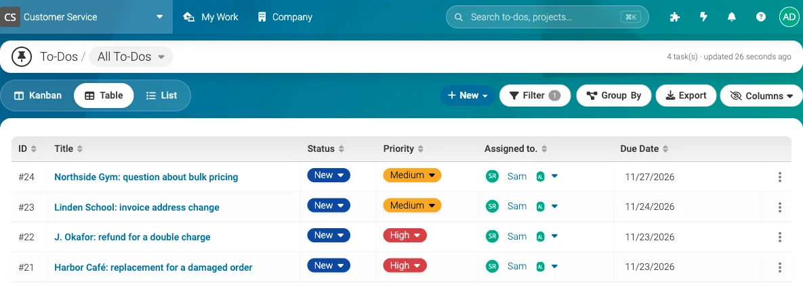

# Turn emails into tasks

Emails that need work, like customer requests, are easy to lose in an inbox. When Leantime and your mail are both connected to Claude, the assistant reads the emails and creates one task per conversation in the right Leantime project, with an assignee, a priority and a due date. Ask when you need it, or let it run every morning.

**At a glance**

- **Time:** about 10 minutes to connect everything, then a minute each time you ask
- **Level:** Beginner. No terminal needed if you use Claude on the web or the Claude app.
- **You need:** a Leantime account, a Claude account, and Gmail
- **At the end:** emails turned into Leantime tasks with an assignee, a priority and a due date, on request or every morning

## What do I need?

- **Leantime connected to Claude.** See [Connect your assistant](ai/recipes.md#connect-your-assistant). For the morning schedule, add Leantime as a connector in Claude on the web, not only in Claude Code.
- **A mail connector,** for example the Gmail connector in Claude. The assistant reads your emails through it, and creates the tasks through Leantime.

## Connect your email

In Claude, open **Customize → Connectors** and connect **Gmail**, then sign in with Google. Claude can then search and read your emails, and add or remove labels. It can't send emails: replies stay with you.

Gmail can't be connected from Claude Code directly. Connect it in Claude on the web: Claude Code uses it from there when you're signed in with the same account.

## Ask when you need it

Ask in your own words, and name the project:

```
Add yesterday's support emails to the Customer Service project.
One task per conversation. Assign them to Sam, with a due date for the
first reply, and add me as a collaborator. Show me the list first.
```

The assistant searches your mail, groups the messages into conversations, and shows you the tasks it would create:

> **You:** Add yesterday's support emails to the Customer Service project. …
>
> **Assistant:** I found 4 conversations from yesterday. I'd create these tasks in Customer Service, assigned to Sam, with you as a collaborator:
>
> 1. **Harbor Café: replacement for a damaged order.** Order 10482 arrived with two broken mugs. High priority, first reply due today.
> 2. **J. Okafor: refund for a double charge.** Receipt R-3391 was charged twice. High priority, first reply due today.
> 3. **Linden School: invoice address change.** Medium priority, first reply due tomorrow.
> 4. **Northside Gym: question about bulk pricing.** Low priority, first reply due Friday.
>
> Shall I create them?
>
> **You:** Yes, but make the Northside one Medium.
>
> **Assistant:** Done. I created 4 tasks in Customer Service and assigned them to Sam.

The tasks in the Customer Service project's table, each assigned to Sam with a priority and a due date:



Besides the title and description, the assistant can set the **assignee**, **priority** (Critical, High, Medium, Low or Lowest), **due date**, **milestone** and **collaborators**. Ask for what you need. If it isn't sure which project or person you mean, it asks.

**Label the emails you want as tasks.** Give them a Gmail label like `→ Leantime` as they come in, by hand or with a Gmail filter. Then name the label in your request, like "add the emails labelled → Leantime". The assistant only looks at those, so nothing else in your inbox ends up in Leantime. Once the tasks are created, ask the assistant to take the label off those emails. Then the label only ever holds emails that aren't in Leantime yet.

**No mail connector?** Take screenshots of the emails and paste them into the chat with the same request. The assistant reads the screenshots instead.

## Every morning, on a schedule

> **To verify:** this workflow hasn't been tested end to end yet.

Instead of asking each time, mark the emails that need a task, and let a scheduled Claude task turn them into tasks every morning.

1. **Label the emails in Gmail,** for example with a label called `→ Leantime`. Do it by hand, or with a Gmail filter for addresses like your support address.
2. **Connect Leantime and Gmail as connectors in Claude** (see [Add Leantime as a connector in Claude](ai/recipes.md#add-leantime-as-a-connector-in-claude)). A scheduled task runs in the cloud. It uses the connectors of your Claude account, not a Leantime connection you added in Claude Code on your computer.
3. **Create a scheduled task** at [claude.ai/code/routines](https://claude.ai/code/routines), or with `/schedule` in Claude Code. Choose **Daily** and a time, and give it instructions like these:

```
Every morning, look in Gmail for conversations with the label "→ Leantime".

For each conversation, search the Leantime project "Customer Service" for its
Gmail thread ID. If a task has it, add the new messages as a comment on that
task. If not, create one task, following these rules:
- Title: "Customer: what they need", for example "Harbor Café: replacement
  for a damaged order".
- Description: what the customer asked for, and any order or receipt numbers.
  End it with a line "Gmail thread: " and the conversation's thread ID.
- In every description and comment, leave out email addresses, phone
  numbers and account numbers. Summarize new messages instead of copying them.
- If the same customer asks about the same thing in another conversation,
  add that thread ID and the message to their existing task instead.
- Priority: from the reason they wrote. Money (refunds, billing) and legal
  questions rank higher; how-to questions rank lower.
- Assign it to Sam, with the first reply due the next working day.
- Add me as a collaborator.

- When the task or comment is saved, remove the "→ Leantime" label from the
  conversation.

At the end, list the tasks you created and the comments you added.
```

Good to know:

- **The label holds only what's left to do.** The assistant takes the label off each conversation it handled, so the next run starts with only new ones.
- **No duplicates.** Each task records the Gmail thread it came from, and the assistant searches Leantime for that thread before it creates a task. So if a label stays on, or a customer's conversation is labelled again, it doesn't get a second task: a new reply becomes a comment on the existing task, and you can see how often a customer followed up.
- **It doesn't wait for your OK.** When you ask in a chat, the assistant shows you the list first. A scheduled task creates the tasks on its own and leaves you a summary, and you fix anything afterwards. It may still stop to ask before an action it isn't sure about. Check its results for the first few days.
- **Scheduled tasks** need a paid Claude plan, run at most once an hour, and are still a preview. See [Claude's documentation](https://code.claude.com/docs/en/routines).

## What makes the tasks useful?

The same rules work for both workflows. Put them in your request, or in the scheduled task's instructions:

- **One task per conversation,** not one per email. Replies belong to the same task.
- **The title says who and what:** "Customer: what they need". People can scan the list without opening anything.
- **The description has what the customer asked for,** and the order or receipt numbers someone needs to look it up.
- **The description ends with the Gmail thread,** as a line like `Gmail thread: 18c2f9a1b3e4d5f6`. That's the conversation's ID, not an email address. With it, the assistant finds the task again when the customer replies, and doesn't create a second one. When a customer writes about the same thing twice, for example once through a chat form and once by email, both threads go on the same task.
- **Leave out email addresses, phone numbers and account numbers,** in the description and in comments about later replies. Everyone on the project sees the task, and the reply goes out from your mailbox anyway.
- **Set a priority from the reason they wrote.** For example, money and legal questions rank higher, and how-to questions lower.
- **Set a due date for the first reply.** With the priority, it makes urgent requests stand out on the board and in My Work.
- **Add a collaborator** for whoever should follow along, for example the person who answers the customer while someone else fixes the problem.

## What are the limits?

- **Your emails go to your AI provider.** The emails the assistant reads, and the tasks it creates, are part of your conversation with Claude. Check that this is allowed for your team before you use it for customer mail.
- **The assistant can't send emails** with the Gmail connector. Reply to the customer from your mailbox, as usual.
- **Labels are changes to your mailbox.** Until you trust the workflow, ask the assistant to show you what it will change before it adds or removes a label.
- **It can't delete tasks.** If it created tasks you don't want, delete them in Leantime.

More limits that apply to every recipe are on [Things your AI assistant can do in Leantime](ai/recipes.md#what-are-the-limits).

## Related

- [Things your AI assistant can do in Leantime](ai/recipes.md): more recipes
- [Turn meeting notes into to-dos](ai/meeting-notes-to-todos.md)
- [Task management](using-leantime/task-management.md)
- [Notifications](using-leantime/notifications.md)
