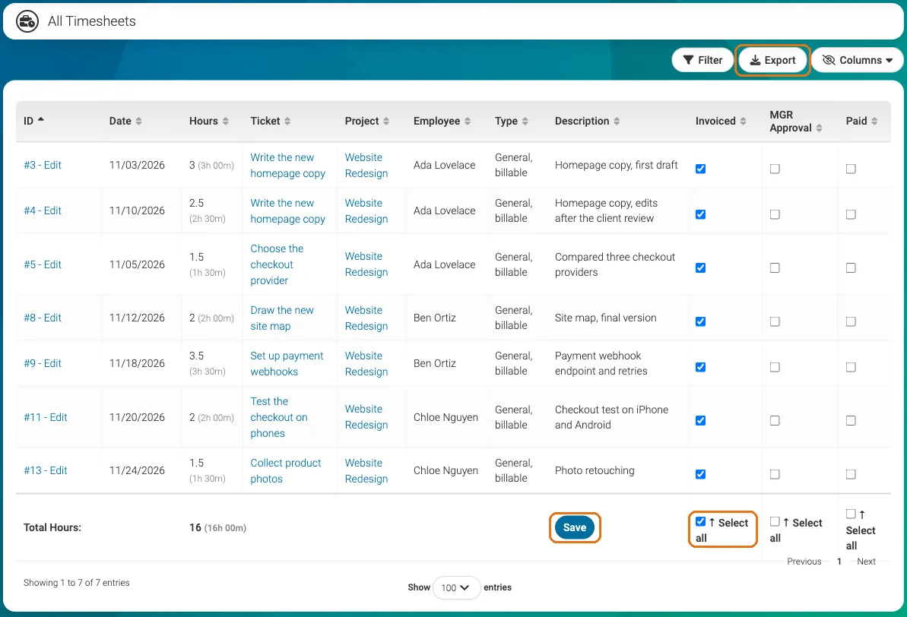

# Turn timesheets into an invoice

Your AI assistant can turn the time your team logged in Leantime into an invoice: the billable hours per person or per to-do, your rates, and the client's details, as a spreadsheet or a PDF. It shows you the lines and the total first, and makes the file once you agree. Then you mark the time as invoiced in Leantime, so it isn't billed twice.

**At a glance**

- **Time:** about 10 minutes
- **You need:** an AI assistant connected to Leantime (see [Connect your assistant](ai/recipes.md#connect-your-assistant)), and the Company Manager role or higher (see [Who can log and see time?](using-leantime/timesheets.md#who-can-log-and-see-time)). For the quick draft, the Company Manager role in that one project is enough (see [Can someone have a different role on one project?](using-leantime/user-management.md#can-someone-have-a-different-role-on-one-project))
- **At the end:** an invoice with your billable hours, and the time marked **Invoiced** in Leantime

## Which way should I use?

| What | Quick draft | Exact lines |
| --- | --- | --- |
| **Where the hours come from** | The assistant reads them from Leantime | A timesheet export you give the assistant |
| **One line per** | Person | To-do, with what was done |
| **Leaves out time that's already invoiced** | No | Yes |
| **Use it when** | Nothing in the period has been invoiced yet | You invoice part of the time, or the client wants details |

## Quick draft: ask your assistant

```
Make an invoice from my Leantime time for the project "Website Redesign",
for time logged from 1 to 30 November 2026:
- Only billable time (type "General, billable"). Look up each person
  separately, so their billable hours are exact.
- One line per person: name, billable hours, rate, amount.
  Rates per hour: Ada 95, Ben 85, Chloe 80.
- Bill to: Riverside Food Bank, 12 Main Street, Springfield.
- From: [your company name and address].
- Invoice number INV-2026-011, dated today, due in 30 days, in USD.
Show me the lines and the total first. Once I say it's right,
make it as a PDF.
```

The assistant reads the project's timesheets for each person, keeps the billable hours, and shows you something like this:

> **Invoice INV-2026-011: Website Redesign, November 2026**
>
> - Ada Lovelace: 7.0 hours × 95 = 665.00
> - Ben Ortiz: 9.5 hours × 85 = 807.50
> - Chloe Nguyen: 6.5 hours × 80 = 520.00
>
> **Total: 1,992.50 USD**

The assistant can't see which hours are already invoiced, so these totals include them. If you've invoiced part of the period, use the exact lines below.

## Exact lines: from a timesheet export

1. **Open Company → All Timesheets.**
2. **Click Filter** and choose the project, the dates, the type **General, billable** and **Not invoiced**.
3. **Click Export.** Leantime downloads the list as a CSV file, one row per entry, with the to-do, the person, the type, the description and an **Invoiced** column.
4. **Give the file to your assistant** with a request like this:

```
Here's my Leantime timesheet export (attached). Make an invoice from it:
- Only entries with Type "General, billable" and an empty Invoiced
  column (it shows the date an entry was invoiced).
- One line per to-do: the to-do, total hours, rate, amount.
  Rate: 90 per hour. List the entries' descriptions under each line.
- Bill to: Riverside Food Bank, 12 Main Street, Springfield.
- From: [your company name and address].
- Invoice number INV-2026-011, dated today, due in 30 days, in USD.
Show me the lines and the total first, and list any entries you
left out and why. Once I say it's right, make it as a spreadsheet and a PDF.
```

The filter already leaves out invoiced and non-billable time. The request checks it again, in case you exported without the filter.

## Mark the time as invoiced

Once the invoice is sent, mark the same entries in Leantime, so the next invoice leaves them out:

1. **In All Timesheets, use the same filter** as for the export.
2. **Under the Invoiced column, tick Select all**, at the bottom of the table.
3. **Click Save.** Each entry's checkbox is replaced by today's date.



The assistant can't mark time as invoiced for you. See [How do I mark time as invoiced, approved or paid?](using-leantime/timesheets.md#how-do-i-mark-time-as-invoiced-approved-or-paid)

## Tips

- **Rates aren't in Leantime.** Put them in the request, per person or one for everyone.
- **Billable means the type.** Time logged as **General, billable** counts. If your team logs billable work under other types, like **Development** or **Project Management**, name those in the request.
- **Check the hours before you invoice.** People sometimes log time late. Ask the assistant which to-dos finished in the period have no time logged (see [Catch up on your timesheet](ai/use-leantime-from-your-ai-assistant.md#routines-worth-keeping)).
- **No file?** Not every assistant can make a PDF or a spreadsheet. Ask for a table instead, and paste it into your invoicing tool.
- **Use the same dates everywhere.** The same dates in the request, the filter and the export keep the invoice and the **Invoiced** marks to the same time.

## Related

- [Things your AI assistant can do in Leantime](ai/recipes.md): more recipes
- [Time tracking](using-leantime/timesheets.md)
- [Use Leantime from your AI assistant](ai/use-leantime-from-your-ai-assistant.md)
