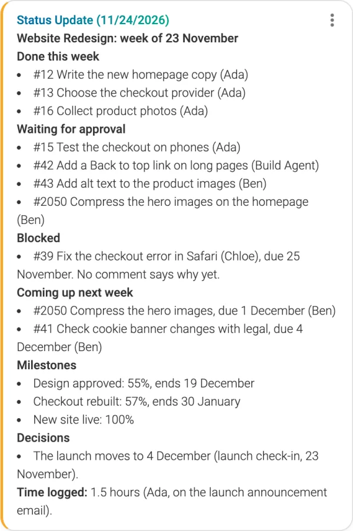

# Get a weekly project summary

Your AI assistant can write a project's weekly summary from what's in Leantime: what got done, what's waiting for approval or blocked, what's due next week, how the milestones are doing, what was decided and the time logged. It posts the summary as a project update, so the team, your manager or a client can read where the project stands without a meeting. Ask for it on Friday, or have Claude write it every Friday on a schedule.

**At a glance**

- **Time:** a minute to ask; about 10 minutes to set up the Friday schedule
- **You need:** an AI assistant connected to Leantime (see [Connect your assistant](ai/recipes.md#connect-your-assistant)); for the schedule, Claude with Leantime added as a connector
- **For the hours:** the Company Manager role or higher, to see everyone's time (see [Who can log and see time?](using-leantime/timesheets.md#who-can-log-and-see-time))
- **At the end:** a project update with the week's summary, with a green, yellow or red status

## Ask for it on Friday

```
Write the weekly summary for the Leantime project "Website Redesign",
for this week, since Monday:
- Done: to-dos that are Done and changed this week.
- Waiting for approval and Blocked: each to-do with who has it.
- Coming up: open to-dos due next week, and anything overdue.
- Milestones: each one's progress and end date.
- Decisions: from this week's project updates.
- Time: the hours logged this week, per person.
One line per to-do, with its number. Leave out empty sections.
Show it to me first. Then post it as a project update, formatted as
paragraphs and bulleted lists. Set the status to yellow if anything is
blocked or overdue, red if a milestone will be missed, otherwise green.
```

The assistant reads the project's to-dos, milestones, project updates and timesheets, shows you the summary, and posts it once you agree. The update appears on the project's overview under **Project Updates**:



The project's team is told about it, like any project update (see [Notifications](using-leantime/notifications.md)). If the project sends its updates to Slack, Discord, Mattermost, Telegram or Zulip, it goes there too (see [Project integrations](using-leantime/integrations.md)).

To read it yourself without posting it, leave out the last three lines of the request.

## Every Friday, on a schedule

> **To verify:** the scheduled run hasn't been tested end to end yet. The request itself has.

1. **Add Leantime as a connector in Claude** (see [Add Leantime as a connector in Claude](ai/recipes.md#add-leantime-as-a-connector-in-claude)). A scheduled task runs in the cloud. It uses the connectors of your Claude account, not a Leantime connection you added in Claude Code on your computer.
2. **Create a scheduled task** at [claude.ai/code/routines](https://claude.ai/code/routines), or with `/schedule` in Claude Code. Choose Friday afternoon, and give it instructions like these:

```
Every Friday, write the weekly summary for the Leantime project
"Website Redesign", for the week since Monday:
- Done: to-dos that are Done and changed this week.
- Waiting for approval and Blocked: each to-do with who has it.
- Coming up: open to-dos due next week, and anything overdue.
- Milestones: each one's progress and end date.
- Decisions: from this week's project updates.
- Time: the hours logged this week, per person.

One line per to-do, with its number. Leave out empty sections.
Post it as a project update on Website Redesign, formatted as
paragraphs and bulleted lists. Set the status to yellow if anything
is blocked or overdue, red if a milestone will be missed, otherwise green.
```

Good to know:

- **Scheduled tasks** need a paid Claude plan, run at most once an hour, and are still a preview. See [Claude's documentation](https://code.claude.com/docs/en/routines).
- **It doesn't wait for your OK.** It posts the update on its own. Read the first few, and adjust the instructions if something is missing or too long.
- **One task can cover several projects.** Name each one, and ask for one update per project.

## Who is it for?

- **The team,** who see the week in one place instead of in the board.
- **Your manager or a client** who can open the project: the updates are on its overview.
- **You, next week,** when you write the next one: the project's updates keep the history of every week.

## Tips

- **"Done this week" means changed this week.** The assistant finds to-dos that are Done and were changed since Monday, so a to-do finished earlier and edited this week shows up too (see [What does "done since yesterday" mean?](ai/standup-report.md#what-does-done-since-yesterday-mean)). If one appears that wasn't finished this week, ask the assistant to leave it out.
- **Keep blocked to-dos explained.** The summary can only say why something is blocked if someone wrote it in a comment.
- **Decisions come from project updates.** If your team records decisions in meeting notes, post them as a project update first (see [Turn meeting notes into to-dos](ai/meeting-notes-to-todos.md)).
- **Time needs logging, and the right role.** The hours come from the project's timesheets (see [Time tracking](using-leantime/timesheets.md)). Seeing everyone's time needs the Company Manager role or higher. As an Editor, leave out the Time line, or ask only for your own hours.
- **Statuses differ per project.** If your project uses other names, like "Review" instead of "Waiting for Approval", use them in the request.

## Related

- [Things your AI assistant can do in Leantime](ai/recipes.md): more recipes
- [Get a standup report every morning](ai/standup-report.md)
- [Use Leantime from your AI assistant: routines worth keeping](ai/use-leantime-from-your-ai-assistant.md#routines-worth-keeping)
- [Projects: what's on the project overview](using-leantime/managing-projects.md#whats-on-the-project-overview)
