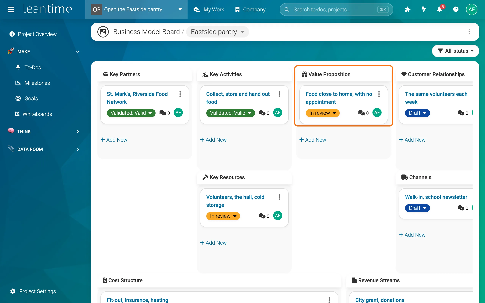

# Business Model Canvas

The Business Model Canvas shows how an organization creates value, delivers it and pays for it, on one page. Use it when a project changes how your organization works: a new service, a new partner, a new way of funding the work.

The canvas is by Alexander Osterwalder and Yves Pigneur, published by Strategyzer. For an early idea you still need to test, the [Lean Canvas](blueprints/lean-canvas.md) is quicker.

To start one, open **Think → Blueprints** in the project and click **Business Model Canvas** (see [Blueprints](using-leantime/blueprints.md)).

## What goes in each box?

The right side of the board is about your customers, the left side about your organization, and the middle connects them.

- **Customer Segments:** the groups you serve.
- **Value Proposition:** what you offer each group, and why it matters to them.
- **Channels:** how you reach them and deliver what you offer.
- **Customer Relationships:** the kind of relationship each group expects, like personal help, self-service or a community.
- **Revenue Streams:** where the money comes from, including grants and donations.
- **Key Resources:** what you need to deliver: people, places, equipment, knowledge.
- **Key Activities:** the most important things you do.
- **Key Partners:** who you rely on, and for what.
- **Cost Structure:** the main costs of running it all.

A good order is customers and value first, then how you reach them, then what it takes and what it costs.

Each card has **Assumptions**, **Data** and a **Conclusion**, and a status: **Draft**, **In review**, **Validated: Valid**, **On Hold** or **Validated: Invalid**.

## How do I use it?

- **Map how things work today** on one board, and how you want them to work on a second one (see [Can I have more than one board of the same kind?](using-leantime/blueprints.md#can-i-have-more-than-one-board-of-the-same-kind)). The differences are your project's work.
- **Check the links between boxes.** Every value proposition needs a customer segment and a channel; every key activity should serve a value proposition. A box that connects to nothing is a question to ask.
- **Mark what you've checked** with the card status, and link a milestone to the cards you need to test or change.

## What's the Detailed Business Model?

**Detailed Business Model** is a longer version in the same list of templates, with 15 boxes. It splits customers into segments, jobs-to-be-done, relationships and delivery; activities into competitive advantage, cost advantage and outsourced; and resources into perishable, capital, labor and skills. It comes from the book *Design Thinking for Strategy*. Use it when the nine boxes are too broad for your discussion.

## Sources and further reading

- Strategyzer, [The Business Model Canvas](https://www.strategyzer.com/library/the-business-model-canvas)
- Alexander Osterwalder and Yves Pigneur, *Business Model Generation* (Wiley, 2010)
- innovate.d, [*Design Thinking for Strategy: Innovating towards Competitive Advantage*](https://inov.at/dts)

## Related

- [Blueprints](using-leantime/blueprints.md)
- [Lean Canvas](blueprints/lean-canvas.md)
