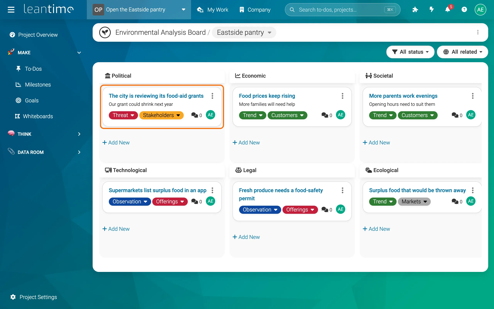

# Environment Analysis

An environment analysis looks at the world around your project: the trends and changes you don't control, but that can help or hurt it. Leantime's board uses the six areas of a PESTLE analysis.

To start one, open **Think → Blueprints** in the project and click **Environment Analysis** (see [Blueprints](using-leantime/blueprints.md)).

## What goes in each area?

- **Political:** government policy, funding programs, elections, local decisions.
- **Economic:** prices, wages, interest rates, what people can afford.
- **Societal:** how people live and work, demographics, attitudes.
- **Technological:** new tools and platforms, and what people expect from them.
- **Legal:** laws, permits, regulations and contracts.
- **Ecological:** climate, sustainability, waste, resources.

Each card has a title and a **Description**.

## How do I sort what I find?

Each card has two labels:

- **Status:** is it an **Observation** (something you've noticed), a **Trend** (something growing) or a **Threat** (something that could hurt the project)?
- **Relates to:** does it affect your **Customers**, your **Offerings**, your **Markets** or your **Stakeholders**? Or **None**.

Use the **All status** and **All related** filters to see, for example, every threat to your customers.

## How do I use it?

- **Collect widely, then focus.** Add everything the team notices, then pick the few trends and threats that would change your plans.
- **Feed the important ones into your plans.** A threat might belong on the [Risk Analysis](blueprints/risk-analysis.md); a trend might be an opportunity in your [SWOT Analysis](blueprints/swot-analysis.md). Link a milestone from the card when you need to act.
- **Repeat it** once or twice a year, on a new board, to see what changed.

## Sources and further reading

- Francis J. Aguilar, *Scanning the Business Environment* (Macmillan, 1967): an early version of this analysis, with four areas

## Related

- [Blueprints](using-leantime/blueprints.md)
- [SWOT Analysis](blueprints/swot-analysis.md)
