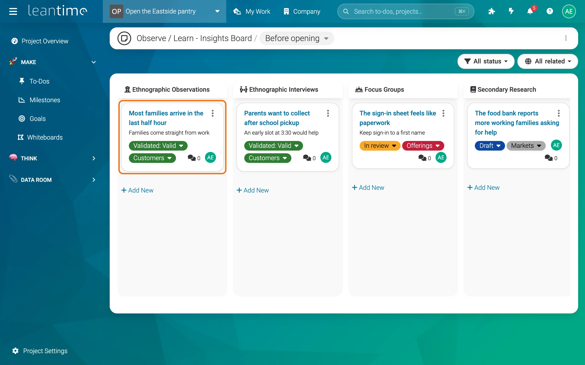

# Observe / Learn - Insights

The Observe / Learn - Insights board collects what you learn from the people you're working for: what you saw, what they told you, and what you've read. Its last column turns all of that into what you now know.

It fits the research steps of [design thinking](knowledge-base/idea-development.md): observe and listen first, then decide what to build.

To start one, open **Think → Blueprints** in the project and click **Observe / Learn - Insights** (see [Blueprints](using-leantime/blueprints.md)).

## What goes in each column?

- **Ethnographic Observations:** what you see people do in their own setting. Watch for what they do, not what they say they do, and for what's missing.
- **Ethnographic Interviews:** open conversations about their day, their problems and what they've tried.
- **Focus Groups:** what comes up when several people discuss a topic together.
- **Secondary Research:** what others have already found: reports, studies, articles, data.
- **Derived Knowledge:** your conclusions from all of the above. What do you now know, and what will you do with it?

If the board is wider than your window, scroll it sideways to reach **Derived Knowledge**.

## What do I write on a card?

- **Insight description:** what you learned, in one or two sentences.
- **Supporting data gathered:** where it comes from: how many people, where, when.

Mark each card's status as you go, from **Draft** to **Validated: Valid** or **Validated: Invalid**, and tag what it's about with **Relates to**, like **Customers** or **Offerings**.

## How do I use it?

- **Record as you go.** Add a card after each interview or visit, while it's fresh.
- **Separate what you saw from what you think.** Observations and interviews hold what happened; **Derived Knowledge** holds what it means.
- **Act on what you learn.** Take the derived knowledge into a [Project Value Canvas](blueprints/project-value-canvas.md) or [Lean Canvas](blueprints/lean-canvas.md), or link a milestone to test it.

## Related

- [Blueprints](using-leantime/blueprints.md)
- [Design thinking](knowledge-base/idea-development.md)
- [Ideas](using-leantime/idea-management.md)
