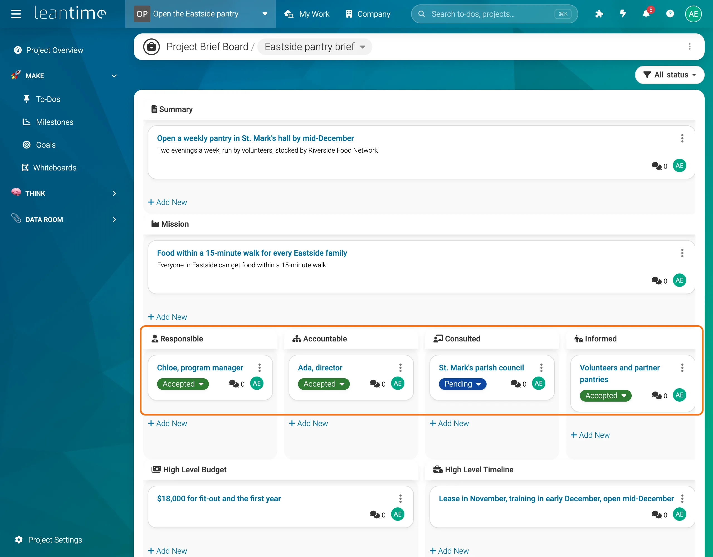

# Project Brief

A project brief is the one page everyone can agree on before work starts: what the project is, why it matters, who decides, and what it can spend. In Leantime it's a board, so each part can be discussed and accepted on its own.

To start one, open **Think → Blueprints** in the project and click **Project Brief** (see [Blueprints](using-leantime/blueprints.md)).

## What goes in each section?

- **Summary:** the project in a sentence or two: what you'll deliver, and by when.
- **Mission:** the bigger purpose the project serves.
- **Responsible, Accountable, Consulted and Informed:** who does the work, who makes the final call, whose advice you need, and who should hear about progress. This is a RACI chart. Keep **Accountable** to one person.
- **High Level Budget:** roughly what the project can spend.
- **High Level Timeline:** the main dates, like start, key steps and finish.
- **Culture:** how the team wants to work together.
- **Change capacity:** how much change the people involved can take on, and what else is competing for their time.
- **Guiding principles:** the rules you'll use when choices get hard, like "no paperwork at the door".

Each card has a title and a **Description**.

## How do I get the brief agreed?

Each card has a status: **Pending**, **Accepted** or **Rejected**. Share the board with the people involved, discuss each card in its **Discussion**, and set it to **Accepted** once everyone agrees. To see what's still open, choose **Pending** in the **All status** filter.

Keep the brief up to date as the project changes. If the budget or timeline moves, change the card and accept it again, so the brief stays the version everyone works from.

## What next?

- **Plan the timeline:** turn **High Level Timeline** into [milestones](using-leantime/roadmap-planning.md).
- **Set up the team:** add the people from the RACI sections to the project (see [User Management](using-leantime/user-management.md)).
- **Look for risks** with the [Risk Analysis](blueprints/risk-analysis.md).

## Related

- [Blueprints](using-leantime/blueprints.md)
- [Project Value Canvas](blueprints/project-value-canvas.md)
