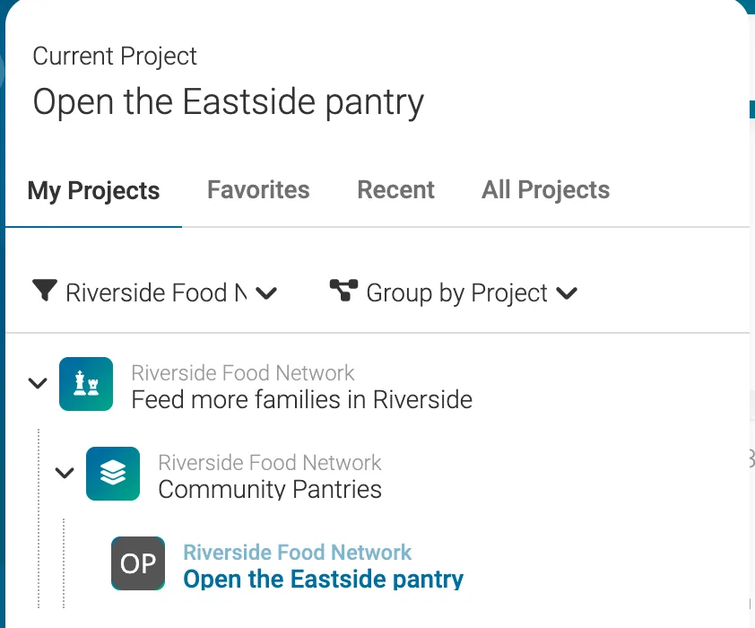

# How should I organize my work in Leantime?

There's no single right way to set up Leantime. A two-person studio, a non-profit with funded programs and an agency with twenty clients all need something different. This page explains the building blocks, then two ideas that make any setup work: keep sight of why the work matters, and size the structure to the team.

For a ready-made starting point, see the examples at the end.

## What are the building blocks in Leantime?

| Block | What it's for | Use it when |
|---|---|---|
| **Project** | A body of work with a team: to-dos, milestones, goals and docs | Always. Everything else is optional. |
| **Milestone** | A stage of a project, with a due date and the to-dos that get you there | The work has steps you want to see on a timeline |
| **To-do** | One piece of work, with subtasks if it has steps | Always |
| **Goal** | A number you want to reach, like orders a week or families reached | You want to know whether the work is paying off |
| **Client** | Who the work is for: a customer, a product or a department | Your work is for different customers, or outsiders need to see their own projects |
| **Program** | A group of projects that serve the same area or focus (Program Plans plugin; the app may call it a "Plan") | Several projects belong together and you want to see them side by side |
| **Strategy** | Your mission, vision and the goals above everything else (Leantime Strategies plugin) | You want every program and project to show the bigger why it serves |

Programs and Strategies come from plugins when you self-host, and are included in Leantime Cloud. Everything else is core.

## Can a to-do have more than one person in Leantime?

Yes. A to-do has one **assignee**, who owns it, so it's always clear who is moving it forward. Anyone else who works on it or needs to follow it can be added as a **collaborator**: they show next to the assignee and get notified when the to-do changes, even if they've turned other notifications down.

- **Bigger shared work:** split it into subtasks and give each one its own assignee.
- **Someone you only need once:** @mention them in a comment, and they get a notification (see [Notifications](using-leantime/notifications.md)).

## In what order should I set up a project?

1. **Describe what the project is for**, when you create it.
2. **Optional: think it through on a [Blueprint](using-leantime/blueprints.md)**, like the Project Value Canvas, if the problem or the customer isn't clear yet.
3. **Set a few goals** that show whether it's working: three to five is plenty. Start each one with a verb, like "Increase…" or "Reduce…".
4. **Plan the milestones**: the stages, each with a clear result.
5. **Add the to-dos** under each [milestone](using-leantime/roadmap-planning.md), small enough to finish in a few days.
6. **Look back after each stage** with a [retrospective](using-leantime/retrospectives.md), and adjust.

## How do I keep sight of why the work matters?

Working towards a target, and seeing progress on it, keeps you going. When a big goal is far away and nothing shows the work adding up, effort starts to feel pointless, and that's when people get overwhelmed and stall. So whatever you set up, make the why visible:

- **Say what each project is for.** The description you write when you create a project shows on its Project Overview, for everyone on the project.
- **Give results a number.** A [goal](using-leantime/goals.md) like "100 online orders a week" moves as the work pays off, and you can link it to the milestones that are meant to move it.
- **Let progress show.** Milestones, goals and the Project Hub all show progress bars, so finished work is visible, not just the work still left.

With the Strategies and Program Plans plugins, the why goes one level higher: each project sits in a program, and each program serves a strategy. The Projects menu shows each project under its program and strategy, a program's dashboard shows its projects, and a strategy's overview shows the plans and projects that serve it. Even a small to-do connects to the mission it's part of.

To put an existing project under a program or strategy, open its **Project Settings** and choose one under **Part of Plan or Strategy** (the app still says "Plan" there for programs).

When you write a strategy, start with two questions: what are you trying to accomplish, and how will the world look different when you do? A new strategy comes with four focus areas to hang its goals on: Customer, Financial, Internal Processes, and Learning & Growth. Rename them or add your own.

## What's the difference between milestones, outcomes and goals in Leantime?

**Milestones** can mean different things to different teams:

- a **stage** of work: Research, Design, Build;
- a **deliverable**: website launched, report sent;
- a **deadline**: grant submission, end of semester;
- a **release**: version 1.2, the demo build.

In Leantime, a milestone works best as a stage with a clear result: "Customer discovery" rather than "Phase 1". It has a due date, and its to-dos are the work that gets you there. As a rule of thumb, a milestone lasts one to three months and holds five to fifteen to-dos of one to five days each. The [Leantime support article on milestones](https://support.leantime.io/en/article/managing-milestones-in-leantime-your-path-to-tangible-project-success-ol8dnp/) goes deeper into planning them.

**Outcomes** are the smaller wins inside a stage. A student writing a semester paper might split it into an introduction, research, a draft and edits. Each finished part is an outcome: proof that the work is moving, long before the paper is done. Seeing outcomes complete is what keeps a long stretch of work from feeling endless. There are three ways to track them:

| Track outcomes as | How | Good for |
|---|---|---|
| **A to-do with subtasks** | The outcome is the to-do, its steps are subtasks | One person, small outcomes |
| **A milestone with to-dos** | Smaller milestones, one per outcome, each with its work under it | Several people sharing an outcome, or when you want it on the timeline |
| **Goals linked to milestones** | The outcome counts toward a measured target | Progress you report on, like grant outcomes or course credits |

**Goals** are the measurable results above it all: the number that tells you the outcomes are adding up to something. Update their current value at least once a month, so the progress you see stays true.

## How big should my Leantime setup be?

Start smaller than you think. People get lost in two ways:

- **Too big:** a project for every topic and a client for every area. There are so many places to look that nothing feels finished, and keeping it tidy becomes its own job.
- **Too small:** everything crammed into one project. The board gets so full that it's hard to see anything, and that's overwhelming too.

Let the size of the team and the work decide:

| Your situation | A good setup |
|---|---|
| **One or two people** | One project. Split the topics (marketing, sales, website) into milestones, so the to-do board can group by them. Simpler: one to-do status per topic, if you only need to see what's open in each. |
| **A few people with their own areas** | A project per area, with its own team |
| **Customers, or several teams** | A [client](using-leantime/managing-clients.md) per customer or department, and projects under each. Add programs when several projects serve the same focus. |
| **Several programs with a shared mission** | A strategy above the programs, with goals that show whether the mission is moving |

Leantime's rule of thumb for one project: two to ten people, three to twelve months, five to fifteen milestones, and three to ten goals. Much smaller, and a few to-dos may be enough; much bigger, and it's probably more than one project.

Signs it's time to change:

- You keep switching projects to do one piece of work: merge them.
- One board has more columns or groups than you can take in at a glance: split it, or use **Group By** on the to-do board (by milestone, person or priority, for example) and collapse the groups you're not working on.

## Who can see what in Leantime?

- Each project chooses who can see it: only the people on its team, everyone assigned to its client, or everyone in your Leantime (see [Who can see a project?](using-leantime/managing-projects.md#who-can-see-a-project-in-leantime)).
- **Everyone in this organization** includes your customers' accounts. Don't use it for projects customers shouldn't see.
- Each person belongs to one client at most, and each project to one client.
- Administrators and Owners see every project.

## How do I make Leantime calmer and easier to focus in?

These help everyone, and especially people with ADHD or anyone who gets overwhelmed by a busy screen:

- **Start with fewer projects.** You can always add more; merging later is harder.
- **Switch off the features you don't use** on each project's **Modules** tab, so the menu stays short (see [Projects](using-leantime/managing-projects.md#how-do-i-switch-features-on-or-off-for-a-project)).
- **Star the projects you're working on now.** They move to the top of the [Project Hub](using-leantime/managing-projects.md#whats-on-the-project-hub), so the rest doesn't compete for your attention.
- **Plan your day in My Work.** Drag to-dos onto the calendar to give them a time (see [My Work Dashboard](using-leantime/my-work-dashboard.md)).
- **Decide when and how you'll start.** On Leantime Cloud, the [Daily Intentions](plugins/daily-intentions.md) plugin lets you pick a to-do, choose when you'll work on it (before lunch, or at the end of your work day) and write down the first step. These if-then plans, also called implementation intentions, are a research-backed way to follow through, and planning them the evening before works best.
- **Make outcomes small enough to finish often.** A win every day or two keeps momentum better than one big one at the end.

## Examples: how teams like yours set up Leantime

- [Client work: MSPs, agencies, consulting and development firms](getting-started/client-work.md)
- [Product and game development](getting-started/product-and-game-development.md)
- [Non-profits, NGOs and mission-driven teams](getting-started/nonprofits.md)
- [Research and academic work](getting-started/research.md)
- [Your own work and career](getting-started/your-own-work.md)

For the methods behind these setups, like Lean, Agile, Scrum and Kanban, see [Project management concepts](knowledge-base/README.md).
