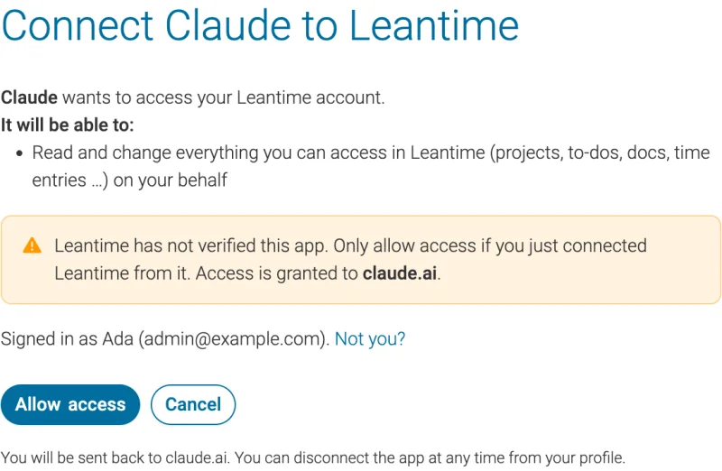

# Leantime MCP Server

The MCP Server lets AI assistants such as Claude, ChatGPT, Cursor, VS Code Copilot, Windsurf and Codex work directly in your Leantime. Instead of copying task lists into a chat, you ask the assistant, and it reads and updates Leantime for you:

- "What's due for me this week, and what's overdue?"
- "Create these five tasks in the Website project and put them in the Launch milestone."
- "Log 2 hours to task #456 for yesterday."
- "Write a status update for the Acme project from what was completed this week."

The assistant only sees and changes what **your** Leantime account can see and change. It works the same way the Leantime app does, with the same project access and role.

This page is the setup. For what to ask once you're connected, see [Use Leantime from your AI assistant](ai/use-leantime-from-your-ai-assistant.md).

**On this page**

1. [How it works](?id=how-it-works)
2. [Before you start](?id=before-you-start)
3. [Step 1: Install the plugin (self-hosted only)](?id=step-1-install-the-plugin-self-hosted-only)
4. [Step 2: Create a token](?id=step-2-create-a-token)
5. [Step 3: Connect your AI assistant](?id=step-3-connect-your-ai-assistant)
6. [Step 4: Check the connection](?id=step-4-check-the-connection)
7. [What the assistant can do](?id=what-the-assistant-can-do)
8. [Getting good results](?id=getting-good-results)
9. [Running an AI agent as a team member](?id=running-an-ai-agent-as-a-team-member)
10. [Security and privacy](?id=security-and-privacy)
11. [Settings for administrators](?id=settings-for-administrators)
12. [Troubleshooting](?id=troubleshooting)
13. [FAQ](?id=faq)

## How it works

[MCP (Model Context Protocol)](https://modelcontextprotocol.io/) is an open standard that lets AI assistants call tools in other applications. Leantime's MCP server is a single web address on your Leantime:

```
https://your-leantime-url/mcp
```

Your AI assistant connects to that address in one of two ways:

- **Sign in (Claude and ChatGPT):** you add the address in the assistant, sign in to Leantime and click **Allow access**. Nothing to copy.
- **Token (Cursor, VS Code, Windsurf, Codex and others):** you create a token in Leantime and add it to the assistant's settings. The assistant sends it with every request.

Either way, Leantime works out which user is connecting and runs each request as that user. Nothing is installed on your computer apart from the assistant itself.

When you ask a question, the assistant decides which Leantime tools to call (for example `findTasks`, then `editTask`), shows you what it is doing, and answers from the results.

## Before you start

You need:

| | Leantime Cloud | Self-hosted |
|---|---|---|
| Leantime version | Always current | **3.13 or later** (MCP Server plugin 2.x). Signing in from Claude and ChatGPT needs **3.16 or later**. |
| MCP Server plugin | Included, nothing to install | Install from the [Marketplace](https://marketplace.leantime.io/product/mcp-server/) |
| HTTPS | Included | Required for Claude and ChatGPT, and strongly recommended for everything else. |
| Reachable from the internet | Included | Needed for Claude and ChatGPT: they connect from their own servers, not from your computer. |

And an AI assistant that can connect to a remote MCP server:

| Assistant | How it connects | Notes |
|---|---|---|
| Claude (claude.ai, Claude Desktop, phone apps) | Sign in | Add it once on the web or in Claude Desktop, and it works in the phone apps too |
| ChatGPT | Sign in | Depends on your ChatGPT plan; on work plans, an admin may have to allow it |
| Claude Code | Sign in or token | Built in |
| Cursor | Token | Built in |
| VS Code (GitHub Copilot agent mode) | Token | Built in |
| Windsurf | Token | Built in |
| OpenAI Codex CLI | Token | Built in |
| CoChat | Token | Built in, as a custom server |

> Your Leantime data goes to the AI provider you use (Anthropic, OpenAI, Cursor, …) as part of the conversation. Check that this is allowed for your organisation before connecting.

## Step 1: Install the plugin (self-hosted only)

Skip this step on Leantime Cloud.

1. In Leantime, open the **Administration** menu and choose **Leantime Apps** (you need to be an Owner or Administrator).
2. On the **App Marketplace** tab, find **MCP Server**.
3. Buy a license, enter the license key and click **Install**.
4. On the **My Apps** tab, click **Enable** next to MCP Server.

The server is now live at `https://your-leantime-url/mcp`. If Leantime is installed in a subfolder, include it: `https://example.com/leantime/mcp`.

## Step 2: Create a token

Connecting Claude or ChatGPT by signing in? Skip this step and go to [Step 3](?id=step-3-connect-your-ai-assistant).

The MCP server accepts two kinds of credentials. Use a **Personal Access Token** unless you are setting up a shared automation.

### Personal Access Token (recommended)

A personal token acts as **you**: "my tasks", "log time for me" and "assign it to me" all mean your account, and the assistant sees exactly the projects you can see.

1. Click your avatar and open **My Profile**.
2. Open the **Personal Access Tokens** tab.
3. Click **Create Token** and give it a name you'll recognise later, such as "Claude Code – laptop".
4. Copy the token. **It is only shown once.**

The assistant sends it as a header:

```
Authorization: Bearer YOUR_TOKEN
```

Good to know:

- A token has the **full access of your account**. It does not expire. Anyone who has it can do in Leantime whatever you can do.
- Create **one token per assistant or device**. Then you can revoke one without breaking the others.
- Revoke a token any time from the same tab. The assistant stops working immediately.
- Tokens are not affected by two-factor authentication or single sign-on (SSO). If you sign in with Google, Microsoft, OIDC or LDAP, you can still create a token.

### API key (for shared automations)

API keys are service accounts created by an Owner or Administrator under **Company Settings → API Keys**. They act as that API user, not as a person. "My tasks" then means the API user's tasks, which is usually nothing. Use them for team-wide automations, not for your own assistant.

```
x-api-key: lt_yourkeyname_yoursecret
```

## Step 3: Connect your AI assistant

In every example, replace `https://your-leantime-url` with your Leantime address and `YOUR_TOKEN` with the token from Step 2. To use an API key, replace the `Authorization` header with `"x-api-key": "lt_..."`.

### Claude (claude.ai, Claude Desktop and the phone apps)

1. In Claude, open **Settings → Connectors** and click **Add custom connector**.
2. Name it "Leantime" and paste `https://your-leantime-url/mcp`. Leave the OAuth client ID and secret fields empty.
3. Click **Connect**. Leantime opens: sign in as usual (with two-factor or single sign-on if you use them).
4. Check what Leantime asks, and click **Allow access**. Leantime warns that it hasn't verified the app: that's expected (see [Why does Leantime say it hasn't verified the app?](#why-does-leantime-say-it-hasnt-verified-the-app)).

You're back in Claude, and Leantime is connected. A connector you add on claude.ai or in Claude Desktop also shows up in the Claude phone apps.

### ChatGPT

1. In ChatGPT, add a custom MCP server or connector. Where to find this depends on your plan, and OpenAI changes the menus often: see [Connecting custom MCP servers in ChatGPT](https://help.openai.com/en/articles/12584461-developer-mode-and-mcp-apps-in-chatgpt). On some plans you first switch on **Developer mode**; on work plans, an admin may have to allow it.
2. Paste `https://your-leantime-url/mcp` as the address, and choose **OAuth** for authentication.
3. Sign in to Leantime and click **Allow access**. Leantime warns that it hasn't verified the app: that's expected (see the next section).

### Why does Leantime say it hasn't verified the app?

When an assistant connects by signing in, Leantime shows what the assistant asks for and who you're signed in as. It also shows a warning: "Leantime has not verified this app. Only allow access if you just connected Leantime from it."



You see this warning every time, for Claude and ChatGPT too. Assistants register themselves with Leantime when you click **Connect**, so Leantime has no list of apps to check them against.

Before you click **Allow access**, check three things:

- **You just started it:** you clicked **Connect** (or **Authenticate** in Claude Code) in your assistant a moment ago.
- **The address after "Access is granted to"** is your assistant's: **claude.ai** for Claude, **chatgpt.com** for ChatGPT, or **localhost** (or **127.0.0.1**) for Claude Code and other assistants that run on your computer.
- **The account under "Signed in as"** is the one the assistant should use. To use another one, click **Not you?** and sign in again.

If you didn't just start connecting, or the address isn't your assistant's, click **Cancel**.

### Which apps are connected?

Apps you connected by signing in are listed under **My Profile → Personal Access Tokens → Connected apps**, with when each was last active. Click **Disconnect** to remove one: it loses access right away. Changing your password also disconnects all of them.

### Claude Code

Run once in a terminal:

```bash
claude mcp add --transport http leantime https://your-leantime-url/mcp
```

Then type `/mcp` inside Claude Code, choose **leantime** and **Authenticate**, and sign in to Leantime in the browser (Leantime warns that it hasn't verified the app: see [Why does Leantime say it hasn't verified the app?](#why-does-leantime-say-it-hasnt-verified-the-app)). To use a token instead, add `--header "Authorization: Bearer YOUR_TOKEN"` to the command.

Add `--scope user` to use Leantime in every project, not just the current folder. Check it with `claude mcp list`.

### Claude Desktop with a token (older self-hosted versions)

On Leantime 3.16 or later and on Leantime Cloud, connect Claude Desktop by signing in, as shown above. On older self-hosted versions, use the free [`mcp-remote`](https://www.npmjs.com/package/mcp-remote) helper with a token. It needs [Node.js](https://nodejs.org/) 18 or later.

1. In Claude Desktop, open **Settings → Developer → Edit Config**. This opens `claude_desktop_config.json`:
   - macOS: `~/Library/Application Support/Claude/claude_desktop_config.json`
   - Windows: `%APPDATA%\Claude\claude_desktop_config.json`
2. Add the `leantime` entry (keep any servers you already have):

```json
{
  "mcpServers": {
    "leantime": {
      "command": "npx",
      "args": [
        "-y", "mcp-remote",
        "https://your-leantime-url/mcp",
        "--header", "Authorization:${LEANTIME_AUTH}"
      ],
      "env": { "LEANTIME_AUTH": "Bearer YOUR_TOKEN" }
    }
  }
}
```

3. Quit Claude Desktop completely and open it again.

Keep the token in `env` as shown. Putting `Bearer YOUR_TOKEN` directly in `args` breaks on Windows because of the space.

### Cursor

Open **Cursor Settings → MCP → Add new MCP server**, or edit `~/.cursor/mcp.json` (all projects) or `.cursor/mcp.json` (one project):

```json
{
  "mcpServers": {
    "leantime": {
      "url": "https://your-leantime-url/mcp",
      "headers": { "Authorization": "Bearer YOUR_TOKEN" }
    }
  }
}
```

### VS Code (GitHub Copilot)

Run **MCP: Add Server…** from the command palette, or create `.vscode/mcp.json`. Using an input means the token isn't stored in the file:

```json
{
  "inputs": [
    { "type": "promptString", "id": "leantime-token", "description": "Leantime token", "password": true }
  ],
  "servers": {
    "leantime": {
      "type": "http",
      "url": "https://your-leantime-url/mcp",
      "headers": { "Authorization": "Bearer ${input:leantime-token}" }
    }
  }
}
```

Use Copilot Chat in **Agent** mode to call the tools.

### Windsurf

Edit `~/.codeium/windsurf/mcp_config.json`. Note that Windsurf uses `serverUrl`, not `url`:

```json
{
  "mcpServers": {
    "leantime": {
      "serverUrl": "https://your-leantime-url/mcp",
      "headers": { "Authorization": "Bearer YOUR_TOKEN" }
    }
  }
}
```

### OpenAI Codex CLI

Add this to `~/.codex/config.toml`, and set the token as an environment variable (`export LEANTIME_TOKEN=YOUR_TOKEN`) so it isn't stored in the file:

```toml
[mcp_servers.leantime]
url = "https://your-leantime-url/mcp"
bearer_token_env_var = "LEANTIME_TOKEN"
```

### Any other assistant

Any assistant that supports **Streamable HTTP** MCP servers with custom headers works. Give it the URL `https://your-leantime-url/mcp` and the `Authorization: Bearer …` header. Assistants that only support local (stdio) servers can use `mcp-remote` as shown for Claude Desktop.

## Step 4: Check the connection

Ask your assistant:

> Which Leantime projects can you see?

It should call `getAllProjects` and list your projects. If it does, you're done: see [Use Leantime from your AI assistant](ai/use-leantime-from-your-ai-assistant.md) for what to ask next.

If it doesn't, test the server directly from a terminal:

```bash
curl https://your-leantime-url/mcp \
  -H "Authorization: Bearer YOUR_TOKEN" \
  -H "Content-Type: application/json" \
  -H "Accept: application/json, text/event-stream" \
  -d '{"jsonrpc":"2.0","id":1,"method":"initialize","params":{"protocolVersion":"2025-06-18","capabilities":{},"clientInfo":{"name":"curl","version":"1"}}}'
```

| Result | Meaning |
|---|---|
| JSON with `"serverInfo":{"name":"Leantime MCP Server"` | The server and your token work. Check the assistant's configuration. |
| `401` | The token is wrong, revoked, or a proxy removed the header. See [Troubleshooting](?id=troubleshooting). |
| `404` or a Leantime web page | The plugin isn't enabled, or the URL is missing a subfolder. |
| `429` | Too many requests. Wait a minute. |

## What the assistant can do

You don't call these tools yourself. The assistant picks them based on what you ask. The list helps you know what's possible and what the assistant will ask permission for.

**Reads** only looks at data. **Adds** creates new data. **Changes** edits existing data.

### Tasks

| Tool | What it does | |
|---|---|---|
| `findTasks` | Finds tasks across your projects by assignee, status or last change | Reads |
| `getTicket` | Shows one task with all its details | Reads |
| `getTaskStatusSummary` | Counts tasks per status in a project | Reads |
| `getStatusLabels` | Lists the statuses a project uses | Reads |
| `getAllStatusLabelsByUserId` | Lists statuses for all your projects | Reads |
| `addTask` | Creates a task | Adds |
| `bulkAddTasks` | Creates many tasks in one go | Adds |
| `addSubtask` | Creates a subtask under a task | Adds |
| `createSubtasksForTask` | Creates several subtasks under a task | Adds |
| `editTask` | Changes a task: status, assignee, dates, milestone, description… | Changes |
| `bulkEditTasks` | Changes many tasks in one go | Changes |
| `bulkScheduleTasks` | Sets the planned start and end of many tasks | Changes |

### Milestones

| Tool | What it does | |
|---|---|---|
| `findMilestones` | Lists a project's milestones | Reads |
| `getMilestone` | Shows one milestone | Reads |
| `addMilestone` | Creates a milestone | Adds |
| `addMilestonesForProject` | Creates several milestones in one go | Adds |
| `editMilestone` | Changes a milestone | Changes |

### Projects

| Tool | What it does | |
|---|---|---|
| `getAllProjects` | Lists your projects with progress | Reads |
| `findProject` | Finds a project by name | Reads |
| `getProject` | Shows one project | Reads |
| `getFullProjectOverview` | Project details, progress, tasks, status updates and time in one answer | Reads |
| `getProjectsAssignedToUser` | Lists the projects you're assigned to | Reads |
| `getUsersAssignedToProject` | Lists a project's team | Reads |
| `addProject` | Creates a project (Managers and above) | Adds |
| `addUserToProject` | Adds someone to a project's team and tells them (Managers and above; Leantime Cloud, or Leantime 3.16.0 or later with MCP Server plugin 2.1.0 or later) | Changes |
| `removeUserFromProject` | Removes someone from a project's team (Managers and above; Leantime Cloud, or Leantime 3.16.0 or later with MCP Server plugin 2.1.0 or later) | Changes |
| `editProject`, `patchProject` | Changes a project (Managers and above) | Changes |

> **Known issue:** in the current version, `editProject` also resets the project fields you don't mention (access, client, budget, dates, program). Until this is fixed, change project settings in Leantime itself, not through the assistant.

### Goals

| Tool | What it does | |
|---|---|---|
| `getAllGoals` | Lists a project's goals | Reads |
| `getGoal` | Shows one goal with its progress | Reads |
| `getGoalsByMilestone` | Lists goals linked to a milestone | Reads |
| `getChildGoals`, `getParentKPIs` | Shows how goals roll up into each other | Reads |
| `createGoalboard` | Creates a goal board | Adds |
| `createGoal` | Creates a goal with start, current and target values | Adds |
| `editGoal` | Updates a goal, for example its current value | Changes |

### Calendar and planning

These work on **your own** calendar.

| Tool | What it does | |
|---|---|---|
| `getCalendar` | Shows your events and scheduled tasks for a date range | Reads |
| `getICalUrl` | Gives you the address to subscribe to your Leantime calendar | Reads |
| `addEvent`, `bulkAddEvents` | Creates calendar events | Adds |
| `editEvent`, `bulkEditEvents` | Changes calendar events | Changes |
| `deleteEvent` | Deletes a calendar event | **Deletes** |
| `scheduleTaskOnCalendar` | Blocks time for a task | Changes |
| `scheduleDay` | Places events into the free slots of a day, and reschedules the tasks you name | Adds and changes |
| `breakdownTask` | Splits a task into subtasks and schedules them | Adds |

> **Known issue:** in the current version, editing an event with `editEvent` or `bulkEditEvents` turns it into an all-day event. Until this is fixed, change existing events in Leantime itself. Creating and deleting events works as expected.

### Reminders

These work on **your own** morning summary and reminders. They need Leantime Cloud, or Leantime 3.17 or later with MCP Server plugin 2.1.0 or later.

| Tool | What it does | Effect |
|---|---|---|
| `getComingUp` | Shows what's coming up for you: due to-dos, milestones and projects ending soon, the same list as your morning summary | Reads |
| `setTaskReminder` | Chooses how often one to-do reminds you: the day before, every morning, only the morning it's due, or never | Changes |
| `getReminderSettings` | Shows your morning summary settings: on or off, the time, and your default for to-dos | Reads |
| `updateReminderSettings` | Changes your morning summary settings | Changes |

### Comments and status updates

| Tool | What it does | |
|---|---|---|
| `getComments` | Shows comments on a task, goal, idea or doc | Reads |
| `getAllProjectComments` | Shows a project's status updates | Reads |
| `pollComments` | Shows recent comments across your projects | Reads |
| `addComment` | Adds a comment | Adds |
| `addProjectStatusUpdate` | Posts a project status update (green, yellow or red) | Adds |

### Time tracking

| Tool | What it does | |
|---|---|---|
| `startTimer`, `stopTimer` | Starts and stops your timer on a task | Changes |
| `logTime` | Logs hours to a task | Adds |
| `getUserTimesheets` | Shows your time entries | Reads |
| `getWeeklyTimesheets` | Shows a week of time entries | Reads |
| `getTimesheetSummary` | Totals hours by project, task, user or day | Reads |
| `getProjectTimesheets` | Shows everyone's time on a project (needs permission to manage timesheets) | Reads |

### Search and help

| Tool | What it does | |
|---|---|---|
| `search` | Searches tasks, projects, goals, milestones, docs and more, like the search bar in Leantime | Reads |
| `searchLeantimeDocumentation` | Searches Leantime's online documentation (self-hosted: needs `LEAN_JINA_KEY`, see [Settings for administrators](?id=settings-for-administrators)) | Reads |
| `seedResourcesFromProjects` | Fills a program's resource plan from its projects (only with the Program Management plugin) | Adds |

Whether a tool works also depends on your role and the project. For example, a Read Only user can use the "Reads" tools but not change tasks, and Goals tools don't work in a project that has Goals switched off.

## Getting good results

The assistant works best when you are specific about **which project** and **what you want back**.

**Name the project, or ask the assistant to find it first.** "Create a task in the Website Redesign project" works better than "create a task", because the assistant otherwise has to guess.

**Use task numbers when you have them.** "Mark #123 as done" is faster and safer than "mark the budget task as done".

**Ask for a plan before big changes.** For anything that changes many tasks, say "show me what you'd change first". Most assistants ask for approval before each change; keep that switched on until you trust the setup.

**Use the bulk tools for big jobs.** "Create these 20 tasks" uses one `bulkAddTasks` call instead of 20 separate calls, which is faster and stays under the rate limit.

**Status names are per project.** Each project can have its own statuses. If "move to In Review" doesn't work, ask "what statuses does this project have?" first.

### What to ask

For examples and routines, like updating to-dos by telling the assistant what you did, turning meeting notes into assigned to-dos, or starting a new project in one message, see [Use Leantime from your AI assistant](ai/use-leantime-from-your-ai-assistant.md). For complete recipes, like turning meeting notes into to-dos, a standup report every morning or handing to-dos to a coding agent, see [Things your AI assistant can do in Leantime](ai/recipes.md).

## Running an AI agent as a team member

You can have an AI agent pick up and work on tasks next to your team. Set it up so its work is visible and easy to undo:

1. **Create a separate Leantime user for the agent**, for example "AI Assistant" with its own email. Give it the **Editor** role, not Manager or Administrator.
2. **Add that user only to the projects it should work in.**
3. **Sign in as that user once, and create a Personal Access Token** for it (Step 2). Configure the agent with that token.
4. Assign tasks to the agent user. Everything it creates, edits or comments on shows its name, so the team can see what was done by the agent.

Then give the agent clear working rules in its instructions, for example:

```
You work in the Leantime project "Support Backlog".
1. Find tasks assigned to you with status "New".
2. Before starting a task, set it to "In Progress" and add a comment saying what you plan to do.
3. When done, add a comment with the result and set the status to "Review". Never set "Done" yourself.
4. If something is unclear, add a comment with your question and assign the task back to its creator.
```

For a complete recipe where the agent picks up to-dos you tag for it, see [Hand to-dos to a coding agent](ai/coding-agent.md).

Leantime doesn't run the agent on a schedule. The agent runs when you (or your automation) start it. Use your agent platform's scheduler if you want a daily digest or a regular check.

## Security and privacy

- **Same permissions as the app.** Every request runs as the user who signed in or owns the token, with that user's role and project access. Tools are built to return only the projects, tasks and entries that user can access. If you find a tool returning something the user can't open in Leantime, please [report it](https://github.com/Leantime/leantime/security/policy) privately.
- **Tokens are full-access keys.** A token can do everything its user can. There are no read-only tokens yet. Treat tokens like passwords, never paste them into a chat or commit them to a repository, and use a separate, limited user (see above) for agents.
- **Apps you sign in to act as you.** When Claude or ChatGPT connects, Leantime shows the app's name and asks you to allow access. Only allow it if you just started connecting from that app. Its access renews itself every hour, and ends when you click **Disconnect**, change your password, or your account is deactivated.
- **Keep approvals on.** Most assistants ask before running a tool that changes data. Leantime marks its tools as read-only, adding data, or changing data, so your assistant can tell them apart. `deleteEvent` is the only tool that deletes.
- **Data goes to your AI provider.** The results of every tool call (task titles, descriptions, comments, time entries) become part of the conversation with the AI provider you use.
- **Use HTTPS.** The token is sent with every request.
- **Rate limits.** Each user and IP can make 300 MCP requests per minute by default.
- **Remove what you don't use** under **My Profile → Personal Access Tokens**: tokens at the top, apps under **Connected apps**. Delete API keys under **Company Settings → API Keys**.

## Settings for administrators

Self-hosted only. Set these in `config/.env`:

| Variable | Default | What it does |
|---|---|---|
| `LEAN_RATELIMIT_MCP` | `300` | MCP requests per minute, per user and IP. |
| `LEAN_OAUTH_ENABLED` | `true` | Lets Claude, ChatGPT and other apps connect by signing in. Set to `false` to switch sign-in off; tokens keep working. |
| `LEAN_OAUTH_REDIRECT_DOMAINS` | empty | Extra web addresses that apps may return to after sign-in, comma separated. Claude, ChatGPT and your own computer (`localhost`) are always allowed. |
| `LEAN_OAUTH_CUSTOM_SCHEMES` | empty | App addresses like `cursor` or `vscode` to allow for sign-in, comma separated. |
| `LEAN_RATELIMIT_OAUTH_REGISTER` | `10` | How many new apps one IP address can register per hour. |
| `LEAN_OAUTH_PRIVATE_KEY`, `LEAN_OAUTH_PUBLIC_KEY` | empty | The key pair that signs sign-in tokens. Leave empty: Leantime creates one and stores it encrypted in the database. |
| `LEAN_JINA_KEY` | empty | API key for [Jina](https://jina.ai/) search. Needed by the `searchLeantimeDocumentation` tool, which searches Leantime's online documentation. Without it, that tool returns an error. The search queries are sent to Jina. |

**Reverse proxies.** If Leantime runs behind nginx, Apache, Traefik, Cloudflare or a load balancer, make sure the `Authorization` header is passed through (see [Run Leantime behind a reverse proxy](installation/reverse-proxy.md)). Apache with PHP-FPM or FastCGI often drops it. Add this to your virtual host or `.htaccess`:

```apache
SetEnvIf Authorization "(.*)" HTTP_AUTHORIZATION=$1
```

Also make sure the proxy doesn't buffer or time out short requests to `/mcp`, that requests to `/.well-known/oauth-…` and `/oauth/…` reach Leantime, and that `LEAN_APP_URL` is set to the public address.

**Sign-in keys.** `php bin/leantime oauth:keys` shows the key Leantime signs sign-in tokens with. `--rotate` replaces it, which disconnects every connected app. `--export` prints the key as `LEAN_OAUTH_*` lines, for example to use the same key on several servers.

**Updates.** After updating Leantime, finish the database update in the browser before using MCP again.

## Troubleshooting

**Claude or ChatGPT can't connect, or the sign-in fails**
- Self-hosted: sign-in needs Leantime 3.16 or later, with `LEAN_OAUTH_ENABLED` not set to `false`.
- Leantime has to be reachable from the internet over HTTPS. Claude and ChatGPT connect from their own servers, so an address that only works in your office or over VPN won't do.
- Sign-in doesn't work when Leantime is installed in a subfolder (`https://example.com/leantime`): the apps look for sign-in details at the root of the domain. Use a subdomain instead, or connect with a token.
- Check `LEAN_APP_URL` and your proxy (see [Settings for administrators](?id=settings-for-administrators)).
- "This sign-in link has expired": start connecting again from the app.

**`401 Unauthorized`**
- Check the header format: `Authorization: Bearer <token>` (with a space after `Bearer`) or `x-api-key: lt_...`.
- The token may have been revoked. Create a new one.
- A reverse proxy may be removing the `Authorization` header. See [Settings for administrators](?id=settings-for-administrators). Test with the curl command from Step 4 on the server itself.

**`404 Not Found` on `/mcp`**
- Self-hosted: the MCP Server plugin isn't installed or enabled.
- Leantime is in a subfolder: use `https://example.com/leantime/mcp`.

**The assistant connects, but finds nothing**
- The token's user isn't assigned to that project. MCP uses the same access as the app.
- With an API key, "my tasks" means the API user's tasks. Use a Personal Access Token.

**"Not allowed" or "module is switched off"**
- The project has that feature (for example Goals or Time tracking) switched off in **Project Settings → Modules**, or your role can't do that action in the app either.

**Dates or times are off by some hours**
- Times are interpreted in your Leantime timezone (**My Profile → Settings**). Tell the assistant the timezone if it guesses wrong, for example "tomorrow 9:00 Berlin time".

**`429 Too Many Requests`**
- Wait a minute. Ask the assistant to use the bulk tools for large jobs, or (self-hosted) raise `LEAN_RATELIMIT_MCP`.

**The assistant doesn't see new tools after an update**
- Assistants may keep the tool list for up to 15 minutes. Restart the assistant or reconnect the server.

**Claude Desktop shows "Server disconnected"**
- Check that Node.js 18+ is installed (`node -v`).
- Read the log: `~/Library/Logs/Claude/mcp-server-leantime.log` (macOS) or `%APPDATA%\Claude\logs\mcp-server-leantime.log` (Windows).
- Local development with a self-signed certificate only: add `"NODE_TLS_REJECT_UNAUTHORIZED": "0"` to `env`. Never do this in production.

**Server logs**
- Self-hosted: `storage/logs/` in your Leantime installation.

## FAQ

**Is it available on Leantime Cloud?**
Yes. Use the address you open Leantime Cloud with, plus `/mcp`. Connect Claude or ChatGPT by signing in, and other assistants with a Personal Access Token.

**Can I use it with ChatGPT or Claude.ai in the browser, or on my phone?**
Yes, on Leantime Cloud and on self-hosted Leantime 3.16 or later: add it as a connector and sign in (see [Step 3](?id=step-3-connect-your-ai-assistant)). A Claude connector you add on the web also works in the Claude phone apps. Your Leantime has to be reachable from the internet over HTTPS, and not installed in a subfolder.

**Can I give the assistant read-only access?**
Not with a token setting yet. Use your assistant's tool approval settings to allow only the read tools, or connect with a separate user that has the **Read Only** role. (In the current version, a Read Only user can still add, edit and delete events on their own calendar through MCP.)

**Can the assistant delete my tasks or projects?**
No. The only tool that deletes anything is `deleteEvent`, for calendar events. The assistant can still change tasks (status, assignee, dates), so keep approvals on for changes.

**I used the `leantime-mcp` npm package before. Do I need to change anything?**
Yes. The npm bridge is deprecated. Replace it with one of the configurations in Step 3. Your existing token keeps working. Then remove the old package with `npm uninstall -g leantime-mcp`.

**Is there an MCP server that works without the plugin?**
There is a community project, [daniel-eder/leantime-mcp](https://github.com/daniel-eder/leantime-mcp), that uses Leantime's [JSON-RPC API](api/usage.md) with an API key. It isn't maintained by the Leantime team.

## Resources

- [MCP Server plugin](https://marketplace.leantime.io/product/mcp-server/) on the Leantime Marketplace
- [Model Context Protocol](https://modelcontextprotocol.io/) specification
- [Leantime JSON-RPC API](api/usage.md)
- [Report a bug](https://github.com/Leantime/leantime/issues/new)
