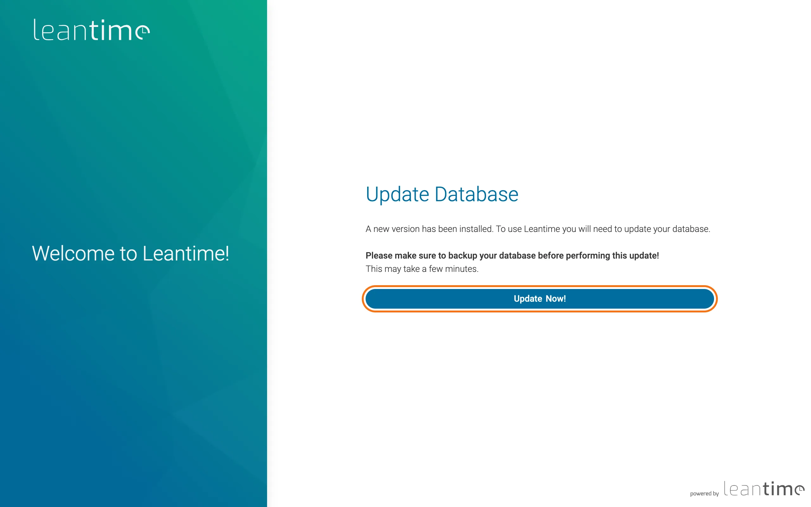

# Upgrade Leantime

This guide is for self-hosted Leantime. Leantime Cloud is upgraded for you.

An upgrade has two parts. First you replace Leantime's files with the new version: a new Docker image, the command line updater, or a release package. Then Leantime updates your database. Your projects, files, settings and plugins stay.

**At a glance**

- **Time:** 15 minutes. Allow 45 if you upgrade by hand or skip several versions.
- **Level:** Some experience with a terminal or your hosting control panel
- **You need:** a fresh backup, and the version you run now
- **At the end:** Leantime on the new version, with your data, files and plugins

## What should I do before I upgrade?

1. **Back up your database and files.** Follow [Backup and restore](installation/backup-restore.md). Some database changes can't be undone, so a backup is the only way back.
2. **Find the version you run now.** In Leantime, open the help menu (the question mark icon at the top right). The version is under **System**, for example **Leantime V3.12.0**.
3. **Read the notes for every version between yours and the new one.** Start with [What changed between versions?](#what-changed-between-versions) below, then the [release notes](https://github.com/Leantime/leantime/releases).
4. **Check your plugins.** Leantime skips a plugin that doesn't support the new version, so it can't break Leantime. The plugin shows **Not compatible** in **My Apps** until you update it. Update Leantime first, then update the plugins.
5. **Pick a quiet time.** After an upgrade, people usually have to sign in again.

> **Tip:** You don't have to upgrade one version at a time. Leantime runs every database change between your version and the new one. Read the notes for all the versions you skip.

## How do I upgrade with Docker?

These steps are for the [Docker Compose setup](installation/docker.md). Your data is in Docker volumes, so it stays when the container is replaced.

1. Go to the folder with your `docker-compose.yml` and `.env` files.
2. Choose the version. The image is `leantime/leantime:${LEAN_VERSION:-latest}`:
   - To get a specific version, set it in `.env`, for example `LEAN_VERSION=3.15.3`.
   - Without `LEAN_VERSION`, Docker uses `latest`.
3. Download the new image and replace the container:

   ```bash
   docker compose pull
   docker compose up -d
   ```

4. Open Leantime in your browser. If the new version has database changes, you see **Update Database**. Select **Update Now!**

   

5. Sign in again.

You can also run the database update from the terminal instead of the browser:

```bash
docker compose exec leantime php bin/leantime db:migrate
```

> **Tip:** Set `LEAN_VERSION` to a version number instead of using `latest`. Then you choose when to upgrade, and moving back to the old version is one change in `.env`.

If you started Leantime with `docker run`, stop and remove the container, then run the same `docker run` command with the new image tag. Keep the same volumes and environment settings.

Don't use the command line updater (`system:update`) in Docker. When the container is replaced, the files from the image come back.

## How do I upgrade with the command line updater?

On a server where you installed the release package, Leantime can upgrade itself. Run the updater as the user your web server runs as, so the new files have the right owner:

```bash
cd /var/www/leantime
sudo -u www-data php bin/leantime system:update
```

The updater:

1. Checks GitHub for the latest version. It always installs the latest release; you can't choose a version.
2. Lists your enabled plugins that don't support the new version, and asks if you want to continue.
3. Backs up the database with `mysqldump` to the folder in `LEAN_DB_BACKUP_PATH` (`backupdb/` in the sample configuration).
4. Downloads the release, turns your plugins off and copies the new files over the old ones.
5. Clears the caches and signs everyone out.
6. Turns your plugins back on. A plugin that doesn't support the new version stays off until you update it.

The updater doesn't update the database. When it's done, open Leantime and select **Update Now!**, or run:

```bash
sudo -u www-data php bin/leantime db:migrate
```

The updater needs the PHP `zip` extension. If the backup step shows an error, the updater continues without a backup, so make your own backup first.

## How do I upgrade by hand?

Use these steps if you can't use Docker or the updater, for example on shared hosting.

1. Download `Leantime-vX.Y.Z.zip` for the new version from the [releases page](https://github.com/Leantime/leantime/releases).
2. Unzip it into a new, empty folder. The zip has no folder of its own, so name one:

   ```bash
   unzip Leantime-v3.15.3.zip -d /var/www/leantime-new
   ```

3. Copy these from your current Leantime folder into the new one:
   - `config/.env` (or `config/configuration.php` on old installs)
   - `userfiles/`
   - `public/userfiles/`
   - `app/Plugins/`
   - your database backup folder, if it's inside the Leantime folder (`backupdb/` in the sample configuration)
4. Give the new folder to the web server user, and let it write to `storage/`, `userfiles/` and `public/userfiles/`:

   ```bash
   sudo chown -R www-data:www-data /var/www/leantime-new
   ```

5. Swap the folders. Keep the old one until you know the upgrade worked:

   ```bash
   sudo mv /var/www/leantime /var/www/leantime-old
   sudo mv /var/www/leantime-new /var/www/leantime
   ```

6. Open Leantime and select **Update Now!**, or run `php bin/leantime db:migrate` in the Leantime folder.

On shared hosting, do the same with your control panel's **File Manager** or FTP: upload the new files into a new folder, copy the four items from step 3 into it, then rename the folders. See [Shared hosting](installation/shared-hosting.md).

Installed from git? After you pull the new version, run `composer install`, because new versions can add dependencies.

## What changed between versions?

The notes below are the changes that affect an upgrade. Changes for plugin developers are in the [release notes](https://github.com/Leantime/leantime/releases).

### 3.15

- **3.15.1:** Users and API keys that aren't active can't sign in or use the API any more, even with an open session or an existing token. Deleting a client that has projects now also needs permission to delete projects.
- **3.15.2:** LDAP and OpenID Connect sign-ins are refused for deactivated users and for people who haven't accepted their invite yet, the same as a password sign-in.
- No database changes.

### 3.14

- **Custom Fields** versions before 1.6.0 don't load. Update Custom Fields in **My Apps**.
- No database changes.

### 3.13

- **Database update.** Adds the per-project feature switches and custom roles.
- Leantime runs on Laravel 12. PHP 8.2 is still the minimum. The Docker images use PHP 8.4.
- **MCP Server plugin:** update to version 2.0. Version 1.x doesn't run on 3.13.
- The 3.13 releases of Custom Fields, Notes, Programs (PgmPro), Strategy (StrategyPro) and Whiteboards need Leantime 3.13. Update Leantime first, then the plugins.

### 3.12

- **Database update.** Merges duplicate plugin rows that older plugin updates left behind.
- Leantime checks which versions each plugin supports, and skips plugins that don't support yours.
- A plugin that causes 5 errors in 10 minutes is turned off, and admins get a notification. Its license stays active.

### 3.10

- **3.10.1:** The server always runs in UTC. `LEAN_DEFAULT_TIMEZONE` is now only the default for users who haven't chosen a timezone. Times saved before this release in another timezone aren't converted and can show shifted.
- **3.10.2 (security release):** Everyone is signed out once, and password reset links sent before the upgrade stop working.
  - Set `LEAN_APP_URL` to your public address. If a reverse proxy changes the host name, forms are refused without it.
  - Leantime now only trusts proxies on private networks. If your proxy or CDN connects from a public address, add it to `LEAN_TRUSTED_PROXIES`.
  - OpenID Connect sign-ins need a verified email address. For providers that don't verify email, set `LEAN_OIDC_REQUIRE_VERIFIED_EMAIL=false`.
- **3.10.3:** Password reset and invite emails only use a trusted address. If `LEAN_APP_URL` isn't set, Leantime doesn't send them until an owner or admin signs in. Plugin scheduled jobs (like Recurring Tasks and calendar sync) now run, so the first run after the upgrade can catch up on missed work.

### 3.7

- The text editor changed. Your content stays the same, but custom extensions for the old editor (TinyMCE) don't work any more.

### 3.6

- Skip 3.6.0 and 3.6.1. Upgrade straight to 3.6.2 or later.

### 3.2

- PHP 8.2 or later is required.
- Turn off all plugins before you upgrade, and make sure `storage/framework/sessions/` exists and the web server can write to it.

### From 2.x to 3.x

- Turn off all plugins in 2.x first.
- Replace all files with the new version. Don't merge old and new files.
- Leantime still reads `config/configuration.php`, but new settings only exist in `config/sample.env`. Move your settings to `config/.env` when you can.
- From 2.1 or older, you can also install the latest version fresh, import your database and copy `userfiles/` across. The database update then runs all the changes in between.

## What if something goes wrong?

**First, look at the log.** It's in `storage/logs/` in the Leantime folder. In Docker, the `logs` volume holds it, or run `docker compose logs leantime`.

**The Update Database page shows "There was a problem updating your database".** Run `php bin/leantime db:migrate` in the Leantime folder (in Docker: `docker compose exec leantime php bin/leantime db:migrate`). It shows the step that failed.

**A plugin shows Not compatible.** Update it in **My Apps**. Leantime skipped it, so it doesn't stop the rest of Leantime.

**Pages show an error 500.** Check the log, then clear the caches:

```bash
php bin/leantime cache:clearAll
```

On package installs, also check that the server runs PHP 8.2 or later.

**Forms are refused or you can't sign in after 3.10.2.** Set `LEAN_APP_URL` to the address people use to open Leantime, including `https://`.

> **Warning:** Only use `db:migrate` for database updates. The `migrate:` commands that Leantime's command line also lists come from Laravel, and `migrate:fresh` deletes every table.

## How do I go back to the old version?

1. Put the old files back:
   - **Docker:** set `LEAN_VERSION` in `.env` to your old version, then run `docker compose up -d`.
   - **Updater or by hand:** move the old folder back, or restore your file backup.
2. Restore the database backup you made before the upgrade. The old version can't use a database that the new version changed.

See [Backup and restore](installation/backup-restore.md).

## Related

- [Backup and restore](installation/backup-restore.md)
- [Install with Docker](installation/docker.md)
- [Common issues](installation/common-issues.md)
- [Plugin licenses and updates](installation/plugin-licenses.md)
- [Command line](development/commandline.md)
