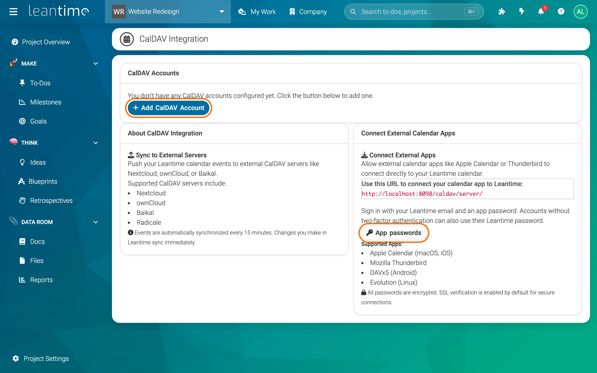

# CalDAV Calendar Sync

The free CalDAV Calendar Sync plugin syncs your Leantime calendar both ways with the calendars you already use, through the open CalDAV standard. Your Leantime events show up in Apple Calendar, Thunderbird or on your Android phone, and your Nextcloud or other calendar server stays in step with Leantime.

## What does it add?

- **Leantime as a calendar server.** Add Leantime as a calendar account in Apple Calendar (Mac, iPhone, iPad), Thunderbird, DAVx5 (Android) or Evolution. You see your Leantime events there and can add, change and delete them from the app. Your due to-dos and planned work show too, read-only. See [How do I see Leantime in my calendar app?](using-leantime/calendars.md#how-do-i-see-leantime-in-my-calendar-app-with-caldav)
- **Sync with your calendar server.** Connect Leantime to Nextcloud, ownCloud, Baikal, Radicale or another CalDAV server, and events sync in both directions. See [How do I sync with Nextcloud or another calendar server?](using-leantime/calendars.md#how-do-i-sync-with-nextcloud-or-another-calendar-server)
- **App passwords.** A separate password for each calendar app, which you can revoke one at a time. People who use two-factor authentication or single sign-on need one to connect a calendar app.

Repeating events work both ways, and changing or deleting one occurrence changes just that occurrence.

## How do I install it on my own server?

- **Leantime version:** 3.13.3 or later. Two things need **Leantime 3.17** or later: servers on your own network, and finding Leantime from its address alone (`/.well-known/caldav`). To check your version, click the **?** (help) icon at the top right; the version is under **System**.
- **Get it:** it's free on the Leantime Marketplace, as [CalDAV Calendar Sync](https://marketplace.leantime.io/product/caldav-calendar-sync/). Choose the tier for your number of users and check out; you get a license key by email, the same way as for paid plugins.
- **Install it** from **Company → Leantime Apps** with the license key (see [Installing from the Marketplace](installation/plugin-installation.md#installing-from-the-marketplace)).
- **Set up Leantime's cron job.** Background sync runs every 15 minutes through Leantime's scheduler. Without a [cron job](installation/scheduled-jobs-and-redis.md#how-do-i-run-the-scheduled-jobs), it only runs while someone is using Leantime.
- **Use HTTPS.** Calendar apps connect to Leantime over the internet, so Leantime needs to be reachable at an `https://` address (see [Run Leantime behind a reverse proxy](installation/reverse-proxy.md)).
- **A calendar server on your own network?** From Leantime 3.17, allow it in `config/.env` (or your Docker settings) with host names, IP addresses or ranges, separated by commas, for example `LEAN_OUTBOUND_ALLOWED_HOSTS = 'nextcloud.lan,192.168.1.0/24'`. Without it, Leantime only connects to public addresses, which protects your network. The same setting also lets Leantime reach external calendars and webhooks on your network.

## How do I keep it up to date?

Leantime checks the marketplace for plugin updates every day and tells administrators; turn on **Update plugins automatically** in **My Apps** to have minor updates installed for you (see [How do plugin updates work?](installation/plugin-licenses.md#how-do-plugin-updates-work)).

Version 1.1.0 fixed sync in both directions, added app passwords, and made the server work behind the official Docker image's web server. If you installed 1.0.0, update.

## Who can use it?

Everyone. Each person connects their own calendar apps and calendar servers, and creates their own app passwords.

## What if something goes wrong?

- **The calendar app can't connect:**
  - Use the full server address shown under **Connect External Calendar Apps**, ending in `/caldav/server/`. The short address (just your Leantime domain) needs Leantime 3.17.
  - Sign in with your Leantime email and an app password. With two-factor authentication or single sign-on, your normal password doesn't work there.
  - Leantime has to be on `https://` and reachable from where the app is.
- **I can't change a to-do from my calendar app:** that's on purpose. To-dos show in calendar apps read-only; change them in Leantime.
- **Connecting to a server on my own network fails:** you need Leantime 3.17 and `LEAN_OUTBOUND_ALLOWED_HOSTS`, as described above. The connect form says when that's the reason.
- **Changes from my calendar server arrive late:** the background sync runs every 15 minutes, and needs Leantime's cron job. Changes made in Leantime go out right away.
- **Buttons show names like `buttons.caldav_app_passwords` after an update** (Leantime 3.16 and earlier): Leantime still has the old texts cached. Delete the contents of `storage/framework/cache/installation/data/` in your Leantime folder (in Docker: `docker compose exec leantime sh -c 'rm -rf storage/framework/cache/installation/data/*'`) and reload the page.
- **The plugin switched itself off:** your Leantime has more users than the license allows, or the plugin kept causing errors. See [Plugin licenses, updates and problems](installation/plugin-licenses.md).

## Related

- [Calendars](using-leantime/calendars.md)
- [Installing plugins](installation/plugin-installation.md)
- [All plugins](installation/using-plugins.md)
