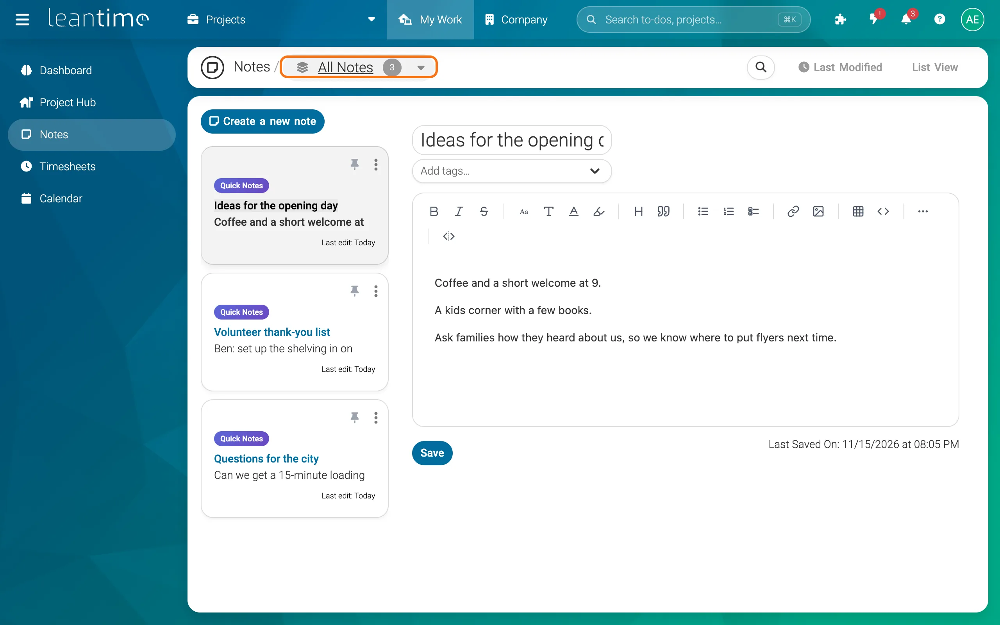

# Notes

The Notes plugin gives everyone a private place for notes that don't belong in a project yet: a question for the city, ideas for an opening day, a list of people to thank.

## What does it add?

- **Private notes** under **My Work → Notes**, with tags, search and pinning. See [Notes](using-leantime/notes.md).
- **Notebooks** with their own colors, to keep notes apart. See [How do I organize my notes?](using-leantime/notes.md#how-do-i-organize-my-notes)
- **A Notes widget** for the [My Work dashboard](using-leantime/my-work-dashboard.md), to start a note without leaving it.

## Do I have it on Leantime Cloud?

Yes. Notes is already on in every Leantime Cloud workspace. To start, see [How do I write a note?](using-leantime/notes.md#how-do-i-write-a-note)

## How do I install it on my own server?

- **Leantime version:** 3.13 or later. To check yours, click the **?** (help) icon at the top right; the version is under **System**.
- **Get a license:** on the Leantime Marketplace it's called [Notes](https://marketplace.leantime.io/product/leantime-notes/). The license is sized by the number of users in your Leantime (see [What counts as a user?](installation/plugin-licenses.md#what-counts-as-a-user-for-a-plugin-license)).
- **Install it** from **Company → Leantime Apps** with the license key (see [Installing from the Marketplace](installation/plugin-installation.md#installing-from-the-marketplace)), or upload it by hand (see [Manual plugin installation](installation/plugin-installation.md#manual-plugin-installation)).
- **Nothing else to set up:** Notes has no settings in `.env` and no scheduled jobs.

After it's on, **Notes** shows in the left menu under **My Work**, and the **Notes** widget in the Widget Manager.

## How do I keep it up to date?

Leantime checks the marketplace for plugin updates every day and tells administrators; turn on **Update plugins automatically** in **My Apps** to have minor updates installed for you (see [How do plugin updates work?](installation/plugin-licenses.md#how-do-plugin-updates-work)). Before you update Leantime itself, check that your Notes version supports the new release (see [What happens to plugins when I update Leantime?](installation/plugin-licenses.md#what-happens-to-plugins-when-i-update-leantime)).

## Who can use it?

Notes is there for people with the Editor role or higher. Each person sees only their own notes, Administrators and Owners included. There's no way to share them.

## What if something goes wrong?

- **There's no Notes under My Work:** check that the plugin is switched on under **Company → Leantime Apps → My Apps**, and that you have the Editor role or higher.
- **The plugin switched itself off:** your Leantime has more users than the license allows, or the plugin kept causing errors. See [Plugin licenses, updates and problems](installation/plugin-licenses.md#what-happens-when-we-have-more-users-than-the-license-allows).

## Related

- [Notes](using-leantime/notes.md)
- [My Work Dashboard](using-leantime/my-work-dashboard.md)
- [Installing plugins](installation/plugin-installation.md)
- [All plugins](installation/using-plugins.md)
