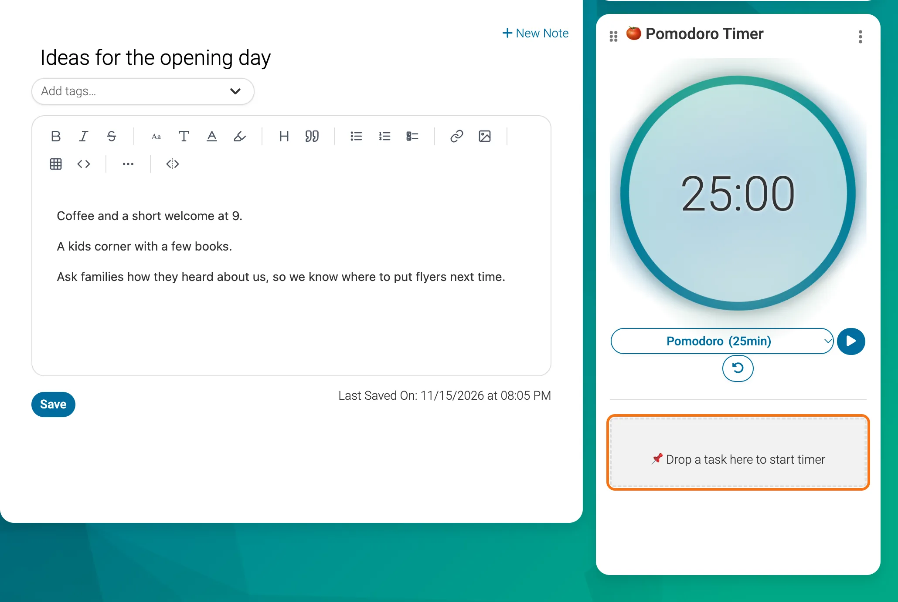

# Pomodoro timer

The Pomodoro plugin puts a focus timer on the My Work dashboard: work on one thing for 25 minutes, then take a short break. It can log the time to the to-do you're working on.

## What does it add?

- **A Pomodoro Timer widget** for My Work, with 25-minute sessions, short and long breaks, or your own length. See [How do I use the Pomodoro timer?](using-leantime/my-work-dashboard.md#how-do-i-use-the-pomodoro-timer)
- **Time logged to a to-do:** drop a to-do onto the timer, and play and pause start and stop its time tracking. See [Can it log my time to a to-do?](using-leantime/my-work-dashboard.md#can-it-log-my-time-to-a-to-do)
- **Just Breath,** a short breathing exercise between sessions.

## Do I have it on Leantime Cloud?

Yes. Pomodoro is already on in every Leantime Cloud workspace. To start, see [How do I use the Pomodoro timer?](using-leantime/my-work-dashboard.md#how-do-i-use-the-pomodoro-timer)

## How do I install it on my own server?

- **Leantime version:** any Leantime 3 release. To check yours, click the **?** (help) icon at the top right; the version is under **System**.
- **Get a license:** on the Leantime Marketplace it's called [Pomodoro Timer](https://marketplace.leantime.io/product/leantime-pomodoro/). The license is sized by the number of users in your Leantime (see [What counts as a user?](installation/plugin-licenses.md#what-counts-as-a-user-for-a-plugin-license)).
- **Install it** from **Company → Leantime Apps** with the license key (see [Installing from the Marketplace](installation/plugin-installation.md#installing-from-the-marketplace)), or upload it by hand (see [Manual plugin installation](installation/plugin-installation.md#manual-plugin-installation)).
- **Nothing else to set up:** Pomodoro has no settings in `.env` and no scheduled jobs.

After it's on, everyone can add the **Pomodoro Timer** widget to My Work in the Widget Manager.

## How do I keep it up to date?

Leantime checks the marketplace for plugin updates every day and tells administrators; turn on **Update plugins automatically** in **My Apps** to have minor updates installed for you (see [How do plugin updates work?](installation/plugin-licenses.md#how-do-plugin-updates-work)). Before you update Leantime itself, check that your Pomodoro version supports the new release (see [What happens to plugins when I update Leantime?](installation/plugin-licenses.md#what-happens-to-plugins-when-i-update-leantime)).

## Who can use it?

Everyone can use the timer on their own My Work dashboard. Logging the time to a to-do needs time tracking to be on for that project.

## What if something goes wrong?

- **There's no Pomodoro Timer in the Widget Manager:** check that the plugin is switched on under **Company → Leantime Apps → My Apps**.
- **No time shows on the to-do:** you need to drop the to-do onto the timer before you press play, and time tracking needs to be on for the project (see [Time tracking](using-leantime/timesheets.md)).
- **The plugin switched itself off:** your Leantime has more users than the license allows, or the plugin kept causing errors. See [Plugin licenses, updates and problems](installation/plugin-licenses.md#what-happens-when-we-have-more-users-than-the-license-allows).

## Related

- [My Work Dashboard](using-leantime/my-work-dashboard.md)
- [Time tracking](using-leantime/timesheets.md)
- [Installing plugins](installation/plugin-installation.md)
- [All plugins](installation/using-plugins.md)
