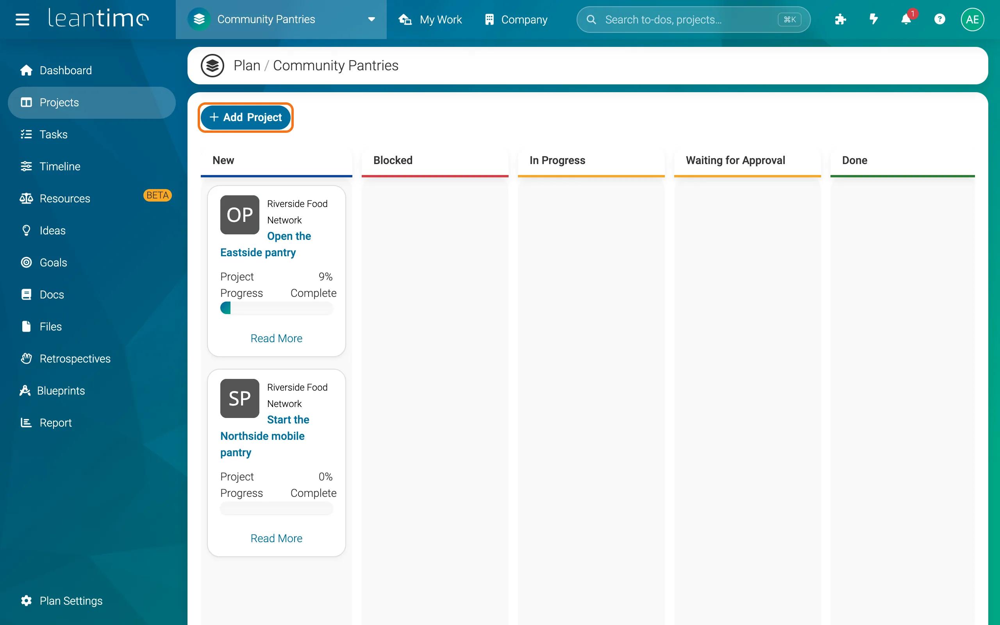

# Programs

The Programs plugin adds programs to Leantime: a group of projects that work toward the same result, with all their to-dos, milestones, people and goals in one place.

On the Leantime Marketplace it's called **Program Plans**, and some screens say "Plan" where they mean a program, like **Plan Settings**.

## What does it add?

- **Programs** with their own dashboard, every project's to-dos on one board, every milestone on one timeline, and shared goals and sprints. See [Programs](using-leantime/programs.md).
- **Resources** (in beta): plan who works on which project and for how many hours a week, and see who's booked past their hours. See [How do I plan people's time with Resources?](using-leantime/programs.md#how-do-i-plan-peoples-time-with-resources)
- **A program report** across all its projects, including people and capacity. See [What's in a program or strategy report?](using-leantime/reports.md#whats-in-a-program-or-strategy-report)

## Do I have it on Leantime Cloud?

Yes. Programs is already on in every Leantime Cloud workspace. To start, see [How do I create a program?](using-leantime/programs.md#how-do-i-create-a-program)

## How do I install it on my own server?

- **Leantime version:** 3.13 or later. To check yours, click the **?** (help) icon at the top right; the version is under **System**.
- **Get a license:** on the Leantime Marketplace it's called [Program Plans](https://marketplace.leantime.io/product/leantime-program-plans/). The license is sized by the number of users in your Leantime (see [What counts as a user?](installation/plugin-licenses.md#what-counts-as-a-user-for-a-plugin-license)).
- **Install it** from **Company → Leantime Apps** with the license key (see [Installing from the Marketplace](installation/plugin-installation.md#installing-from-the-marketplace)), or upload it by hand (see [Manual plugin installation](installation/plugin-installation.md#manual-plugin-installation)). Leantime creates the plugin's tables when you install it.
- **Nothing else to set up:** Programs has no settings in `.env` and no scheduled jobs.
- **For Resources,** give people their **Weekly hours** under **Company → User Management** (see [How do I set how many hours someone works?](using-leantime/user-management.md#how-do-i-set-how-many-hours-someone-works)). Without them, planners type each person's hours on the Resources page.
- **With [Strategy Pro](plugins/strategy-pro.md),** programs sit under strategies, and the strategy report adds up their Resources plans.

After it's on, **Start something new** in the project menu offers **Create a Program**.

## How do I keep it up to date?

Leantime checks the marketplace for plugin updates every day and tells administrators; turn on **Update plugins automatically** in **My Apps** to have minor updates installed for you (see [How do plugin updates work?](installation/plugin-licenses.md#how-do-plugin-updates-work)). Before you update Leantime itself, check that your Programs version supports the new release (see [What happens to plugins when I update Leantime?](installation/plugin-licenses.md#what-happens-to-plugins-when-i-update-leantime)).

## Who can use it?

Creating a program needs the Editor role or higher; **Program Settings** (or **Plan Settings**) need Manager or higher. Who can see a program is set in its settings, like a project.

## What if something goes wrong?

- **There's no Create a Program:** check that Programs is switched on under **Company → Leantime Apps → My Apps**.
- **The plugin switched itself off:** your Leantime has more users than the license allows, or the plugin kept causing errors. See [Plugin licenses, updates and problems](installation/plugin-licenses.md#what-happens-when-we-have-more-users-than-the-license-allows).

## Related

- [Programs](using-leantime/programs.md)
- [Strategy Pro](plugins/strategy-pro.md)
- [Installing plugins](installation/plugin-installation.md)
- [All plugins](installation/using-plugins.md)
