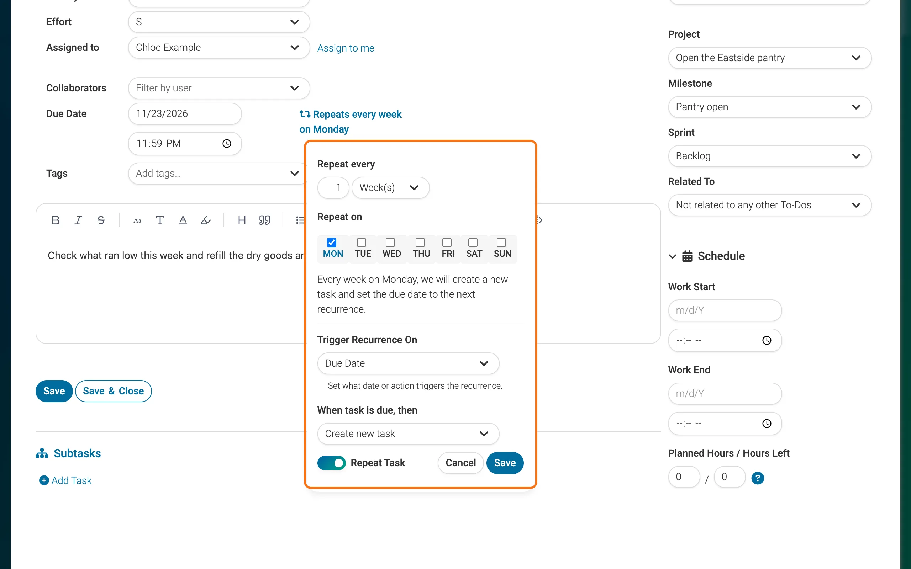

# Recurring to-dos

The Recurring Tasks plugin repeats a to-do on a schedule, like restocking every Monday or a report at the end of every month, so you set it up once instead of adding it again each time.

## What does it add?

- **A repeat schedule on any to-do:** every few days, weeks, months or years, on the days you choose. See [How do I make a to-do repeat?](using-leantime/task-management.md#how-do-i-make-a-to-do-repeat)
- **A choice of what starts the next one:** the due date, the start date, or finishing this one. See [When is the next one created?](using-leantime/task-management.md#when-is-the-next-one-created)
- **New copies or the same to-do again:** each repeat as a new to-do, kept together as subtasks, or the same to-do reset to **New**.

## Do I have it on Leantime Cloud?

Yes. Recurring Tasks is already on in every Leantime Cloud workspace. To start, see [How do I make a to-do repeat?](using-leantime/task-management.md#how-do-i-make-a-to-do-repeat)

## How do I install it on my own server?

- **Leantime version:** any Leantime 3 release. To check yours, click the **?** (help) icon at the top right; the version is under **System**.
- **Get a license:** on the Leantime Marketplace it's called [Recurring Tasks](https://marketplace.leantime.io/product/recurring-tasks/). The license is sized by the number of users in your Leantime (see [What counts as a user?](installation/plugin-licenses.md#what-counts-as-a-user-for-a-plugin-license)).
- **Install it** from **Company → Leantime Apps** with the license key (see [Installing from the Marketplace](installation/plugin-installation.md#installing-from-the-marketplace)), or upload it by hand (see [Manual plugin installation](installation/plugin-installation.md#manual-plugin-installation)).
- **Set up Leantime's cron job.** The plugin checks for repeats every minute through Leantime's scheduler. Without a [cron job](installation/scheduled-jobs-and-redis.md#how-do-i-run-the-scheduled-jobs), Leantime only runs the scheduler while someone is using it, so on a quiet day a repeat can come late. The plugin has no settings in `.env`.

After it's on, **Recurring** (↻) shows next to **Due Date** on every to-do.

## How do I keep it up to date?

Leantime checks the marketplace for plugin updates every day and tells administrators; turn on **Update plugins automatically** in **My Apps** to have minor updates installed for you (see [How do plugin updates work?](installation/plugin-licenses.md#how-do-plugin-updates-work)). Before you update Leantime itself, check that your Recurring Tasks version supports the new release (see [What happens to plugins when I update Leantime?](installation/plugin-licenses.md#what-happens-to-plugins-when-i-update-leantime)).

## Who can use it?

Setting up a repeat needs the Editor role or higher in the project.

## What if something goes wrong?

- **There's no Recurring next to Due Date:** check that the plugin is switched on under **Company → Leantime Apps → My Apps**, and that you have the Editor role or higher.
- **Repeats come late, or only when someone logs in:** Leantime's scheduler isn't running on its own. Set up the [cron job](installation/scheduled-jobs-and-redis.md#how-do-i-run-the-scheduled-jobs).
- **The plugin switched itself off:** your Leantime has more users than the license allows, or the plugin kept causing errors. See [Plugin licenses, updates and problems](installation/plugin-licenses.md#what-happens-when-we-have-more-users-than-the-license-allows).

## Related

- [To-Dos](using-leantime/task-management.md)
- [Installing plugins](installation/plugin-installation.md)
- [All plugins](installation/using-plugins.md)
