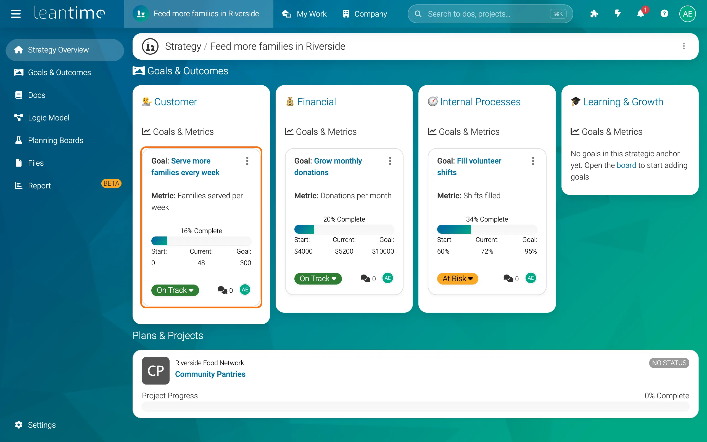

# Strategy Pro

Strategy Pro adds strategies to Leantime: a place above your programs and projects for what your organization is working toward, with goals you can measure and the work that moves them.

## What does it add?

- **Strategies** with focus areas, goals and the programs and projects that serve them. See [Strategies](using-leantime/strategies.md).
- **Goals that add up:** project and program goals report into the strategy's goals, so its numbers move as the work gets done. See [Can a project goal count toward a bigger goal?](using-leantime/goals.md#can-a-project-goal-count-toward-a-bigger-goal)
- **A Logic Model connected to the work:** build it from your programs, milestones and goals, rate how strong each link is, and turn it into milestones, to-dos and goals. See [Logic Model](blueprints/logic-model.md).
- **A strategy report** (in beta) for your board or funders. See [What's in a program or strategy report?](using-leantime/reports.md#whats-in-a-program-or-strategy-report)

## Do I have it on Leantime Cloud?

Yes. Strategy Pro is already on in every Leantime Cloud workspace. To start, see [How do I create a strategy?](using-leantime/strategies.md#how-do-i-create-a-strategy)

## How do I install it on my own server?

- **Leantime version:** 3.13 or later. To check yours, click the **?** (help) icon at the top right; the version is under **System**.
- **Get a license:** on the Leantime Marketplace, Strategy Pro is called [Leantime Strategies](https://marketplace.leantime.io/product/leantime-strategies/). The license is sized by the number of users in your Leantime (see [What counts as a user?](installation/plugin-licenses.md#what-counts-as-a-user-for-a-plugin-license)).
- **Install it** from **Company → Leantime Apps** with the license key (see [Installing from the Marketplace](installation/plugin-installation.md#installing-from-the-marketplace)), or upload it by hand (see [Manual plugin installation](installation/plugin-installation.md#manual-plugin-installation)). Leantime creates the plugin's tables when you install it.
- **Nothing else to set up:** Strategy Pro has no settings in `.env` and no scheduled jobs.
- **Install Programs too** if you use programs. The strategy report's **Resources & Coverage** tab adds up the programs' Resources plans, and the Logic Model can create a **New Program** from your activities. Both need the [Programs](plugins/programs.md) plugin.

After it's on, **Start something new** in the project menu offers **Create a Strategy**.

## How do I keep it up to date?

Leantime checks the marketplace for plugin updates every day and tells administrators; turn on **Update plugins automatically** in **My Apps** to have minor updates installed for you (see [How do plugin updates work?](installation/plugin-licenses.md#how-do-plugin-updates-work)). Before you update Leantime itself, check that your Strategy Pro version supports the new release (see [What happens to plugins when I update Leantime?](installation/plugin-licenses.md#what-happens-to-plugins-when-i-update-leantime)).

## Who can use it?

Creating a strategy needs the Editor role or higher; its settings, and deleting it, need Manager or higher. Who can see a strategy, and who can change it, is set per strategy (see [Who can see and change a strategy?](using-leantime/strategies.md#who-can-see-and-change-a-strategy)).

## What if something goes wrong?

- **There's no Create a Strategy:** check that Strategy Pro is switched on under **Company → Leantime Apps → My Apps**.
- **The plugin switched itself off:** your Leantime has more users than the license allows, or the plugin kept causing errors. See [Plugin licenses, updates and problems](installation/plugin-licenses.md#what-happens-when-we-have-more-users-than-the-license-allows).

## Related

- [Strategies](using-leantime/strategies.md)
- [Programs](plugins/programs.md)
- [Installing plugins](installation/plugin-installation.md)
- [All plugins](installation/using-plugins.md)
