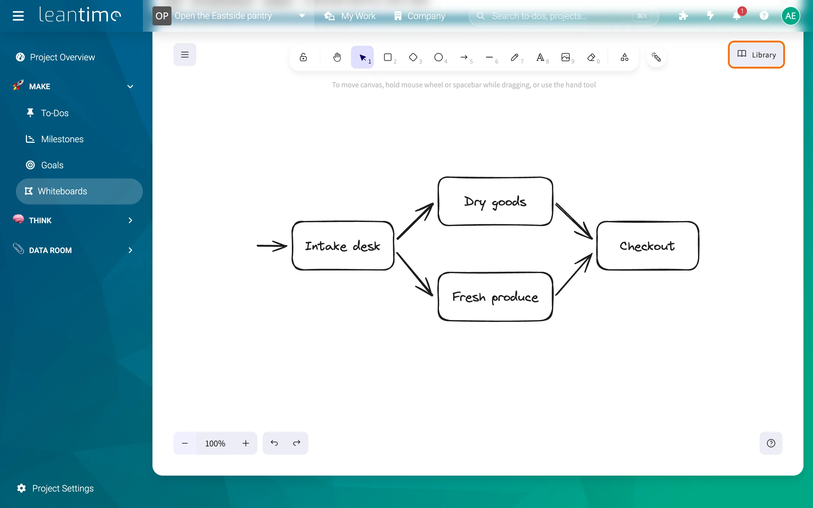

# Whiteboards

The Whiteboards plugin adds a blank canvas to every project, for anything that's easier to draw than to write: a floor plan, a process, an org chart, a rough screen layout.

## What does it add?

- **Whiteboards in every project,** under **Make** in the project menu, in groups you name yourself. See [Whiteboards](using-leantime/whiteboards.md).
- **Excalidraw's drawing tools:** shapes, arrows that stay attached, freehand drawing, text and images, with the drawing saved as you go. See [How do I draw on a whiteboard?](using-leantime/whiteboards.md#how-do-i-draw-on-a-whiteboard)
- **A Library of ready-made pieces:** sticky notes, org charts, decision flows, a Gantt chart, a customer journey map and wireframing kits. See [What's in the Library?](using-leantime/whiteboards.md#whats-in-the-library)
- **Export** a whiteboard as an image or a file. See [Can I export a whiteboard?](using-leantime/whiteboards.md#can-i-export-a-whiteboard)

## Do I have it on Leantime Cloud?

Yes. Whiteboards is already on in every Leantime Cloud workspace. To start, see [How do I create a whiteboard?](using-leantime/whiteboards.md#how-do-i-create-a-whiteboard)

## How do I install it on my own server?

- **Leantime version:** 3.13 or later. To check yours, click the **?** (help) icon at the top right; the version is under **System**.
- **Get a license:** on the Leantime Marketplace it's called [Whiteboards](https://marketplace.leantime.io/product/leantime-whiteboards/). The license is sized by the number of users in your Leantime (see [What counts as a user?](installation/plugin-licenses.md#what-counts-as-a-user-for-a-plugin-license)).
- **Install it** from **Company → Leantime Apps** with the license key (see [Installing from the Marketplace](installation/plugin-installation.md#installing-from-the-marketplace)), or upload it by hand (see [Manual plugin installation](installation/plugin-installation.md#manual-plugin-installation)).
- **Nothing to set up on the server:** Whiteboards has no settings in `.env` and no scheduled jobs.
- **People's browsers need to reach `unpkg.com`.** The whiteboard loads its drawing tools (Excalidraw) from there when it opens. Leantime's own security headers already allow it; a firewall, proxy or content filter on your network must allow it too. The ready-made Library pieces are part of the plugin.

After it's on, **Whiteboards** shows in each project's menu, under **Make**. Each project can switch it off under **Project Settings → Modules** (see [How do I switch features on or off for a project?](using-leantime/managing-projects.md#how-do-i-switch-features-on-or-off-for-a-project)).

## How do I keep it up to date?

Leantime checks the marketplace for plugin updates every day and tells administrators; turn on **Update plugins automatically** in **My Apps** to have minor updates installed for you (see [How do plugin updates work?](installation/plugin-licenses.md#how-do-plugin-updates-work)). Before you update Leantime itself, check that your Whiteboards version supports the new release (see [What happens to plugins when I update Leantime?](installation/plugin-licenses.md#what-happens-to-plugins-when-i-update-leantime)).

## Who can use it?

Whiteboards are for people with the Editor role or higher in the project.

## What if something goes wrong?

- **There's no Whiteboards in the project menu:** check that the plugin is switched on under **Company → Leantime Apps → My Apps**, that whiteboards are switched on for the project, and that you have the Editor role or higher.
- **A whiteboard opens blank:** the browser couldn't load the drawing tools from `unpkg.com`. Check that your network allows it, and look in the browser's developer console for blocked requests. If you've added your own `Content-Security-Policy` in a reverse proxy, allow `unpkg.com` for scripts and fonts.
- **The plugin switched itself off:** your Leantime has more users than the license allows, or the plugin kept causing errors. See [Plugin licenses, updates and problems](installation/plugin-licenses.md#what-happens-when-we-have-more-users-than-the-license-allows).

## Related

- [Whiteboards](using-leantime/whiteboards.md)
- [Blueprints](using-leantime/blueprints.md)
- [Installing plugins](installation/plugin-installation.md)
- [All plugins](installation/using-plugins.md)
