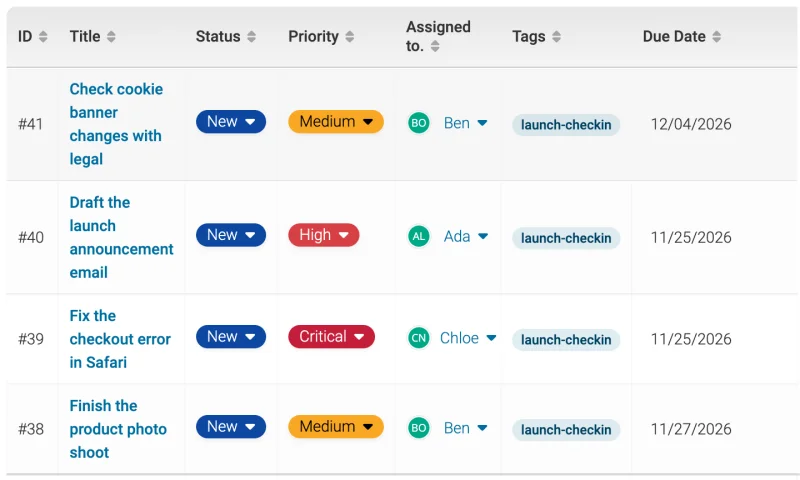
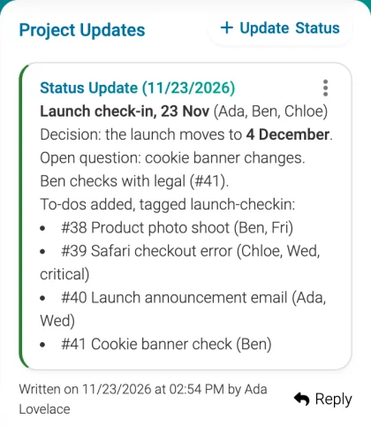

After a meeting, paste your notes into your AI assistant. It creates one to-do per action item, with the person, due date and priority from the notes, tags them all with the meeting's name, and posts what was decided as a project update. Everyone sees their to-dos in Leantime, and the decisions are on the project's overview.

## What to ask

Paste the notes as they are, bullet points and shorthand included, and say which project they're for:

```
Here are the notes from today's launch check-in for the Website Redesign
project. Create a to-do for each action item, assigned to the person named,
with the due date and a priority. Tag them all launch-checkin.
Then post a project update with the decisions, the open questions and the
list of new to-dos, formatted as paragraphs and a bulleted list.
Show me the to-dos before you create them.

Launch check-in, 23 Nov. Ada, Ben, Chloe.
- Launch moves to 4 Dec, the photos aren't ready
- Ben: finish the product photo shoot by Fri
- Chloe: checkout error in Safari, has to be fixed by Wed, blocks launch
- Ada: draft the launch announcement email, Wed
- Cookie banner: do we need changes? Ben checks with legal before launch
```

The assistant lists the to-dos it would create, with who, when and how urgent. Check the people and the dates, correct anything in plain words ("make the cookie banner one Medium"), and say yes.

## What you get

Four to-dos in the project, each assigned, with a due date, a priority from how urgent the notes made it sound, and the `launch-checkin` tag:



And a project update on the project's overview, under **Project Updates**, with the decision, the open question and the new to-dos:



The people you assigned are told about their to-dos the same way as when you assign them yourself (see [Notifications](/using-leantime/notifications/)).

## Find the meeting's to-dos later

Because every to-do carries the meeting's tag, you can bring them back together:

- **In Leantime:** on the project's To-Dos, click **Filter** and type the tag, like `launch-checkin`, as the **Search Term** (see [How do I filter or find to-dos?](/using-leantime/task-management/#how-do-i-filter-or-find-to-dos)).
- **From your assistant:** "Which launch-checkin to-dos are still open, and who has them?" Before the next check-in, that's your follow-up list.

Use one tag per kind of meeting, like `launch-checkin` or `client-weekly`, rather than one per date. Then the follow-up question covers every check-in, and the to-dos' dates tell them apart.

## Tips

- **Name the project.** The assistant doesn't have to guess, and it checks that the people are on that project's team.
- **Use first names.** If two people share a name, or someone isn't on the team, the assistant asks. Add people to the team first, or they may not be able to open their to-dos. The assistant can do that too: see [Add or remove people from a project's team](/ai/project-for-someone-else/#add-or-remove-people-from-a-projects-team).
- **Relative dates are fine.** "Fri" or "by next week" become dates; the assistant shows them in the list so you can check.
- **Ask for paragraphs and a list in the update.** Line breaks in plain text can run together into one paragraph in Leantime. Asking for "paragraphs and a bulleted list" gives a readable update.
- **Set the status of the update.** Add "status green" (On Track), "yellow" (At Risk) or "red" (Off Track). The project's overview and its [report](/using-leantime/reports/) show the status of the latest update.
- **Check the tags and priorities.** Leantime can't set them while it creates a to-do yet, so the assistant has to set them in a second step. If they're missing in the list, ask: "set the priority and the launch-checkin tag on the to-dos you just created".

## Related

- [Things your AI assistant can do in Leantime](/ai/recipes/): more recipes
- [Get a standup report every morning](/ai/standup-report/)
- [To-dos](/using-leantime/task-management/)
- [Projects: what's on the project overview](/using-leantime/managing-projects/#whats-on-the-project-overview)
