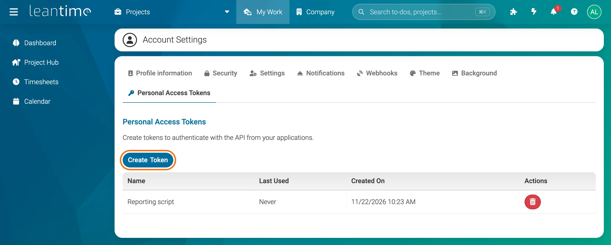

Leantime has a JSON-RPC API: other tools and your own scripts can read and change your projects, to-dos, milestones, timesheets and more. Every call goes to one address, `/api/jsonrpc`, with a key or token that says who is calling.

To work with Leantime from an AI assistant like Claude or ChatGPT, you don't need the API: connect the [MCP server](/installation/leantime-mcp/) instead.

## Which key should I use?

| Detail | API key | Personal access token |
| --- | --- | --- |
| **For** | Integrations that run on their own, like a sync with another tool | Your own scripts and tools that act for you |
| **Acts as** | Its own user, with the role and projects you give it | You, with your role and your projects |
| **Who can create it** | Administrators and Owners | Everyone |
| **Where** | **Company → Company Settings → API Keys** | **My Profile → Personal Access Tokens** |
| **Header** | `x-api-key: lt_…` | `Authorization: Bearer …` |

Changes made with an API key show the key's name as the author. Changes made with a token show your name.

## How do I create an API key?

1. **Open Company Settings:** click **Company** at the top, then **Company Settings** in the left menu.
2. **Open the API Keys tab** and click **Generate API Key**.
3. **Enter a Key Name,** so you know later what uses it.
4. **Choose a Role.** You can give a key your own role or a lower one. **Read Only** is enough for tools that only read.
5. **Tick the projects** the key can use.
6. **Click Save,** then copy the key. It starts with `lt_`, and this is the only time you see all of it.

A key can also see the projects that are open to everyone in your organization. To pause a key, edit it and set its **Status** to **Deactivated**. See [Company Settings](/using-leantime/company-settings/) for more.

## How do I create a personal access token?

1. **Click your profile picture** at the top right, then **My Profile**. Account Settings opens.
2. **Open the Personal Access Tokens tab** and click **Create Token**.
3. **Enter a Token Name,** like the tool you'll use it in, and click **Create Token**.
4. **Copy the token.** This is the only time you see it.

A token doesn't expire. It works until you delete it on the same tab, where you also see when it was last used.



## How do I make my first call?

Send a `POST` request to `https://your-leantime-url/api/jsonrpc`, with your key in the header. This call returns your Leantime version:

```bash
curl https://your-leantime-url/api/jsonrpc \
  -H "x-api-key: lt_your_key" \
  -H "Content-Type: application/json" \
  -d '{"jsonrpc":"2.0","id":1,"method":"leantime.rpc.api.config.getSystemInfo"}'
```

With a personal access token, use `-H "Authorization: Bearer your_token"` instead of the `x-api-key` line.

The answer:

```json
{"jsonrpc":"2.0","result":{"version":"3.15.3","enabledPlugins":[]},"id":1}
```

Every request has the same four parts:

| Part | What it is |
| --- | --- |
| `jsonrpc` | Always `"2.0"`. Leantime refuses requests without it. |
| `id` | Any number or text. The answer carries the same `id`, so you can match them. |
| `method` | What to do, like `leantime.rpc.tickets.getTicket` (see below). |
| `params` | The method's parameters, by name. Leave it out if the method has none. |

## How are methods named?

A method name is `leantime.rpc.` followed by the area and the method: `leantime.rpc.tickets.getTicket` gets one to-do. When an area has more than one service, the service comes in between: `leantime.rpc.api.config.getSystemInfo`.

Only methods made for the API can be called. Others answer with "Method is not available via API". The [API reference](/api/) lists the areas and their methods.

Methods from a plugin only work while the plugin is on. Otherwise you get error `-32004`, or "Service doesn't exist".

## What does a request look like?

**List the projects** the key or token can see:

```json
{"jsonrpc":"2.0","id":1,"method":"leantime.rpc.projects.getAll"}
```

**Create a to-do** in project 6, with Medium priority. The answer is the new to-do's ID:

```json
{
  "jsonrpc": "2.0",
  "id": 2,
  "method": "leantime.rpc.tickets.addTicket",
  "params": {
    "values": {
      "headline": "Call back Harbor Café",
      "projectId": 6,
      "priority": "3"
    }
  }
}
```

```json
{"jsonrpc":"2.0","result":25,"id":2}
```

**Get one to-do** by its ID:

```json
{"jsonrpc":"2.0","id":3,"method":"leantime.rpc.tickets.getTicket","params":{"id":25}}
```

**Send several calls at once** as a list. You get a list of answers back, in the same order:

```json
[
  {"jsonrpc":"2.0","id":1,"method":"leantime.rpc.projects.getAll"},
  {"jsonrpc":"2.0","id":2,"method":"leantime.rpc.tickets.getTicket","params":{"id":25}}
]
```

A request without an `id` gets no answer, even when it fails. Always send an `id` unless you don't need the result.

### Can I use GET instead of POST?

Yes, for calls that only read. Put `method`, `jsonrpc` and `id` in the address, and the `params` as JSON encoded with Base64:

```bash
curl -G https://your-leantime-url/api/jsonrpc \
  -H "x-api-key: lt_your_key" \
  --data-urlencode "jsonrpc=2.0" \
  --data-urlencode "id=1" \
  --data-urlencode "method=leantime.rpc.tickets.getTicket" \
  --data-urlencode "params=$(printf '{"id":25}' | base64)"
```

## What do the errors mean?

Leantime answers most errors with HTTP status 200 and an `error` in the body, like this:

```json
{"jsonrpc":"2.0","error":{"code":-32001,"message":"You are not allowed to perform this action.","data":null},"id":3}
```

| Error | What it means |
| --- | --- |
| HTTP `401`, `{"error":"Unauthorized"}` | The key or token is wrong, deleted or deactivated. |
| HTTP `429`, `Too many requests` | Too many calls in a minute. Wait the seconds in the `Retry-After` header. See below. |
| `-32700` Parse error | The body isn't valid JSON. |
| `-32600` Invalid Request | `jsonrpc` is missing or isn't `"2.0"`. |
| `-32601` Method not found | The method name is wrong, or the method isn't made for the API. The `data` says which. |
| `-32602` Invalid params | A parameter is missing or has the wrong type. The `data` names it. |
| `-32001` | The key or token isn't allowed to do this: its role is too low, or it can't see the project. |
| `-32004` | The method belongs to a plugin that isn't on. |
| `-32000` Server error | Something failed inside Leantime. The server's log has the details. |

## How many calls can I make?

By default, 120 calls per minute, counted per IP address and user. Over the limit, Leantime answers with HTTP `429` and a `Retry-After` header: the number of seconds to wait before you try again.

If you host Leantime yourself, change the limit with `LEAN_RATELIMIT_API` in your `.env` file. **In Docker, check this setting:** the official Docker setup's sample `.env` sets `LEAN_RATELIMIT_API = 10`, which is only 10 calls a minute. Raise it, for example to `120`, then recreate the container with `docker compose up -d`.

## How do I keep keys and tokens safe?

- **Treat them like passwords.** Anyone with a key can do what the key can do. Keep them out of code you share, and store them in your tool's secret settings.
- **Give each tool its own key,** with the lowest role and only the projects it needs. Then you can delete one without breaking the others.
- **Delete keys and tokens you no longer use.** The API Keys and Personal Access Tokens tabs show when each was last used.
- **Use HTTPS.** Over plain `http://`, the key travels unencrypted.

## Related

- [MCP server: connect your AI assistant](/installation/leantime-mcp/)
- [API reference](/api/)
- [Company Settings](/using-leantime/company-settings/)
- [Configuration](/installation/configuration/)
