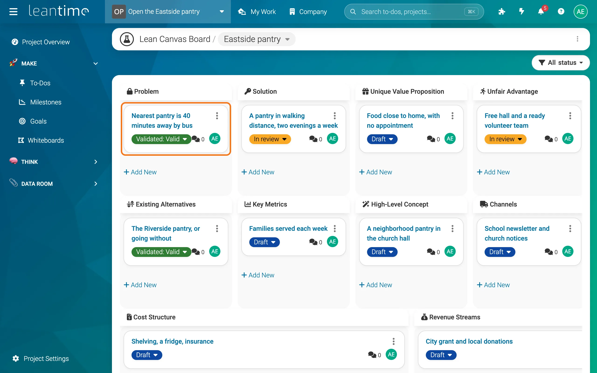

The Lean Canvas fits a whole business idea on one page, so you can see quickly whether it holds together and what you still need to test. It's meant for early ideas: new products, services and programs, where you know less than you'd like.

The Lean Canvas is by Ash Maurya, adapted from the Business Model Canvas. For a model of how an established organization works, use the [Business Model Canvas](/blueprints/business-model-canvas/) instead.

To start one, open **Think → Blueprints** in the project and click **Lean Canvas** (see [Blueprints](/using-leantime/blueprints/)).

## What goes in each box?

A good order to fill it in is customer and problem first, then the rest.

- **Customer Segments:** who has the problem.
- **Early Adopters:** the people in that group who need a solution most, and will try yours first.
- **Problem:** the top one to three problems they have.
- **Existing Alternatives:** how they deal with the problem today.
- **Unique Value Proposition:** one clear message that says why you're different and worth their attention.
- **High-Level Concept:** your idea in a few words, often as an analogy.
- **Solution:** the simplest thing that solves each problem.
- **Channels:** how you'll reach your customers.
- **Revenue Streams:** where the money comes from: sales, fees, grants or donations.
- **Cost Structure:** what it costs to run.
- **Key Metrics:** the few numbers that show it's working.
- **Unfair Advantage:** what others can't easily copy or buy.

Each card has **Assumptions**, **Data** and a **Conclusion**, and a status: **Draft**, **In review**, **Validated: Valid**, **On Hold** or **Validated: Invalid**.

## How do I use it?

- **Fill it in quickly.** A first canvas should take less than an hour. Leave a box empty rather than guess at length.
- **Mark what you know and what you assume.** Most cards start as **Draft**. The riskiest assumptions, often the problem and the early adopters, are the ones to test first.
- **Test, then update.** Create a milestone from a card's **Linked Milestone** for each test, and change the card's status when you know more. Start a new board when the idea changes a lot, so you keep the history.

## Sources and further reading

- Ash Maurya, *Running Lean: Iterate from Plan A to a Plan That Works* (3rd edition, O'Reilly, 2022)

## Related

- [Blueprints](/using-leantime/blueprints/)
- [Lean](/knowledge-base/whatislean/)
- [Project Value Canvas](/blueprints/project-value-canvas/)
