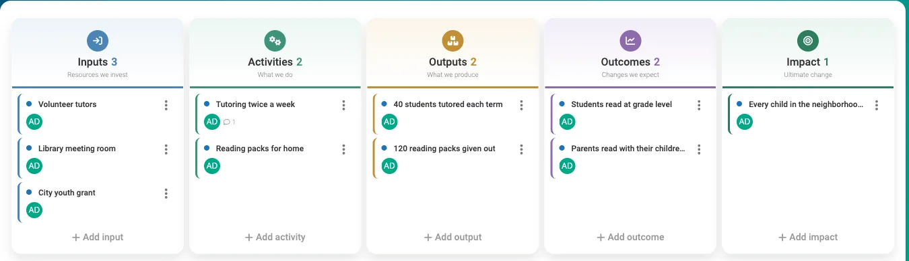
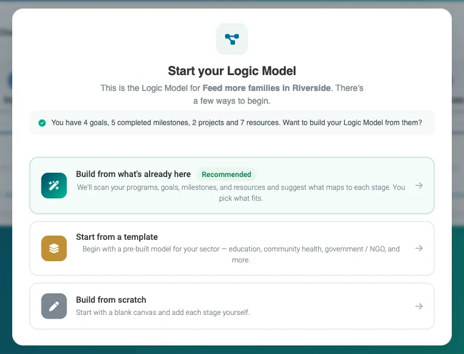
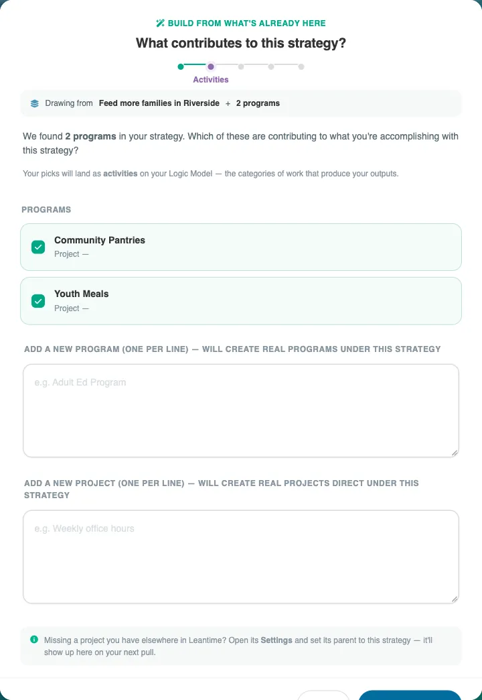
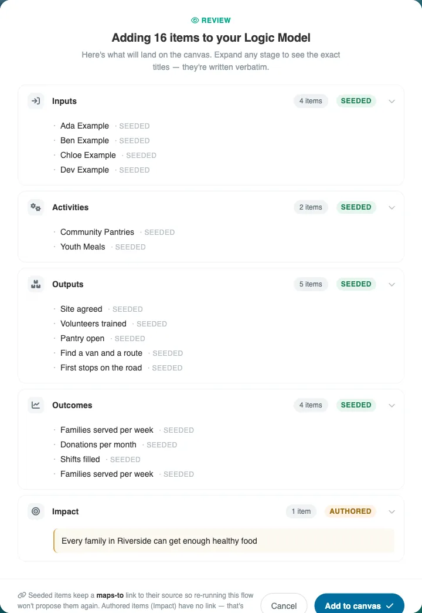
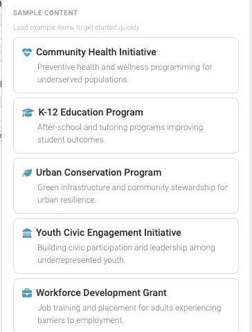
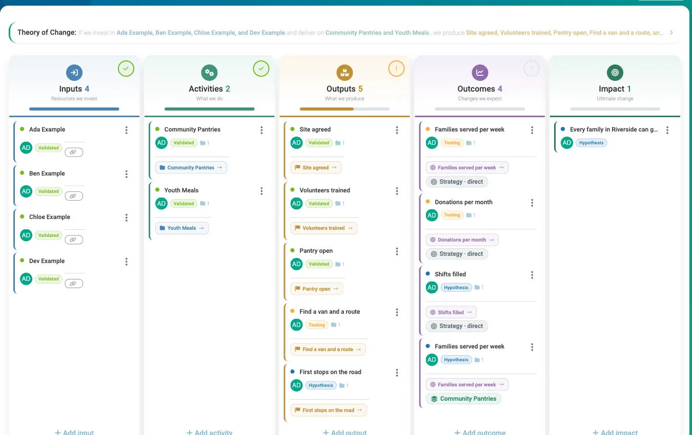
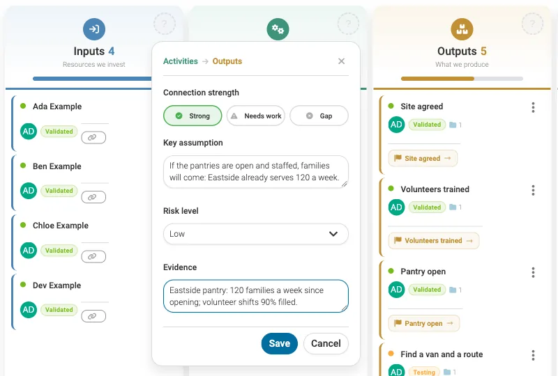
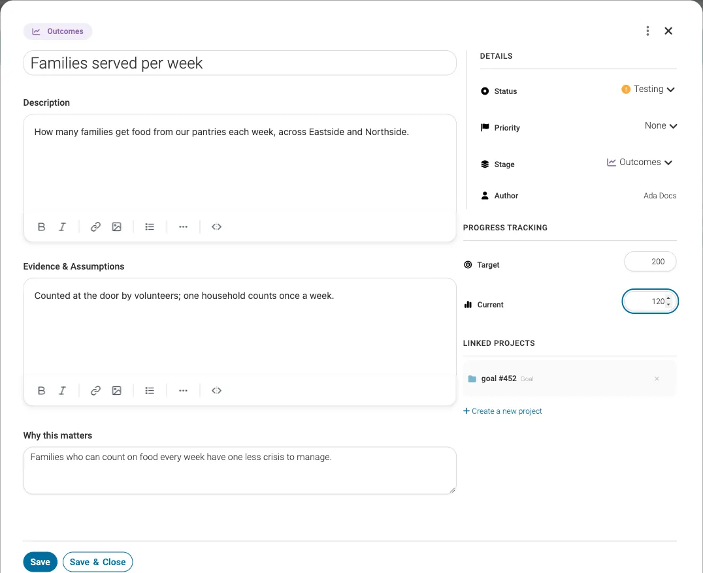
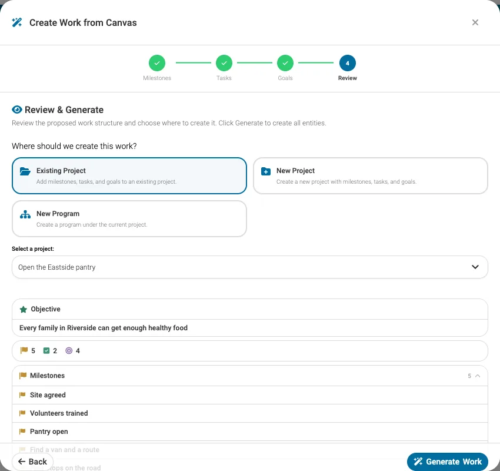

A logic model shows how your work leads to change: what you put in, what you do, what that produces, what changes because of it, and the difference you're working toward. Funders often ask for one, and it's a good way to check that a program's plan holds together.

In Leantime, the Logic Model is a board in every project. With the [Strategy Pro](/plugins/strategy-pro/) plugin it also connects to the work itself: it can be built from your programs, goals and milestones, and it can turn into projects, milestones, to-dos and goals.

To start one, open **Think → Blueprints** in the project and click **Logic Model** (see [Blueprints](/using-leantime/blueprints/)). New to logic models? [What is a logic model?](/knowledge-base/logic-model/) explains the idea.

## What goes in each column?

Each column has a short question under its name. For an after-school tutoring program:

| Column | The question | Example cards |
| --- | --- | --- |
| **Inputs** | Resources we invest | Volunteer tutors, a library meeting room, a city youth grant |
| **Activities** | What we do | Tutoring twice a week, reading packs for home |
| **Outputs** | What we produce | 40 students tutored each term, 120 reading packs given out |
| **Outcomes** | Changes we expect | Students read at grade level, parents read with their children weekly |
| **Impact** | Ultimate change | Every child in the neighborhood can read well by age 10 |

Outputs count what you did. Outcomes describe what changed for the people you serve. If a card would still be true even when nobody's life changed, it's an output.

## How do I fill out a logic model?

1. **Start at the right, with Impact.** Write the change you're working toward in one sentence.
2. **Add the Outcomes** that would show you're getting there, in the next year or two. Make them something you could count or observe.
3. **Fill in Activities and Outputs:** what you'll do, and what that produces.
4. **List the Inputs:** the people, money, places and partners the activities need.
5. **Read it from left to right as a chain of "if… then…":** if we have these inputs, we can run these activities; if we run them, we produce these outputs; and so on. Where a step doesn't follow, add a card or change one.

Three to five cards per column is plenty. A logic model is a summary, not a work plan.

## What do I write on a card?

Click a card, or **Add input**, **Add activity** and so on under a column. Each card has:

- **Title:** a short name that reads well on the board.
- **Description:** what the card means, in a sentence or two.
- **Evidence & Assumptions:** what you know, and what you're assuming. Assumptions are what you'll need to check.
- **Why this matters**, on Outputs, Outcomes and Impact: why this step counts toward the next one.
- **The world today, before this work**, on Impact: where things stand now, so you can see the change later.

Give each card a **Status** as you learn: **Hypothesis**, **Testing**, **Validated**, **Paused** or **Invalid**. The **All status** filter at the top of the board shows only the cards with one status. **Stage** moves a card to another column.

## How do I connect the Logic Model to the work?

**With Strategy Pro:** a [strategy](/using-leantime/strategies/) has its own **Logic Model** in its menu, and there it connects to the programs, projects, goals and milestones under the strategy. Everything below is part of the [Strategy Pro](/plugins/strategy-pro/) plugin (**Get it:** [Leantime Strategies on the Leantime Marketplace](https://marketplace.leantime.io/product/leantime-strategies/); it's already on in Leantime Cloud). You need to be on the strategy's team to use these features.

### Build it from the work you already have

The first time you open the Logic Model of a strategy that already has work under it, Leantime offers to build it for you.

1. **Click Build from what's already here.**
2. **Go through the five stages.** Each one shows what Leantime found and asks which items belong. Click a row to pick it:

   | Stage | What Leantime suggests |
   | --- | --- |
   | **Inputs** | The people in your programs' **Resources** plans |
   | **Activities** | The programs and projects under the strategy. You can also type new ones, one per line, and they're created for real. |
   | **Outputs** | Completed milestones |
   | **Outcomes** | The goals of the strategy |
   | **Impact** | Nothing: you write it yourself |

   

   If a stage finds nothing, you type your own items instead. **Skip this stage** moves on.
3. **Check the review** and click **Add to canvas**. Each card that came from your work stays linked to it, so **Pull in new work** won't suggest it again.

Later, when there's new work, open the menu at the top right of the board (⋮) and click **Pull in new work**. Leantime suggests only what's new since the last time.

### Start from a sample

Open the menu (⋮), click **Choose a framework**, and under **Sample content** pick one: **Community Health Initiative**, **K-12 Education Program**, **Urban Conservation Program**, **Youth Civic Engagement Initiative** or **Workforce Development Grant**. Choose **Add alongside** to keep your own cards, or **Replace all items** to start over. Then change the cards to fit your program.

### See whether your logic holds

- **Theory of Change:** the line at the top turns your cards into one sentence: "If we invest in… and deliver on…, we produce…". Read it out loud: if it doesn't make sense, neither does the model.
- **Progress bars:** the bar under each column name shows how many of its cards are **Validated**.
- **Connections:** the circle at the top right of each column rates the link to the next column. Click it to choose **Strong**, **Needs work** or **Gap**, and write down the **Key assumption**, the **Risk level** and your **Evidence**.

### Track progress on a card

Open a card to see what it's tied to and how far along it is.

- **Progress tracking:** type a **Target** and the **Current** value. The card shows a small progress bar on the board.
- **Linked projects:** the work this card is tied to. On the board, the card shows a link for each one (a program, project, milestone or goal); click it to open the work.
- **Create a new project:** starts a project under the strategy for this card, and links it. You need permission to create projects.

### Turn the model into work

When the model is ready, open the menu (⋮) and click **Create Work from Canvas**. It suggests the work in four steps:

1. **Milestones:** one per Output. Change the names and dates, or untick what you don't need.
2. **Tasks:** one to-do per Activity, grouped under a milestone.
3. **Goals:** one per Outcome, with a metric, a start value and a target.
4. **Review:** choose where the work goes: an **Existing Project**, a **New Project**, or a **New Program** (with the [Programs](/plugins/programs/) plugin, which makes a project per activity instead). Then click **Generate Work**.

Each new milestone, to-do and goal stays linked to its card, so the Logic Model shows the work it led to. Inputs don't become work.

### Show it to your board or funders

The strategy's **Report** (in beta) puts the Logic Model next to the strategy's progress: the theory of change, how strong each connection is, and what the programs are delivering. See [What's in a program or strategy report?](/using-leantime/reports/#whats-in-a-program-or-strategy-report)

## Who can change the Logic Model?

The Logic Model follows the same permissions as other [Blueprints](/using-leantime/blueprints/): Editors and above add and change cards. In a strategy that's open to everyone, people who aren't on the strategy's team can see the Logic Model but not change it.

## Related

- [What is a logic model?](/knowledge-base/logic-model/)
- [Project management for non-profits](/getting-started/nonprofits/)
- [Strategies](/using-leantime/strategies/)
- [Strategy Pro](/plugins/strategy-pro/)
- [Goals](/using-leantime/goals/)
- [Blueprints](/using-leantime/blueprints/)
