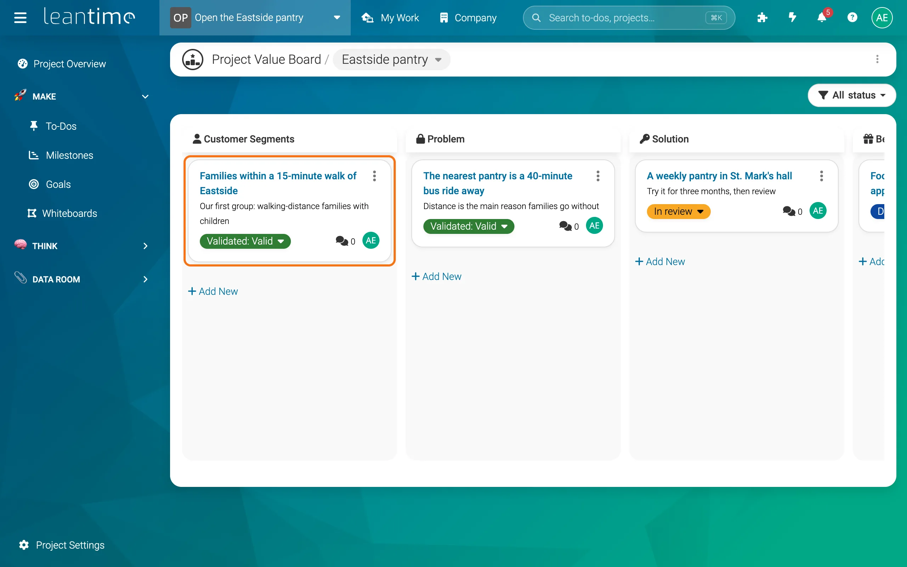

The Project Value Canvas checks that a project is worth doing before you plan the work: who it's for, what problem they have, how you'll solve it, and what they gain. It's a good first blueprint for any new project.

To start one, open **Think → Blueprints** in the project and click **Project Value Canvas** (see [Blueprints](/using-leantime/blueprints/)).

## What goes in each column?

Work from left to right. Each column builds on the one before it.

- **Customer Segments:** who the project is for. Be specific: "families within a 15-minute walk of Eastside" says more than "the community". If you serve several groups, give each its own card and start with the one that matters most.
- **Problem:** what gets in their way. List up to three problems, most important first.
- **Solution:** how the project solves each problem. One solution per problem keeps you honest.
- **Benefit:** what the people you serve gain, in their terms. This is the reason the project exists.

## What do I write on a card?

Every card asks three questions about its column. On a **Customer Segments** card, for example:

- **What assumptions do you have about this customer segment?**
- **What data do you have to support this customer segment?**
- **What are your conclusions?**

The other columns ask the same about the problem, the solution and the benefit. Write down your assumptions even when you have no data yet: they're what you need to check.

Give each card a status as you learn: **Draft**, **In review**, **Validated: Valid**, **On Hold** or **Validated: Invalid**. A board full of validated cards means you know your customer, their problem and your solution fit together. A card marked **Validated: Invalid** is useful too: it tells you what to change before you build.

## What next?

- **Check the open questions.** For each card in **Draft** or **In review**, decide how you'll find out, like talking to five people or looking at last year's numbers, and create a milestone for it from the card's **Linked Milestone**.
- **Turn the benefit into a goal.** Something you can measure, like "families served each week" (see [Goals](/using-leantime/goals/)).
- **Go deeper** with the [Lean Canvas](/blueprints/lean-canvas/) if the project needs a business model, or the [Project Brief](/blueprints/project-brief/) to agree on roles, budget and timeline.

## Related

- [Blueprints](/using-leantime/blueprints/)
- [Design thinking](/knowledge-base/idea-development/)
