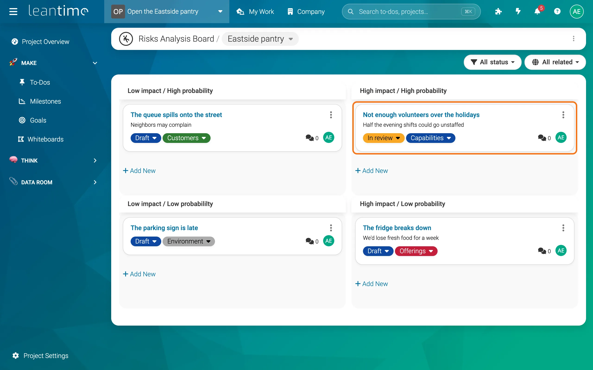

A risk analysis lists what could go wrong, how likely it is, how much it would hurt, and what you'll do about it. Leantime's board sorts risks into a grid by impact and probability, so the ones that need attention first stand out.

To start one, open **Think → Blueprints** in the project and click **Risk Analysis** (see [Blueprints](/using-leantime/blueprints/)).

## How do I fill it in?

1. **List the risks with your team.** Think about people, money, suppliers, rules, technology and timing. Ask "what would stop us?" and "what has gone wrong before?".
2. **Put each risk in a box** by how big the impact would be and how likely it is:
   - **High impact / High probability:** deal with these first.
   - **High impact / Low probability:** have a plan ready.
   - **Low impact / High probability:** find a simple routine that handles them.
   - **Low impact / Low probability:** note them and move on.
3. **Fill in each card:**
   - **Risk description:** what could happen, and what it would mean.
   - **Data:** what makes you think so.
   - **Planned risk mitigation measures:** what you'll do to make it less likely, or less harmful if it happens.
4. **Tag it** with **Relates to**, like **Capabilities** or **Financials**, if you want to filter by area later.

## How do I keep risks under control?

- **Give the top risks an owner and a date.** Open the card and use **Linked Milestone** to create a milestone for its mitigation, with to-dos for the work.
- **Show where each risk stands** with its status: **Draft**, **In review**, **Validated: Valid**, **On Hold** or **Validated: Invalid**.
- **Look at the board again** at each milestone or retrospective. Move cards when the impact or probability changes, and add new risks as you learn.

## Related

- [Blueprints](/using-leantime/blueprints/)
- [SWOT Analysis](/blueprints/swot-analysis/): threats are often where risks come from
- [Retrospectives](/using-leantime/retrospectives/)
