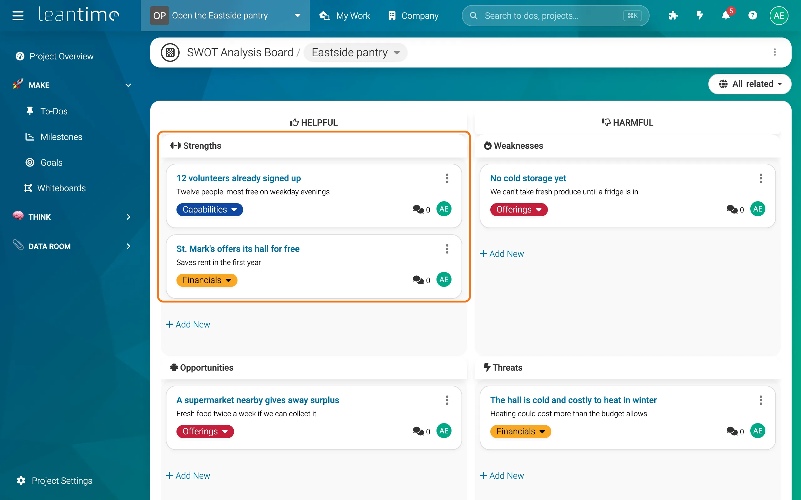

A SWOT analysis looks at where a project stands: its **Strengths** and **Weaknesses**, which are inside your team or organization, and the **Opportunities** and **Threats** around it. It helps you decide what to build on and what to protect against.

To start one, open **Think → Blueprints** in the project and click **SWOT Analysis** (see [Blueprints](/using-leantime/blueprints/)).

## What goes in each part?

The board is a 2×2 grid. The left side is **Helpful**, the right side **Harmful**.

- **Strengths** (inside, helpful): what makes success easier. An experienced team, a supporter who opens doors, a space you already have.
- **Weaknesses** (inside, harmful): what makes it harder. Missing skills, no budget for something you need, a team that's new to working together.
- **Opportunities** (outside, helpful): what could move the project forward. A partner looking for exactly what you do, a grant program, a change in what people need.
- **Threats** (outside, harmful): what could get in the way. A supplier closing, rising costs, a competing project.

Each card has a **Description** and **Data**: what backs it up.

## How do I use it?

1. **Fill it in together.** Different people see different strengths and threats.
2. **Tag each card** with **Relates to**: **Customers**, **Offerings**, **Capabilities**, **Financials**, **Markets**, **Environment** or **Firm**. The **All related** filter then shows, for example, everything about your finances.
3. **Pick what matters most.** Not every card needs action. Look for strengths you can use to take an opportunity, and weaknesses that make a threat worse.
4. **Turn the top items into work.** Open the card and use **Linked Milestone** to create a milestone for it.

A SWOT is a snapshot. Start a new board when things change, like one per year or per phase, so you can compare (see [Can I have more than one board of the same kind?](/using-leantime/blueprints/#can-i-have-more-than-one-board-of-the-same-kind)).

## Related

- [Blueprints](/using-leantime/blueprints/)
- [Risk Analysis](/blueprints/risk-analysis/): for the threats you need a plan for
- [Environment Analysis](/blueprints/environment-analysis/): for a closer look at the world around the project
