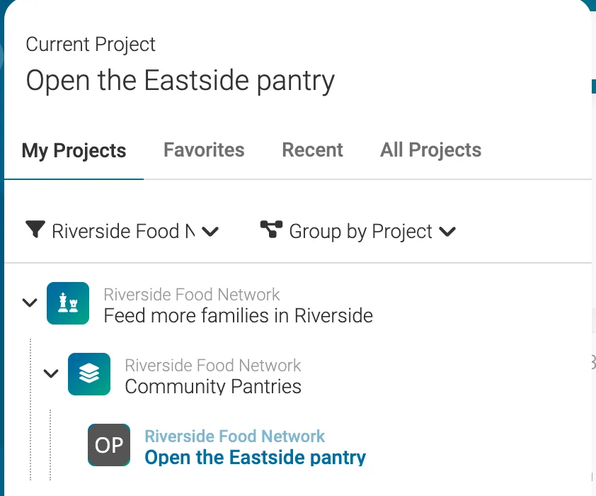

For non-profits, NGOs, charities and other mission-driven teams: the work is there to change something, funders want to see that it does, and small teams often juggle programs, volunteers and reports at once. The setup below keeps the mission at the top and the day-to-day work connected to it.

## How should a non-profit set up Leantime?

Take a food network that wants to feed more families:

| Level | Example | What it holds |
|---|---|---|
| **Strategy** | Feed more families in Riverside | The mission, the vision, and the goals that show whether it's working |
| **Program** | Community Pantries | One funded area of work, with its own dates and team |
| **Project** | Open the Eastside pantry | The work itself: milestones, to-dos and docs |

Strategies and programs come from the Leantime Strategies and Program Plans plugins when you self-host, and are included in Leantime Cloud. A small team without them can start with one project per program and add the levels above later.

## How do I build a logic model in Leantime?

A Logic Model shows how your work leads to change: the **Inputs** you invest, the **Activities** you do, the **Outputs** they produce, the **Outcomes** you expect and the **Impact** you're working toward. Funders often ask for one.

- **In core Leantime,** the Logic Model is a [Blueprint](/using-leantime/blueprints/#what-about-the-logic-model): a board you fill with cards, one per input, activity, output, outcome and impact.
- **With the Leantime Strategies plugin,** the Logic Model sits inside your strategy and adds tracking and views, so you can follow your outcomes over time.

## How do I track outcomes for funders?

- **Turn outcomes into goals with a number:** families served each month, volunteers trained, pantries open. Link each goal to the milestones that are meant to move it (see [Goals](/using-leantime/goals/)).
- **Use milestones for the stages a funder cares about,** like "Site agreed", "Volunteers trained" and "Pantry open", with the dates from your grant.
- **Post a project update** when something changes, so the board and funders' reports start from the same picture (see [Reports](/using-leantime/reports/)).

## How do volunteers, partners and funders get access?

- **Volunteers** who do the work need the **Editor** role on the projects they help with.
- **Partners or funders** who only follow along can be **Read Only** or **Commenter**. Add them to a [client](/using-leantime/managing-clients/) for their organization and set their projects to **Everyone assigned to this client**, so they see only what's theirs.

## Tips for non-profits

- **Keep grant reports simple:** for the quarter you pick, the Status Report shows the milestones finished, what's in progress and the project updates, and it prints to PDF. Its goals show where each one stands today, even for a past quarter. To show a funder how a goal moved, post a project update with the goal's number at each reporting date; the report for that period includes it.
- **Write procedures once in Docs,** like volunteer onboarding or food-safety checks, and link them to the milestone they belong to (see [Docs](/using-leantime/docs/)).
- **Small team, many hats?** Star the one or two projects you're on this week, and let the rest wait.

Back to [How should I organize my work in Leantime?](/getting-started/organize-your-work/)
