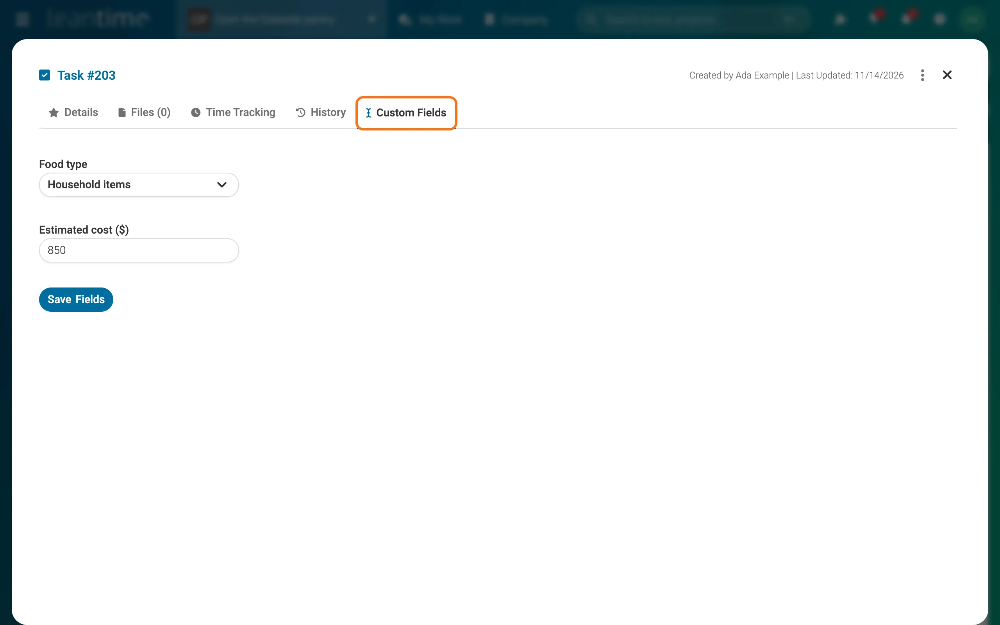

The Custom Fields plugin lets you add your own fields to to-dos, for the details your team tracks that Leantime doesn't have a field for: a budget code, a cost estimate, which client contact asked for it.

## What does it add?

- **Your own fields on to-dos:** text, longer text, numbers, a choice from a list, checkboxes, radio buttons and on/off. See [Which field types can I use?](/using-leantime/custom-fields/#which-field-types-can-i-use)
- **Fields for every project or only some:** show a field in one project, all but one, or on one to-do. See [How do I show a field only on some to-dos?](/using-leantime/custom-fields/#how-do-i-show-a-field-only-on-some-to-dos)
- **A Custom Fields tab** on each to-do, where people fill them in. See [How do I fill in custom fields on a to-do?](/using-leantime/custom-fields/#how-do-i-fill-in-custom-fields-on-a-to-do)

## Do I have it on Leantime Cloud?

Yes. Custom Fields is already on in every Leantime Cloud workspace. To start, see [How do I add a custom field?](/using-leantime/custom-fields/#how-do-i-add-a-custom-field)

## How do I install it on my own server?

- **Leantime version:** 3.13 or later. To check yours, click the **?** (help) icon at the top right; the version is under **System**.
- **Get a license:** on the Leantime Marketplace it's called [Custom Fields](https://marketplace.leantime.io/product/leantime-customfields/). The license is sized by the number of users in your Leantime (see [What counts as a user?](/installation/plugin-licenses/#what-counts-as-a-user-for-a-plugin-license)).
- **Install it** from **Company → Leantime Apps** with the license key (see [Installing from the Marketplace](/installation/plugin-installation/#installing-from-the-marketplace)), or upload it by hand (see [Manual plugin installation](/installation/plugin-installation/#manual-plugin-installation)).
- **Nothing else to set up:** Custom Fields has no settings in `.env` and no scheduled jobs. Leantime creates the plugin's tables when you install it.
- **Before you remove it:** **Remove** deletes the plugin's tables, so every field and everything people entered in them is gone. To stop using it for a while, **Disable** it instead (see [What's the difference between Disable and Remove?](/installation/plugin-licenses/#whats-the-difference-between-disable-and-remove)).

After it's on, **Custom Fields** shows under **Company**, in the **Administration** menu.

## How do I keep it up to date?

Leantime checks the marketplace for plugin updates every day and tells administrators; turn on **Update plugins automatically** in **My Apps** to have minor updates installed for you (see [How do plugin updates work?](/installation/plugin-licenses/#how-do-plugin-updates-work)). Before you update Leantime itself, check that your Custom Fields version supports the new release (see [What happens to plugins when I update Leantime?](/installation/plugin-licenses/#what-happens-to-plugins-when-i-update-leantime)).

## Who can use it?

Setting up fields needs the Admin or Owner role. Filling them in on a to-do needs the Editor role or higher in the project.

## What if something goes wrong?

- **There's no Custom Fields under Company:** check that the plugin is switched on under **Company → Leantime Apps → My Apps**, and that you're an Admin or Owner.
- **A field doesn't show on a to-do:** check its **Display Conditions**. A field with no conditions shows nowhere (see [How do I show a field only on some to-dos?](/using-leantime/custom-fields/#how-do-i-show-a-field-only-on-some-to-dos)).
- **There's no Date field type:** not yet. Custom Fields has Text, Textarea, Select, Checkbox, Radio, Number and Boolean fields (see [Which field types can I use?](/using-leantime/custom-fields/#which-field-types-can-i-use)).
- **The plugin switched itself off:** your Leantime has more users than the license allows, or the plugin kept causing errors. See [Plugin licenses, updates and problems](/installation/plugin-licenses/#what-happens-when-we-have-more-users-than-the-license-allows).

## Related

- [Custom Fields](/using-leantime/custom-fields/)
- [To-Dos](/using-leantime/task-management/)
- [Installing plugins](/installation/plugin-installation/)
- [All plugins](/installation/using-plugins/)
