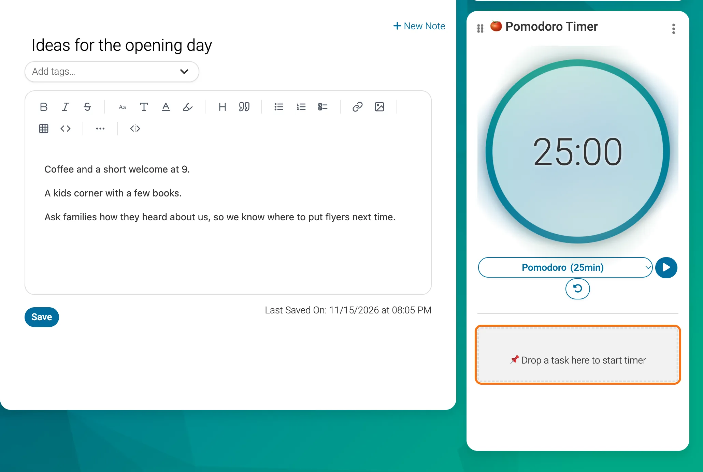

The Pomodoro technique is simple: work on one thing for 25 minutes, then take a short break. The Pomodoro plugin puts the timer on your My Work dashboard, and can log the time to the to-do you're working on.

**Get it:** [Pomodoro Timer on the Leantime Marketplace](https://marketplace.leantime.io/product/leantime-pomodoro/). It's already on in Leantime Cloud.

## How do I start a focus session?

1. **Open your [My Work dashboard](/using-leantime/my-work-dashboard/)** and find the **Pomodoro Timer** box. If it isn't there, switch it on in the Widget Manager (see [How do I add, remove or move widgets?](/using-leantime/my-work-dashboard/#how-do-i-add-remove-or-move-widgets)).
2. **Choose the length:** **Pomodoro (25min)**, **Short Break (5min)**, **Long Break (15min)**, or **Custom** for your own number of minutes.
3. **Click play.**

The countdown also shows in your browser tab, so you can see it from another tab. When the time is up, a soft alarm plays. Pause and reset are next to the play button.

The timer doesn't move on to the break by itself: choose **Short Break** or **Long Break** when you're ready for one.

**Just Breath** is a short breathing exercise, for a moment's calm between sessions.

## Can it log my time to a to-do?

Yes. Drag a to-do from **My ToDos** on the dashboard onto **Drop a task here to start timer**. Now play also starts the to-do's time tracking, and pause stops it, so your focus time ends up on the to-do's timesheet. Click pause when you stop working, so the time on the to-do stays right.

Without a to-do dropped in, the timer just counts down and logs nothing. Logging time needs time tracking to be on for the project (see [Timesheets and time tracking](/using-leantime/timesheets/)).

## Related

- [My Work Dashboard](/using-leantime/my-work-dashboard/)
- [Timesheets and time tracking](/using-leantime/timesheets/)
- [Notes](/plugins/notes/)
- [All plugins](/installation/using-plugins/)
