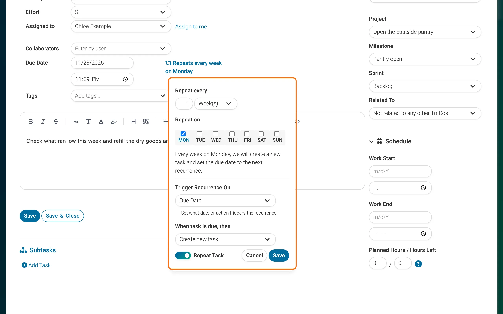

Some work comes back on a schedule: restocking every Monday, a report at the end of every month, a check-in every two weeks. The Recurring Tasks plugin repeats a to-do for you, so you set it up once instead of adding it again each time.

**Get it:** [Recurring Tasks on the Leantime Marketplace](https://marketplace.leantime.io/product/recurring-tasks/). It's already on in Leantime Cloud.

## How do I make a to-do repeat?

1. **Open the to-do** and click **Recurring** (↻), next to **Due Date**.
2. **Switch on Repeat Task.**
3. **Set Repeat every:** a number, and **Day(s)**, **Week(s)**, **Month(s)** or **Year(s)**. Every two weeks is "2 Week(s)"; every quarter is "3 Month(s)".
4. **For weeks, tick the days** under **Repeat on**. For months, choose the day of the month.
5. **Choose what starts the next one** under **Trigger Recurrence On** (see the next section).
6. **Choose what happens:** **Create new task** adds a new to-do each time; **Reset status to 'New'** reuses the same to-do.
7. **Click Save.**

The link next to **Due Date** now describes the schedule, like "Repeats every week on Monday". You also find the ↻ icon on the to-do's card on the Kanban board and in **My ToDos** on your dashboard.

Setting up a repeat needs the Editor role or higher in the project.

## When is the next to-do created?

It depends on **Trigger Recurrence On**:

| Trigger | When the next one comes |
| --- | --- |
| **Due Date** | When the next due date arrives. The copy is created then, already due, not ahead of time. |
| **Scheduled Start Date** | When the next start date arrives, counted from the to-do's **Work Start** date. |
| **Task is set to done** | Shortly after someone moves it to a Done status, so the next one only comes once this one is finished. |

The new to-do is a copy: same title, description, assignee, project and milestone, starting in **New**. Each copy shows up as a subtask of the first to-do (or of its parent, if the first to-do is a subtask itself), so the repeats stay together. With **Reset status to 'New'**, the same to-do goes back to **New** instead; with the **Due Date** or **Scheduled Start Date** trigger, its date moves to the next time too.

**On your own server:** Leantime checks for repeats in the background, every minute. If no [cron job](/installation/configuration/#cron-jobs) runs Leantime's scheduler, it only checks while someone is using Leantime, so a repeat can come a little late on a quiet day.

## How do I stop a to-do from repeating?

With **Create new task**, the schedule moves to each new copy. So open the most recent to-do in the series, click the ↻ link next to **Due Date**, switch off **Repeat Task** and click **Save**. To-dos that were already created stay. Change the schedule the same way.

Deleting the most recent to-do in the series also stops it from repeating.

## Related

- [To-Dos](/using-leantime/task-management/)
- [Custom fields](/plugins/custom-fields/)
- [All plugins](/installation/using-plugins/)
