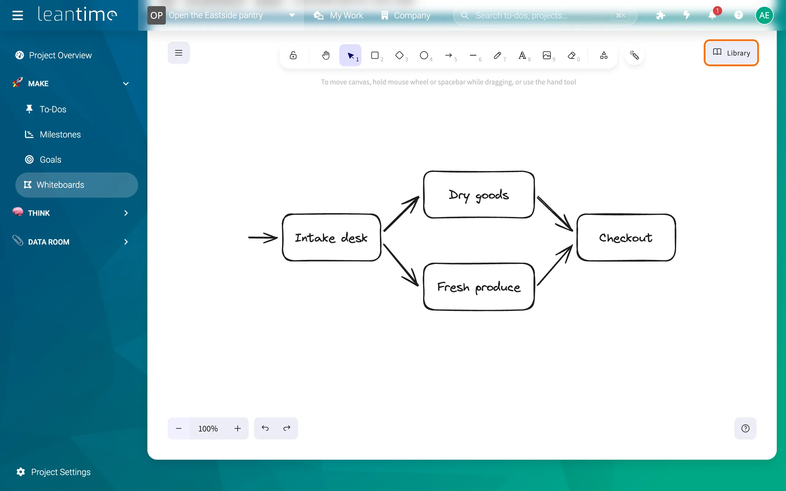
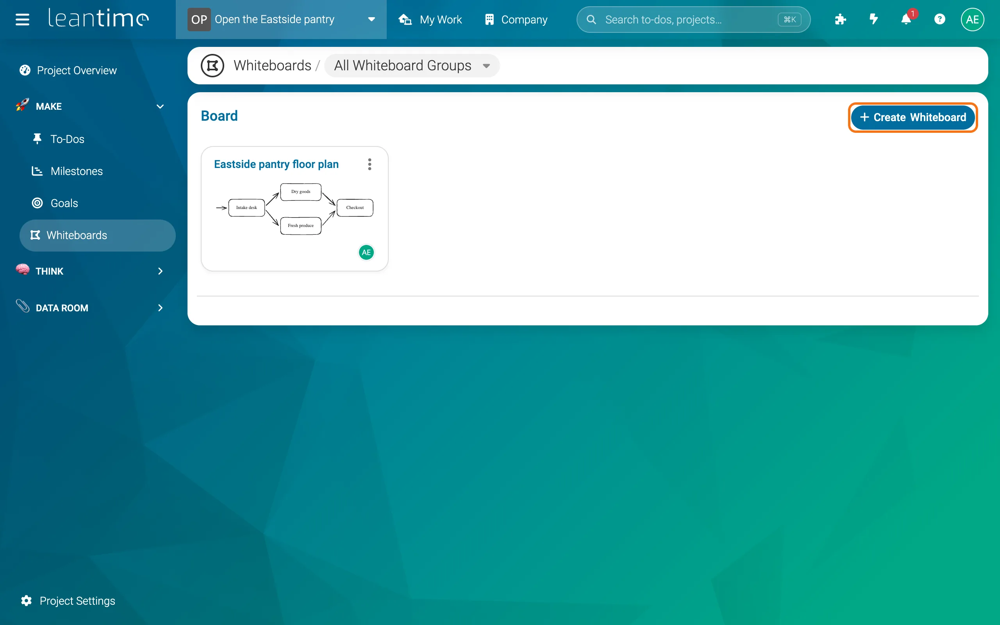

A whiteboard is a blank canvas inside a project, for anything that's easier to draw than to write: a floor plan, a process, an org chart, a rough screen layout. The Whiteboards plugin adds them to every project, and saves your drawing as you go.

The drawing tools come from [Excalidraw](https://excalidraw.com), so if you've used it before, you already know how they work.

**Get it:** [Whiteboards on the Leantime Marketplace](https://marketplace.leantime.io/product/leantime-whiteboards/). It's already on in Leantime Cloud.

## How do I create a whiteboard?

1. **Open the project** and click **Whiteboards** in the left menu, under **Make**.
2. **Click Create Whiteboard.**
3. **Enter a title** and click **Save**. The whiteboard opens, ready to draw on.

If you don't see **Whiteboards**, check that you have the Editor role or higher, and that whiteboards are switched on for the project (see [How do I switch features on or off for a project?](/using-leantime/managing-projects/#how-do-i-switch-features-on-or-off-for-a-project)).

## How do I draw on a whiteboard?

Pick a tool from the toolbar at the top: shapes, arrows, lines, a pen for freehand drawing, text, images and an eraser. Then click and drag on the canvas.

- **Write inside a shape:** select it and press **Enter**, or double-click it.
- **Join two shapes:** draw an arrow from one to the other. It stays attached when you move them.
- **Move around:** hold the space bar (or the mouse wheel) and drag, or use the hand tool. Zoom with the buttons at the bottom left.
- **Change colors and styles:** select something and use the panel that opens on the left.

Each tool's number is its keyboard shortcut: **2** for a rectangle, **5** for an arrow, **8** for text, and so on.

There's no save button. Your changes are saved a moment after you make them.

## What's in the Library?

Click **Library** at the top right for ready-made pieces to drag onto the canvas, like sticky notes, basic shapes, an org chart, decision flows, a Gantt chart, a customer journey map, wireframing kits for screens and forms, and icons for IT and software diagrams.

## How do I organize whiteboards?

Whiteboards live in groups. Each project starts with one, called **Board**.

- **To add a group,** click **All Whiteboard Groups** at the top of the Whiteboards page and choose **Create New Whiteboard Group**.
- **To rename or delete a whiteboard,** open it and use the **⋮** menu at the top right: **Edit Title** or **Delete**. Deleting needs the Editor role or higher.

## Can I export a whiteboard?

Yes. Open the menu at the top left of the canvas (☰) to save the drawing as an image, export it, or open a saved file. **Clear canvas** in the same menu removes everything from the whiteboard.

## Related

- [Blueprints](/using-leantime/blueprints/): ready-made boards like a SWOT analysis or a Lean Canvas
- [Docs](/using-leantime/docs/)
- [All plugins](/installation/using-plugins/)
