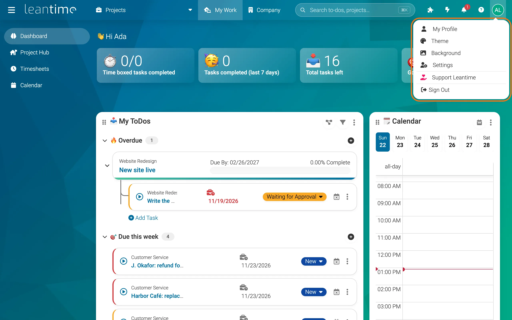
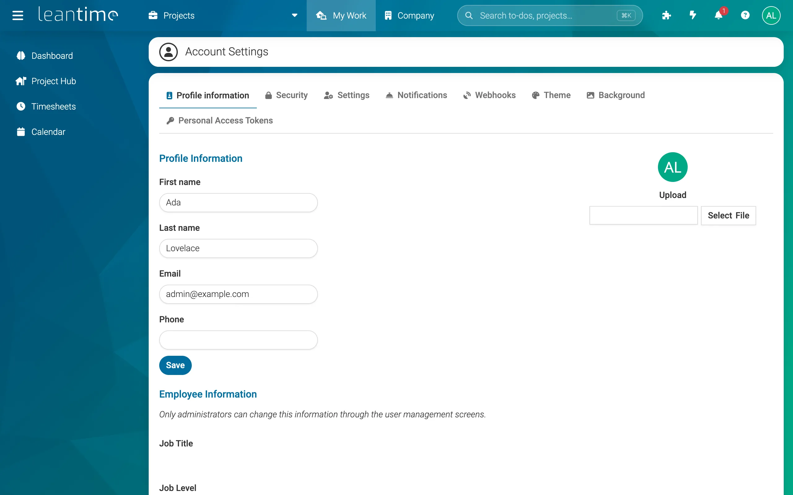
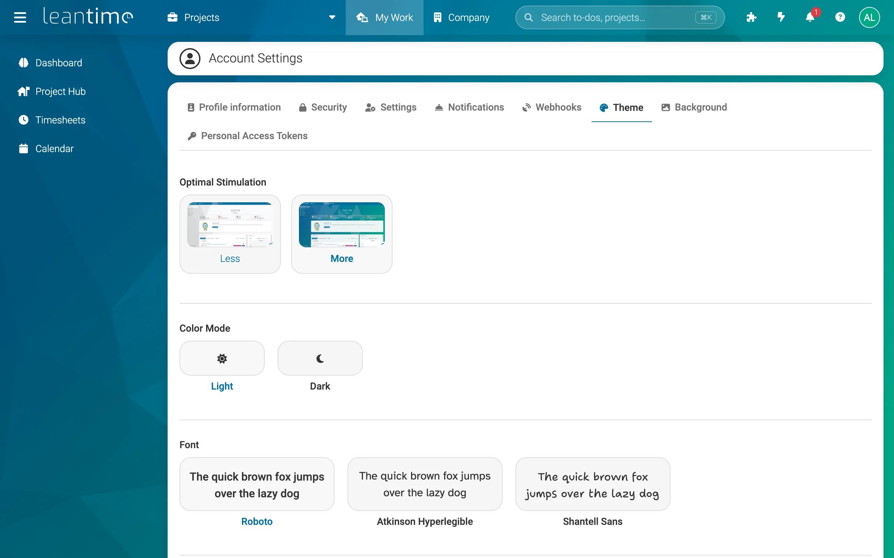

Account Settings is where you change your own details: your name, email and photo, your password and two-factor authentication, your language and time zone, how Leantime looks, and which notifications you get. Changes here only affect you.

## How do I open my account settings?

Click your profile picture (or your initials) at the top right, then **My Profile**. **Account Settings** opens. The same menu also goes straight to **Theme**, **Background** and **Settings**, and has **Sign Out**.



| Tab | What you change there |
| --- | --- |
| **Profile information** | Your name, email, phone and photo |
| **Security** | Your password and two-factor authentication |
| **Settings** | Language, date format, time format and time zone |
| **Notifications** | Which notifications you get, by email and on your phone (see [Notifications](/using-leantime/notifications/)) |
| **Webhooks** | Sending your notifications to a web address of your own (see [Can I get notifications in Slack, Teams or another tool?](/using-leantime/notifications/#can-i-get-notifications-in-slack-teams-or-another-tool)) |
| **Theme** | Light or dark mode, the font and the colors |
| **Background** | The color gradient or a picture behind your pages |
| **Personal Access Tokens** | Tokens for your own scripts and tools (see [Use the Leantime API](/api/usage/#how-do-i-create-a-personal-access-token)) |

## How do I change my name, email or photo?

Open the **Profile information** tab.



- **Name, email and phone:** change them and click **Save**. Your email is also what you sign in with, so use the new address the next time you sign in. Each email can belong to only one person in Leantime.
- **Photo:** on the right, click **Select File** and choose a JPG, PNG, GIF or WebP picture. Move and zoom it until it fits the circle, then click **Save** under it.
- **Job title, job level and department** (under **Employee Information**) are set by an administrator in [User Management](/using-leantime/user-management/#how-do-i-change-someones-role-or-details).

If your company signs you in with LDAP or single sign-on, your name, email and phone are grayed out. Change them in your company's sign-in system. If your email changes there, ask an administrator to change it in Leantime's [User Management](/using-leantime/user-management/#how-do-i-change-someones-role-or-details) before you next sign in. Leantime finds your account by email, so with the new address it refuses the sign-in or creates a second account.

## How do I change my password?

1. Open the **Security** tab.
2. Enter your **Old Password**, then your **New Password** twice.
3. Click **Save**.

A password needs at least 8 characters, with an uppercase letter, a lowercase letter, a number and a special character.

Forgot your password? Click **Forgot password?** on the sign-in page, and Leantime emails you a link to set a new one.

If your company signs you in with LDAP or single sign-on, you can't change your password here. Change it in your company's sign-in system.

## How do I turn on two-factor authentication?

Two-factor authentication asks for a code from your phone each time you sign in, so a stolen password isn't enough to get in.

1. Install an authenticator app on your phone, like Google Authenticator, Microsoft Authenticator or 1Password.
2. Open the **Security** tab and click **Manage two-factor authentication**.
3. Scan the QR code with the app. If you can't scan it, type the **Secret** under it into the app instead.
4. Enter the 6-digit code the app shows, and click **Save**.

From now on, after your password, Leantime asks for the code from the app.

To turn it off, open **Manage two-factor authentication** again and click **Remove**.

### What if I lose my phone?

Leantime has no backup codes, and an administrator can't switch two-factor authentication off for you in User Management.

- **Leantime Cloud:** email [support@leantime.io](mailto:support@leantime.io) from the address you sign in with.
- **Your own server:** an administrator with access to the database can switch it off for you. Replace the email address with yours:

  ```sql
  UPDATE zp_user SET twoFAEnabled = 0, twoFASecret = NULL WHERE username = 'you@example.com';
  ```

  Then sign in with your password and set up two-factor authentication again on your new phone.

## How do I change my language, date format or time zone?

Open the **Settings** tab, choose them and click **Save**:

- **Language:** 44 languages.
- **Date Format** and **Time Format:** how dates and times look everywhere in Leantime, like `11/22/2026` or `2026-11-22`, and `01:00 PM` or `13:00`.
- **Timezone:** the times you see and enter are in this time zone. Until you choose one, Leantime uses your company's default.

## How do I change how Leantime looks?

Open the **Theme** tab, choose and click **Save**:

- **Optimal Stimulation:** **Less** is a calmer, simpler look. **More** is the full Leantime look, with more color.
- **Color Mode:** **Light** or **Dark**.
- **Font:** **Roboto**, **Atkinson Hyperlegible** (made to be easy to read, with letters that are hard to mix up) or **Shantell Sans** (a friendly, handwritten look).
- **Color Scheme:** Leantime's colors, your company's colors (**Company Colors**), or one of 13 other schemes.



To change what's behind your pages, open the **Background** tab. Choose the **Color gradient** of your color scheme, or upload a picture (JPG, PNG, GIF or WebP).

Each person picks their own look; it doesn't change what anyone else sees.

## What if something goes wrong?

- **The fields are gray and won't change:** your company signs you in with LDAP or single sign-on. Change your details in that system. If that changes your email, have an administrator change it in Leantime first, before you sign in again.
- **"Old password is incorrect":** check the **Old Password**. If you've forgotten it, sign out and use **Forgot password?** on the sign-in page.
- **The new password isn't accepted:** it needs at least 8 characters, with an uppercase letter, a lowercase letter, a number and a special character.
- **"This email address is already used" or "Not a valid email address":** someone else in your Leantime already has that email, or there's a typo in it.
- **The code from the app isn't accepted:** check that your phone's time is set automatically. The codes depend on the time.

## Related

- [Notifications](/using-leantime/notifications/)
- [Use the Leantime API](/api/usage/)
- [User Management](/using-leantime/user-management/)
- [Leantime on your phone](/using-leantime/mobile-app/)
