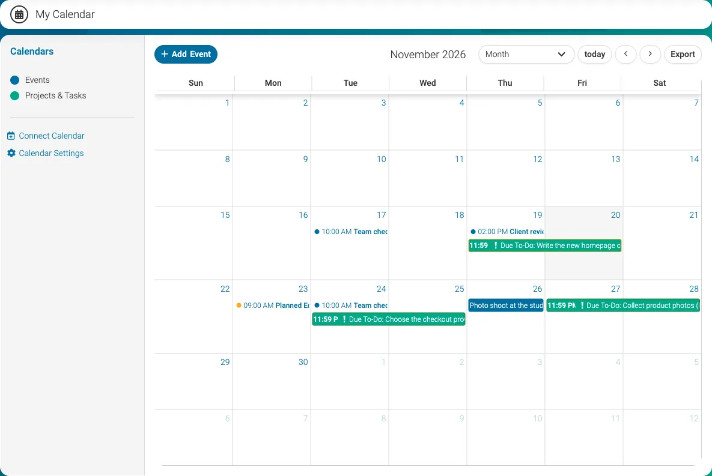
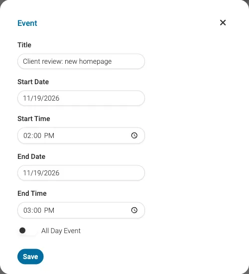
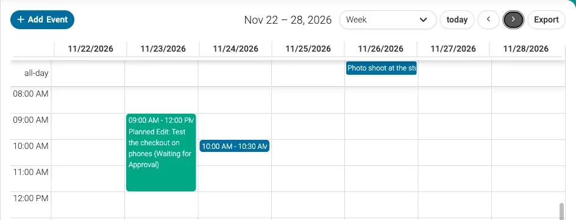
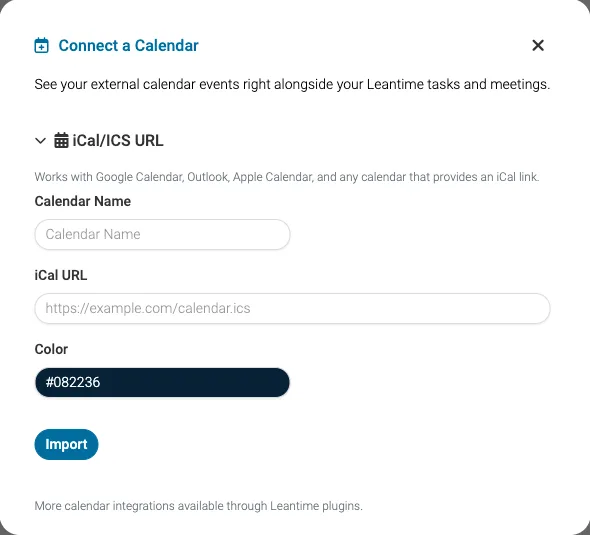
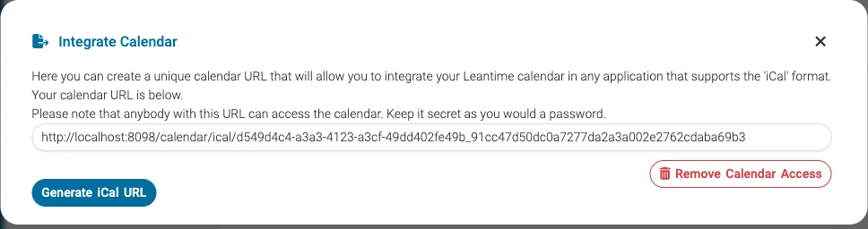

My Calendar shows your own events and your to-dos from every project in one place: when each one is due, and when you've planned to work on it. You can bring in your Google, Outlook or Apple calendar, and subscribe to your Leantime calendar from those apps.

## How do I open my calendar?

Click **My Work** at the top, then **Calendar** in the left menu. Everyone has their own calendar; nobody else sees your events.

Two other places show a calendar:

- **The Calendar widget on My Work** is for planning your day: drag a to-do onto it to block time for it (see [How do I plan my day with the Calendar widget?](/using-leantime/my-work-dashboard/#how-do-i-plan-my-day-with-the-calendar-widget)).
- **A project's milestones** have a **Calendar** tab next to **Timeline** and **Table** (see [Milestones](/using-leantime/roadmap-planning/)). It shows that project's milestones, not your personal events.

## What's on my calendar?

| What | How it looks |
| --- | --- |
| **Your events** | Your own events, in the color shown next to **Events** in the left panel |
| **To-dos with a due date** | "❕ Due To-Do:" with the to-do and its status, on its due date |
| **Planned work** | "Planned Edit:" across the to-do's **Work Start** and **Work End** dates or times |
| **Connected calendars** | Each in the color you chose for it |

To-dos show when you're assigned to them or a collaborator on them, in every project, done ones included. Their border has the color of their status. Click a to-do to open it.

## How do I add an event?

1. **Click Add Event** at the top of the calendar.
2. **Enter a Title.**
3. **Choose the Start Date and Start Time, then the End Date and End Time.** For something that takes the whole day, switch on **All Day Event** instead of setting times.
4. **Click Save.**

An event has a title and a time, and that's all: there's no description, location, guest list or repeat. For meetings with other people, use the calendar you already invite them from, and [connect it](#how-do-i-see-my-google-outlook-or-apple-calendar-in-leantime) so they show here too.

## How do I change or move something on the calendar?

- **Change or delete an event:** click it, change the details and click **Save**, or click **Delete**.
- **Move an event:** drag it to another day or time. Drag its bottom edge to make it longer or shorter.
- **Move a due date:** drag a **Due To-Do** to another day. This changes the to-do's due date.
- **Move planned work:** drag a **Planned Edit**. This changes the to-do's **Work Start** and **Work End**.

Events from connected calendars can't be moved here; change them in their own calendar.

## How do I plan time for a to-do?

Give it a **Work Start** and **Work End** on the to-do, or drag it from **My ToDos** onto the Calendar widget on [My Work](/using-leantime/my-work-dashboard/). Either way it shows on your calendar as a **Planned Edit** block, and you can drag the block to another time.

## How do I see my Google, Outlook or Apple calendar in Leantime?

Connect it with its iCal link, so your meetings show next to your to-dos.

1. **Copy your calendar's iCal link:**
   - **Google Calendar:** open **Settings**, choose the calendar under **Settings for my calendars**, and copy **Secret address in iCal format**.
   - **Outlook:** in Outlook on the web, open **Settings → Calendar → Shared calendars**, publish the calendar under **Publish a calendar**, and copy the **ICS** link.
   - **Apple Calendar (iCloud):** share the calendar as a **Public Calendar** and copy its link. A `webcal://` link works too.
2. **In Leantime, click Connect Calendar** in the left panel of My Calendar.
3. **Fill in a Calendar Name, paste the iCal URL, and pick a Color.**
4. **Click Import.**

The calendar appears in the left panel with its color. Leantime reads it again every 30 minutes or so, and only shows it: change its events in their own app.

To rename a connected calendar, change its link or color, or remove it, use the **…** menu next to it, or **Calendar Settings** in the left panel.

## How do I see my Leantime calendar in Google, Outlook or Apple Calendar?

1. **Click Export** at the top of My Calendar. The **Integrate Calendar** dialog opens.
2. **Click Generate iCal URL** and copy the address that appears.
3. **Add it to your calendar app as a subscription:**
   - **Google Calendar:** next to **Other calendars**, click **+**, then **From URL**.
   - **Outlook:** **Add calendar → Subscribe from web**.
   - **Apple Calendar:** **File → New Calendar Subscription**.

The subscription has your events, your due to-dos (with a reminder 30 minutes before) and your planned work (with a reminder 5 minutes before). Calendars you connected from elsewhere aren't included. Calendar apps check subscriptions on their own schedule, so changes can take a few hours to show up in Google Calendar.

**Keep the address private:** anyone who has it can see your calendar, without signing in. If it got out, click **Generate iCal URL** again: the new address replaces the old one, which stops working. **Remove Calendar Access** turns the address off completely.

## Which views can I use?

Choose **Day**, **Week**, **Month** or **Year** in the menu at the top. **today** jumps back to the current date, and the arrows move back and forward. Leantime remembers the view you used last.

Times show in the time zone in your profile (**My Profile → Settings → Timezone**), not your computer's.

## Who can use the calendar?

Everyone has a calendar and sees their own to-dos on it. Adding events and connecting calendars needs the Editor role or higher. Your events and connected calendars are yours only: other people don't see them, not even in shared projects.

## What if something goes wrong?

- **A connected calendar shows no events:** the link has to be an iCal (`.ics`) address. Open it in your browser: it should download a file, not show a sign-in page. For Google, use the **Secret address in iCal format**, not the public or embed link. After you fix the link, events can take up to 30 minutes to appear.
- **My calendar app stopped updating:** someone clicked **Generate iCal URL** again, which replaced the old address. Subscribe again with the new one.
- **Events are at the wrong time:** check **Timezone** under **My Profile → Settings**.
- **A to-do isn't on my calendar:** it needs a due date or a **Work Start**, and you need to be assigned to it or a collaborator on it.

## Related

- [My Work Dashboard](/using-leantime/my-work-dashboard/)
- [To-Dos](/using-leantime/task-management/)
- [Milestones](/using-leantime/roadmap-planning/)
- [Notifications](/using-leantime/notifications/)
