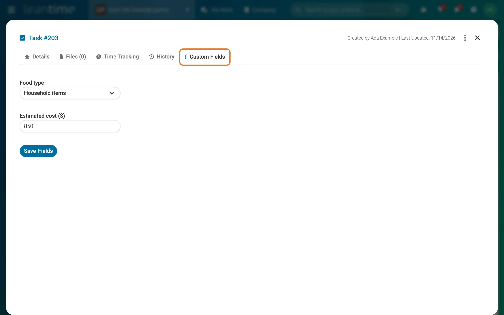
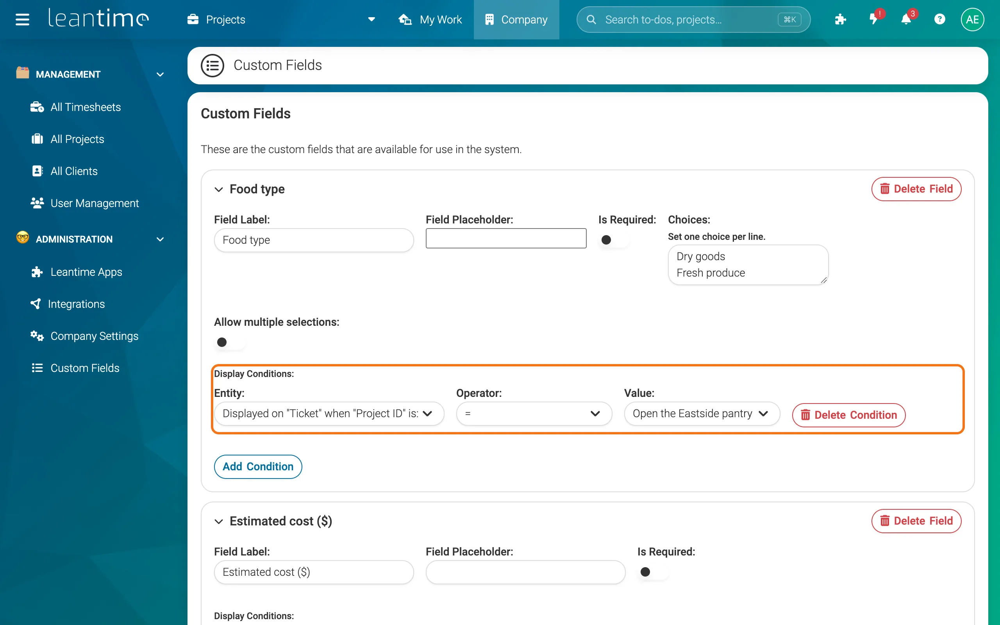

Every team tracks something Leantime doesn't have a field for: a budget code, a cost estimate, which client contact asked for it. The Custom Fields plugin lets you add your own fields to to-dos, for every project or only the ones that need them.

Custom fields come with the [Custom Fields](/plugins/custom-fields/) plugin. On Leantime Cloud it's already on; on your own server, see [Custom Fields](/plugins/custom-fields/) to install it.

## How do I add a custom field?

Custom fields are set up once for your whole Leantime, by an Admin or Owner.

1. **Click Company** at the top of the page, then **Custom Fields** under **Administration** in the left menu.
2. **Choose the Field Type** and click **Add Field**.
3. **Fill in the Field Label**: the name people see on the to-do, like "Estimated cost ($)".
4. **Optional:** add a **Field Placeholder** (example text shown in an empty field), and switch on **Is Required**.
5. **For a dropdown, checkboxes or radio buttons,** type the **Choices**, one per line. A dropdown can also **Allow multiple selections**.
6. **Choose where it shows** under **Display Conditions** (see the next section).
7. **Click Save Fields.**

## Which field types can I use?

| Field Type | What people enter |
| --- | --- |
| **Text Field** | A short line of text |
| **Textarea Field** | Longer text |
| **Number Field** | A number |
| **Select Field** | One choice from a dropdown, or several if you allow multiple selections |
| **Checkbox Field** | Any of the choices, as checkboxes |
| **Radio Field** | One of the choices, as radio buttons |
| **Boolean Field** | On or off |

## How do I show a field only on some to-dos?

**Display Conditions** decide which to-dos a field appears on. A new field starts with one condition that shows it on every to-do.

- **Only in one project:** set **Entity** to the project option (it reads "when Project ID is"), keep **=**, and pick the project under **Value**.
- **In every project except one:** the same, with **!=**.
- **On one particular to-do:** set **Entity** to the to-do option (it reads "when Ticket ID is") and pick the to-do.
- **On every to-do:** set **Value** to **Any**.

Click **Add Condition** for more than one. A field shows wherever any of its conditions match. If you delete all of a field's conditions, it doesn't show anywhere.

## How do I fill in custom fields on a to-do?

1. **Open the to-do** and click the **Custom Fields** tab at the top.
2. **Fill in the fields** and click **Save Fields**.

Custom fields are on the to-do's **Custom Fields** tab only. They aren't on the form for a new to-do, so save the to-do first, and they don't show in the to-do lists or in exports. Filling them in needs the Editor role or higher in the project.

## What happens when I delete a field?

Click **Delete Field** on the Custom Fields page. Leantime asks first, because deleting a field also deletes everything people entered in it, on every to-do.

When you copy a project, fields that show only in the original project also show in the copy.

## Related

- [Custom Fields: install and set up](/plugins/custom-fields/)
- [To-Dos](/using-leantime/task-management/)
- [Repeating to-dos](/using-leantime/task-management/#how-do-i-make-a-to-do-repeat)
- [All plugins](/installation/using-plugins/)
