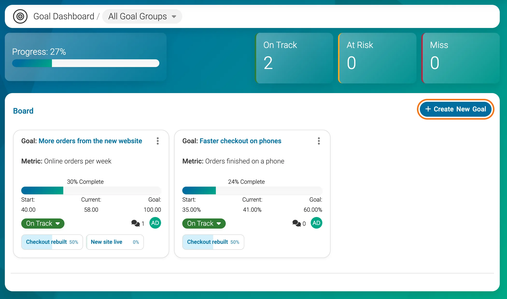
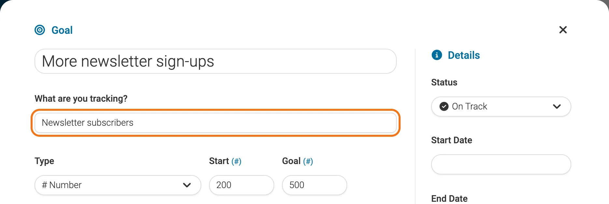
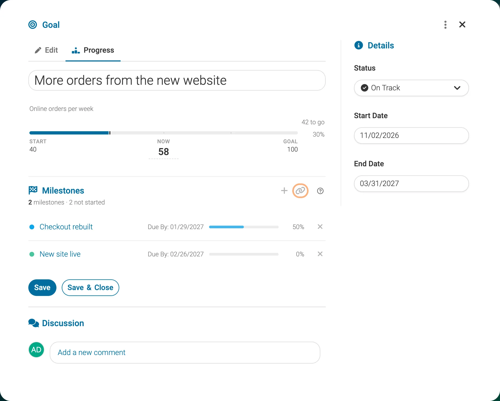
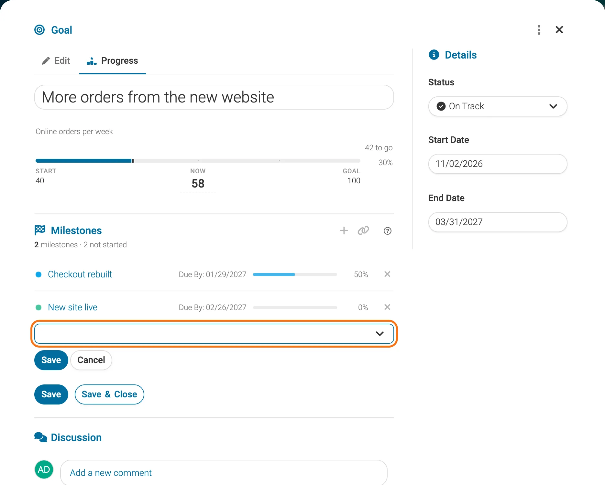
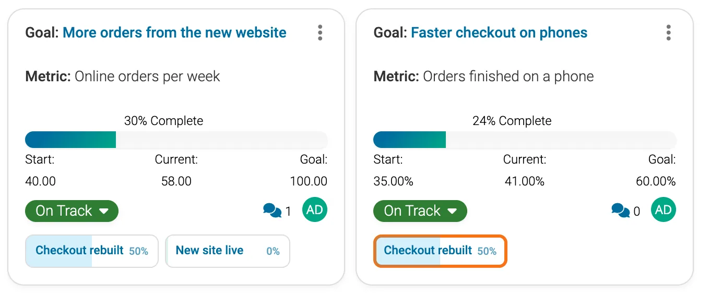
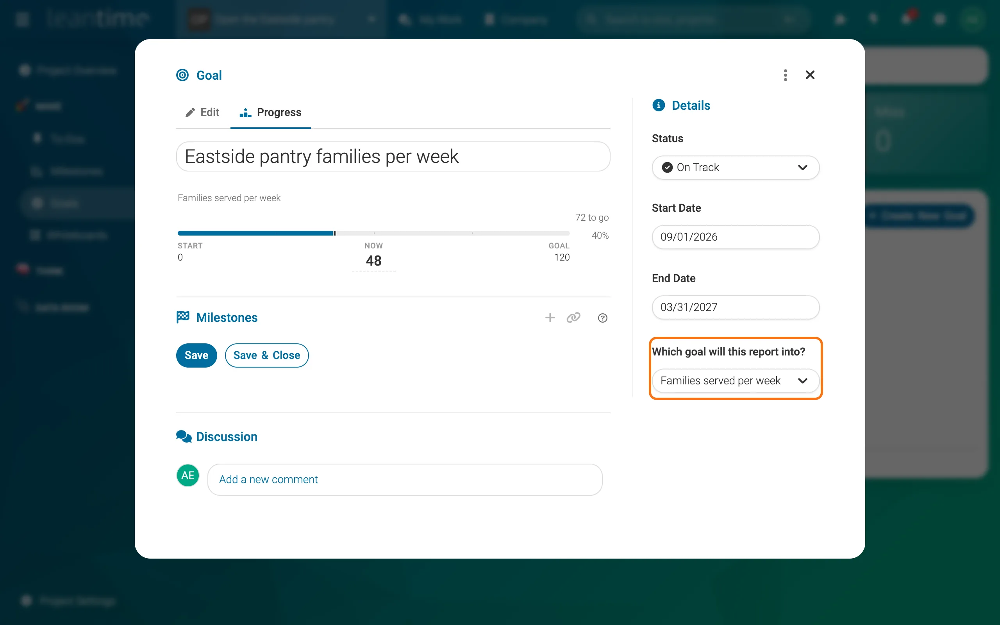

A goal is a result you can measure: a number you want to reach, like "100 online orders a week by March". Milestones and to-dos are the work. A goal tells you whether that work is getting you where you want to go.

Goals keep the reason for the work in view. Big results take time, and it's easy to lose track of why a to-do matters. When the number on a goal moves, you can see the work adding up.

## How do I create a goal in Leantime?

1. **Open the project** and click **Goals** in the left menu. The **Goal Dashboard** opens. If you don't see Goals, it may be switched off for this project (see [How do I switch features on or off for a project?](/using-leantime/managing-projects/#how-do-i-switch-features-on-or-off-for-a-project)).
2. **Click Create New Goal.**

   

3. **Name your goal:** the result you want, in a few words.
4. **Fill in What are you tracking?:** the thing you count, like "Newsletter subscribers" or "Online orders per week".
5. **Choose the Type:** **# Number**, **% Percent** or **$ Currency**. Then enter **Start**, where you are today, and **Goal**, where you want to be.
6. **Optional: add dates.** Set a **Start Date** and **End Date** under **Details**.
7. **Click Save.**

   

After you save, the goal opens on its **Progress** tab. Set **Now** to where you are today: click the number under **NOW**, type it and click **Save**.

## How do I update a goal's progress?

1. **Open the goal** by clicking its name on the Goal Dashboard.
2. **On the Progress tab, click the number under NOW** and type the new value.
3. **Click Save.**

The bar shows how far you've come from **Start** toward **Goal**, and how much is still to go. For example, a goal that starts at 40 orders a week and aims for 100 is 30% done at 58.

**Status** (**On Track**, **At Risk** or **Miss**) is yours to set, under **Details** or with the status button on the goal's card. It doesn't change by itself, so it says what the team thinks, not just what the number says.

## How do I link a goal to milestones?

A milestone is a group of to-dos with a due date: a step on the way to a goal (see [Milestones](/using-leantime/roadmap-planning/)). Linking milestones to a goal shows which work is meant to move its number.

A goal can link to as many milestones as it needs, and one milestone can count toward several goals. Rebuilding the checkout, for example, can serve both "More orders from the new website" and "Faster checkout on phones".

1. **Open the goal** and go to the **Progress** tab.
2. **Under Milestones, click the link button** ("Link one you already have"). To make a new milestone instead, click **+**, type its name and click **Save**.

   

3. **Choose the milestone** from the list and click **Save**. Repeat for each milestone.

   

The goal now lists each linked milestone with its due date and progress, and a count of how many are not started, in progress or done. On the Goal Dashboard, each goal card shows its milestones too.

To unlink a milestone, click the **×** at the end of its row. The milestone and its to-dos stay as they are.

On a goal, a milestone's progress counts each of its to-dos by effort. Reports also weigh in priority, so the same milestone can show a slightly different percentage there (see [How does Leantime calculate progress?](/using-leantime/reports/#how-does-leantime-calculate-progress)).

### Why doesn't finishing a milestone change the goal's number?

Because they measure different things. A milestone's progress is the work: how many of its to-dos are done. The goal's number is the result: orders, sign-ups, people reached. Seeing both side by side tells you whether finished work is actually moving the result. If milestones are done and the number hasn't moved, that's worth talking about.

## Where do I see all my goals at once?

The **Goal Dashboard** (click **Goals** in the left menu) shows every goal in the project, the overall progress, and how many goals are **On Track**, **At Risk** or **Miss**.

## Can I group goals?

Yes. Goals sit on boards, and Leantime calls each board a **Big Rock**: a big priority with its own goals, like "Grow online sales" or "Q1". To add one, open a board by clicking its name on the Goal Dashboard, open the menu next to **Goals** at the top, and click **Create a new Big Rock**. On the Goal Dashboard, **All Goal Groups** lets you show one board at a time.

## Can a project goal count toward a bigger goal?

Yes, with the [Strategy Pro](/plugins/strategy-pro/) plugin. A project goal can report into a goal of your organization's [strategy](/using-leantime/strategies/), so the strategy's number moves as your projects make progress, and nobody has to add it up by hand.

1. **Open the goal in the project.**
2. **Under Which goal will this report into?, pick the strategy goal.** The list shows each goal by its metric.
3. **Click Save.**

The list only offers goals of the strategy the project belongs to (directly or through its [program](/using-leantime/programs/)), and only goals that allow linking. Whether the strategy goal adds up the project numbers or is updated by hand is set on the strategy goal (see [How do my projects' goals count toward the strategy?](/using-leantime/strategies/#how-do-my-projects-goals-count-toward-the-strategy)).

## What if something goes wrong?

- **I don't see Goals in the left menu.** Goals may be switched off for this project on the **Modules** tab of **Project Settings**.
- **I can't add or change goals.** Creating and changing goals needs the **Editor** role or higher in the project.
- **The milestone I want isn't in the list.** It belongs to another project. A goal can only link to milestones in its own project.
