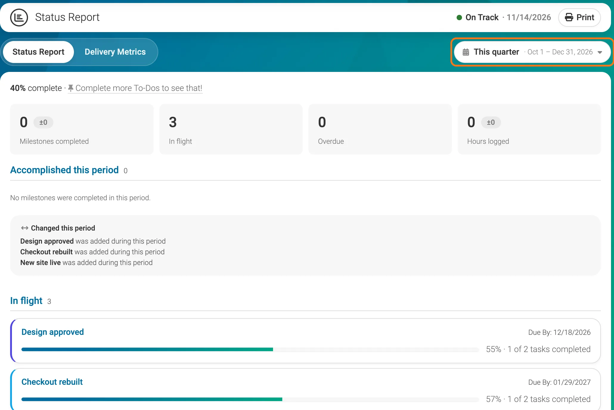
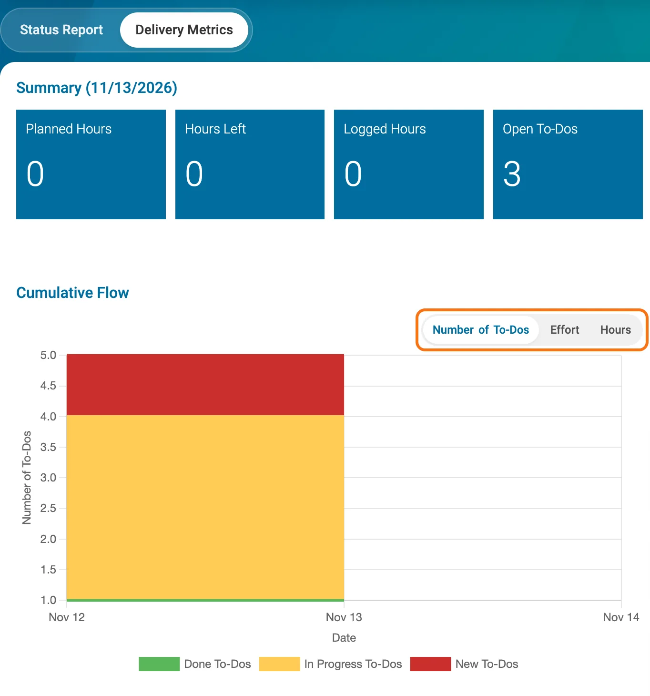
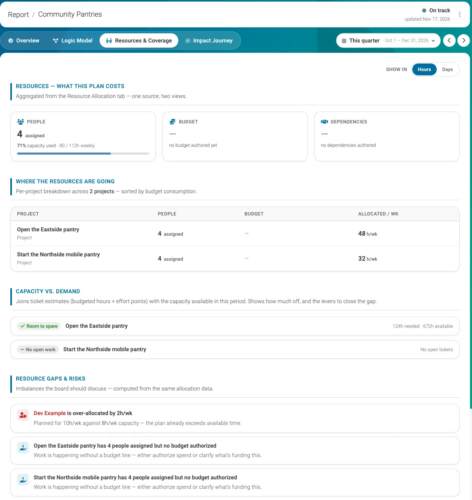

Reports answer "how is this project going?" in one place: what got done, what's in progress, what's coming, and whether the goals are moving. Use them for a weekly check-in, a client update or a board meeting, or just to see your progress add up.

## How do I see a project's report in Leantime?

Open the project, open **Data Room** in the left menu and click **Reports**. The **Status Report** opens first. The second tab, **Delivery Metrics**, has the numbers behind the work.

## What's in the Status Report?

**At the top:** the project's status from its latest [project update](/using-leantime/managing-projects/#whats-on-the-project-overview) (**On Track**, **At Risk** or **Off Track**) and a **Print** button.

**The period.** The report covers one period at a time. Choose it at the top right: **last quarter**, **this quarter**, **next quarter**, or your own dates.

**The numbers:** how much of the project is done, then **Milestones completed**, milestones **In flight**, **Overdue** milestones and **Hours logged** in the period. The small badge next to a number shows the change from the period before.

**The sections below them:**

- **Needs attention** appears when something needs a look, like an overdue milestone or a goal at risk.
- **Accomplished this period:** the [milestones](/using-leantime/roadmap-planning/) finished in the period. This is the part to share when someone asks what got done.
- **Changed this period:** milestones that were added during the period, or whose due date moved out of it. It keeps the report honest about plans that changed.
- **In flight:** the milestones being worked on, with their due dates and how far along they are.
- **Coming up:** milestones planned for the periods after this one.
- **Goals & KPIs:** each [goal](/using-leantime/goals/) with its number, its progress and the milestones linked to it. Goals show where they stand today, whichever period you pick.
- **Status updates:** the project updates posted in the period.

## What's in Delivery Metrics?

- **Summary:** planned hours, hours left, logged hours and open to-dos.
- **Cumulative Flow:** how many to-dos were new, in progress and done on each day. Switch between **Number of To-Dos**, **Effort** and **Hours** above the chart. A band that keeps growing while **Done** stays flat means work is piling up.
- **Sprint Burndown:** when the project has [sprints](/using-leantime/sprints/#how-do-i-follow-a-sprints-progress), the work left in the sprint you pick, day by day.
- **Project Progress:** done and open to-dos as a ring.
- **Milestones:** each milestone's due date and progress.

Planned and logged hours only show numbers when the team plans and [tracks time](/using-leantime/timesheets/) on their to-dos.

How a to-do counts as new, in progress or done comes from its status's **Report As** setting (see [How do I change the to-do statuses?](/using-leantime/managing-projects/#how-do-i-change-the-to-do-statuses)).

## How does Leantime calculate progress?

Progress shows up in several places, and they don't all count the same way, because each answers a slightly different question. In all of them, a to-do counts as done when its status's **Report As** setting is **Done**.

| Where you see it | What it answers | How it's counted |
|---|---|---|
| **Project progress:** the Project Overview, the Project Hub cards, "% complete" at the top of the Status Report and the ring in Delivery Metrics | How much of the project's work is done? | Each to-do counts by its **effort**. A to-do without an effort counts as the project's average effort. Milestones themselves don't count. |
| **Milestone progress in Reports** and on the Milestones timeline | How much of this milestone's work is done, counting urgent work more? | Each to-do counts by its **effort × priority**: Critical ×2, High ×1.75, Medium ×1.5, Low ×1.25, Lowest ×1. A to-do without an effort counts as 3, without a priority as Medium. In the Status Report, a milestone that is itself set to Done counts as 100%. |
| **Milestone progress on a goal:** the goal's Progress tab and its card | How much of the work behind this goal is done? | Each to-do counts by its **effort** only. A to-do without an effort counts as 3. |
| **Goal progress** | How far has the number moved? | (Now − Start) ÷ (Goal − Start). A goal from 40 to 100 is 30% done at 58. |

**An example.** The milestone "Checkout rebuilt" has two to-dos, neither with an effort set. The finished one is **Critical**, the open one **Medium**.

- On the goal, it shows **50%**: each to-do counts 3, and 3 of 6 is done.
- In the Status Report, it shows **57%**: the finished to-do counts 3 × 2 = 6, the open one 3 × 1.5 = 4.5, and 6 of 10.5 is done.

Both are right: the report gives more weight to the urgent to-do that's already finished.

**The estimated finish date.** Once 10 or more to-dos in the project are done, Leantime estimates when the project will be finished from how fast work has been getting done since the first to-do. Until then, the top of the Status Report says "Complete more To-Dos to see that!".

## What's in a program or strategy report?

The reports above cover one project. A [program](/using-leantime/programs/) and a [strategy](/using-leantime/strategies/) each have a **Report** that covers everything under them, for your leadership, board or funders. They come with the [Programs](/plugins/programs/) and [Strategy Pro](/plugins/strategy-pro/) plugins; the strategy report is in beta. They're put together from the work underneath, so there's nothing extra to fill in.

1. **Click Report** in the program's or strategy's menu.
2. **Pick the period** at the top right: **Last quarter** (the default), **This quarter** or **Next quarter**. The arrows step back and forward.
3. **Switch between the four tabs:**

| Tab | What it shows |
| --- | --- |
| **Overview** | Milestones completed, goals on track, overdue milestones and hours logged in the period, each with **See list**. **Peak this period** picks a completed milestone worth showing, **Needs attention** lists things like projects with no update in 30 days, and **What the team is saying** shows the latest status updates. In a strategy, **Theory health** shows how strong each link of the [Logic Model](/blueprints/logic-model/) is. |
| **Logic Model** | What you believe will happen, what the outputs are producing, how each outcome is doing, what it's all for, and where it's most at risk. It reads the program's or strategy's Logic Model; until that has cards, the tab shows how to start one. |
| **Resources & Coverage** | People and capacity from the programs' [Resources](/using-leantime/programs/#how-do-i-plan-peoples-time-with-resources) plans: how much of everyone's time is booked, a row per project (or per program, in a strategy), the work still to do against the time available, and gaps to discuss, like someone booked past their hours. **Show in** switches between hours and days. |
| **Impact Journey** | Where things stood before the work, how far each outcome has come against its target, and the change you're working toward. |

At the top right, the report says **On track**, **At risk** or **Off track**. It comes from the latest status update on the program or strategy, or, without one, from its goals; the line under it says which. Open the menu (⋮) to set it yourself under **Set verdict**, go back to the calculated one with **Revert to metrics**, or **Print** the report or save it as a PDF.

**To get the most out of it:** post status updates on the program or strategy, give goals a target and link them to the Logic Model's outcomes, keep the **Resources** plan current, and fill in **The world today, before this work** on the Logic Model's Impact card.

## How do I share a report?

Click **Print** at the top of the Status Report. Your browser's print window opens, where you can print it or save it as a PDF to send.

## What if something goes wrong?

- **I don't see Reports in the left menu.** Reports may be switched off for this project on the **Modules** tab of **Project Settings** (see [How do I switch features on or off for a project?](/using-leantime/managing-projects/#how-do-i-switch-features-on-or-off-for-a-project)).
- **The top of the report says "No update".** Nobody has posted a project update yet. Post one on the Project Overview with **Update Status**.
- **Done to-dos don't count as done.** Check the **Report As** setting of the status they're in.
- **Hours show 0.** No time was logged on this project's to-dos in the period you picked; check the timesheets for those dates (see [Time tracking](/using-leantime/timesheets/)). If Time tracking is switched off for the project, nobody can log new time, but hours logged earlier still count.
