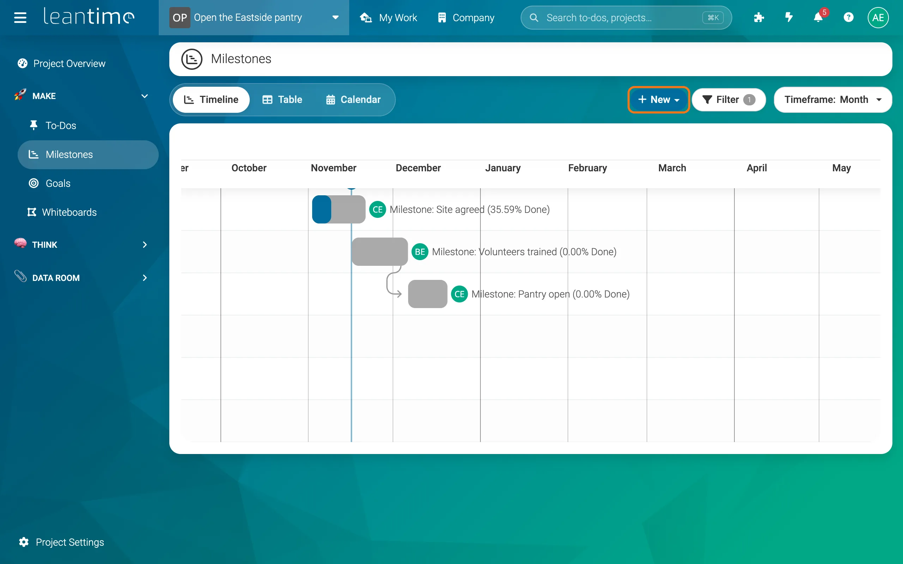
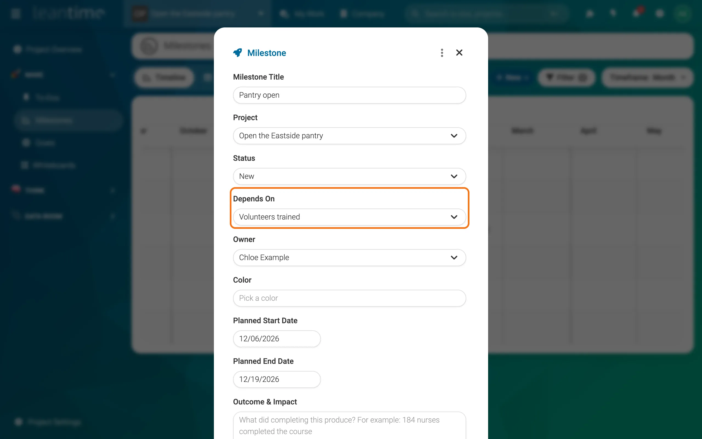

A milestone is a stretch of work with a clear result: something you can point to when it's done, like "Site agreed", "Volunteers trained" or "Pantry open". It has a start date, an end date and an owner, and the to-dos that get it done. Milestones turn a long project into steps, and show everyone where the project stands.

Goals and milestones work together. A goal says what you want to change and how you'll measure it; milestones are the work that gets you there. See [Goals](/using-leantime/goals/).

## How do I create a milestone?

1. **Open the project** and click **Milestones** in the left menu, under **Make**.
2. **Click New**, then **Add Milestone**.
3. **Fill in the milestone:**
   - **Milestone Title:** name the result, not the period. "Volunteers trained" says more than "Phase 2".
   - **Status**
   - **Depends On:** the milestone that has to finish first, if there is one (see below).
   - **Owner:** the person who keeps it moving. They don't need to do all the work.
   - **Color:** the color of its bar on the timeline.
   - **Planned Start Date** and **Planned End Date**
   - **Outcome & Impact:** what finishing it produced, for example "12 volunteers trained". You can fill this in when it's done.
4. **Click Save.**

Creating and changing milestones needs the Editor role or higher.

## How do I add to-dos to a milestone?

Open a to-do and choose the milestone in its **Milestone** field. You can also change it from the milestone label on the to-do's card on the Kanban board.

To see the to-dos of one milestone, use **Filter → Milestone** on the To-Dos page. To see them all side by side, use **Group By → Milestone** on the Kanban board.

## How do I see and change the timeline?

**Milestones** has three views, at the top of the page:

- **Timeline:** each milestone as a bar across the calendar. **Timeframe** zooms between **Day**, **Week** and **Month**.
- **Table:** the milestones in a list, with their status, owner, dependency, dates and progress, and their planned, remaining and logged hours.
- **Calendar:** the milestones on a month calendar.

On the timeline, drag the ends of a bar to change its dates, or drag the bar to move it. Leantime saves the new dates right away. To show the to-dos on the timeline too, switch on **Show Tasks** under **Filter**.

Leantime opens the view you used last.

## What does "Depends On" do?

**Depends On** says that this milestone waits for another one. On the timeline, an arrow goes from the first milestone to the one that depends on it.

It's a reminder, not a rule: Leantime doesn't stop you from planning a milestone before the one it depends on. Check the arrows when you move dates.

## How is a milestone's progress worked out?

The timeline shows progress as **(N% Done)** after each milestone's name, and the bar fills up as it grows.

Progress counts the to-dos in the milestone, weighted by their effort and priority: a large, high-priority to-do counts for more than a small, low-priority one. A to-do counts as done when it's in a status of the **Done** type. To-dos without an effort set get a default weight.

## How do I link milestones to goals?

From the goal: open the goal, go to its **Progress** tab, and under **Milestones** click **New milestone** or **Link one you already have**. A goal can have several milestones, from the same project. See [Goals](/using-leantime/goals/).

## What makes a good milestone?

- **A result you can show.** At the end, you should have something to present: a signed lease, a trained team, an open door.
- **A few weeks to a few months long.** Longer than that, split it.
- **Enough to-dos to get there, and no more.** If a milestone gathers dozens of to-dos, it's probably two milestones.
- **One owner.** Someone who notices when it stalls.

For the ideas behind milestones, phases and timelines, see [Phases of a project](/knowledge-base/phasesofproject/).

## Related

- [To-Dos](/using-leantime/task-management/)
- [Goals](/using-leantime/goals/)
- [Reports](/using-leantime/reports/): progress per milestone
- [Time tracking](/using-leantime/timesheets/)
