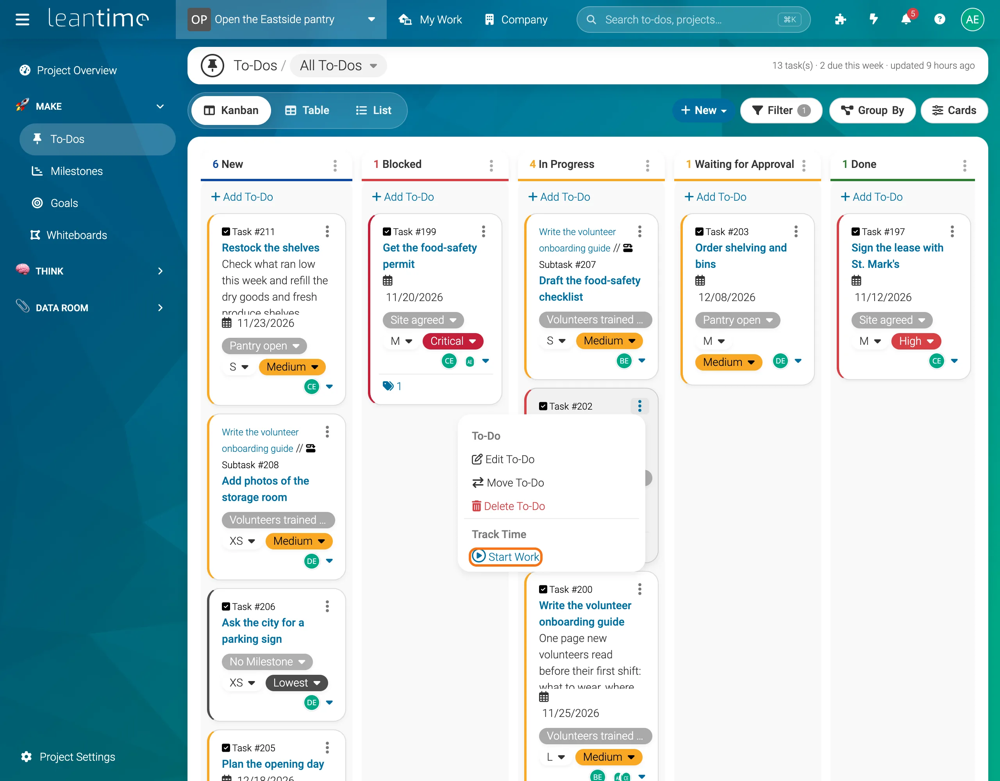
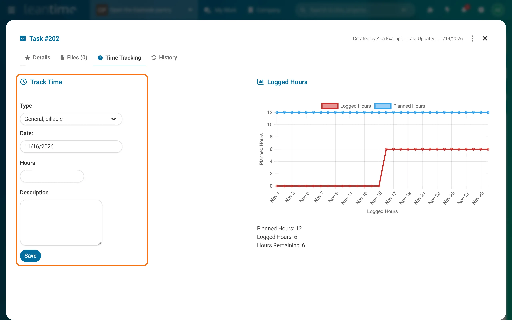
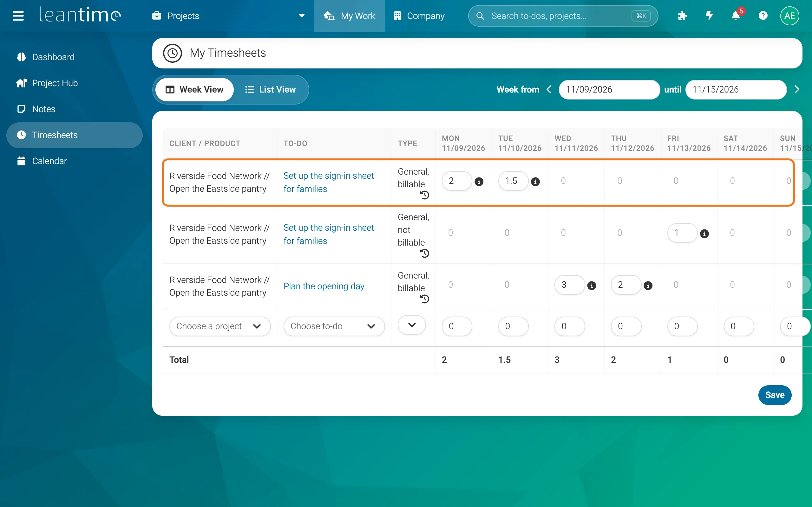
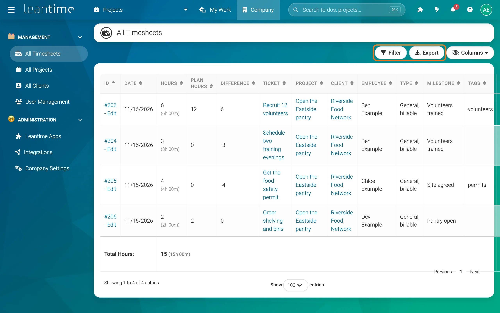

Leantime records the time people spend on to-dos. You can run a timer while you work, log hours on the to-do afterwards, or fill in a week at a time. The hours add up per to-do, per person and per project, so you can compare them with what you planned, and bill for them if you work for clients.

There are three ways to log time. They all end up in the same timesheets.

## How do I start a timer on a to-do?

1. **Open the to-do's ⋮ menu**, on its card or at the top right of the open to-do.
2. **Click Start Work** under **Track Time**.

The timer shows at the top of the page, next to the menu, while it runs. When you're done, click it and choose **Stop Timer**, or choose **Stop Work** in the to-do's ⋮ menu. The time goes into your timesheet as **General, billable**.

Good to know:

- **One timer at a time.** While a timer runs, other to-dos show **Timer set on another To-Do**.
- **Very short sessions aren't logged.** Leantime rounds the time to hundredths of an hour. If you stop the timer in under 54 seconds, nothing is saved; from 54 seconds on, it saves at least 0.02 hours.
- **Moving the to-do to a Done status stops its timer** and logs the time.
- **On My Work,** the play button on a to-do in **My ToDos** starts and stops the same timer.

## How do I log time on a to-do afterwards?

1. **Open the to-do** and click the **Time Tracking** tab.
2. **Under Track Time,** choose the **Type** of work, the **Date** and the **Hours**, and add a **Description** if you like.
3. **Click Save.**

**Logged Hours**, next to it, shows the time logged on this to-do against its plan: **Planned Hours**, **Logged Hours** and **Hours Remaining**. If the to-do has subtasks, it also shows the totals including them. Set the plan on the **Details** tab, in **Planned Hours / Hours Left**.

## How do I fill in a week at a time?

1. **Click My Work** at the top of the page, then **Timesheets** in the left menu.
2. **Pick the week** with the arrows next to **Week from**.
3. **In the empty row at the bottom,** choose a project (**Choose a project**), a to-do (**Choose to-do**) and the type of work.
4. **Type the hours** under each day.
5. **Click Save.**

Each row is one to-do and one type of work. To change hours, type over them and click **Save**.

**List View**, next to **Week View**, lists your entries one by one, with filters for dates and type. To change the date or description of an entry, or to delete it, click **Edit** next to its number. **Delete** is in the ⋮ menu of the window that opens.

## What types of work are there?

Each entry has a type, so you can tell billable and non-billable time apart:

- **General, billable**
- **General, not billable**
- **Project Management**
- **Development**
- **Correction, not billable**
- **Review/Testing**

The timer always logs **General, billable**. Change the type afterwards in **List View** if you need to.

## How do I see everyone's time?

**Company → All Timesheets** lists the time everyone has logged. It needs the Company Manager role or higher.

- **Filter** by client, project, to-do, dates, person, type, and whether the time is invoiced, approved or paid.
- **Columns** shows or hides columns, like **Plan Hours**, **Difference**, **Milestone** and **Tags**.
- **Export** downloads the list as a CSV file.

### How do I mark time as invoiced, approved or paid?

Further along each row are three columns: **Invoiced**, **MGR Approval** and **Paid**. Tick the checkbox of each entry you've dealt with, or use **Select all** under the column at the bottom of the table, then click **Save**. Once saved, the checkbox is replaced by the date it was marked.

## Who can log and see time?

- **Editors and above** log their own time and see their own timesheets.
- **Company Managers, Administrators and Owners** also see, change and approve everyone's time.
- **Read Only and Commenter** users can't log time.

## Can I switch time tracking off for a project?

Yes. In the project's **Project Settings**, open the **Modules** tab and switch off **Time tracking**. The timer and the **Time Tracking** tab disappear from that project's to-dos, and nobody can log new time on them. Time logged earlier stays in the timesheets and still counts in reports.

## Where else do the hours show up?

- **[Reports](/using-leantime/reports/)** show the hours logged on a project, and per milestone.
- With the Programs plugin, a program's **Resources** page compares each person's booked hours with the time they've logged this week.

With the Pomodoro plugin, you can also drop a to-do onto the Pomodoro timer on My Work: its play and pause buttons then start and stop this same timer.

## Related

- [My Work Dashboard](/using-leantime/my-work-dashboard/)
- [To-Dos](/using-leantime/task-management/)
- [Projects](/using-leantime/managing-projects/#how-do-i-switch-features-on-or-off-for-a-project)
