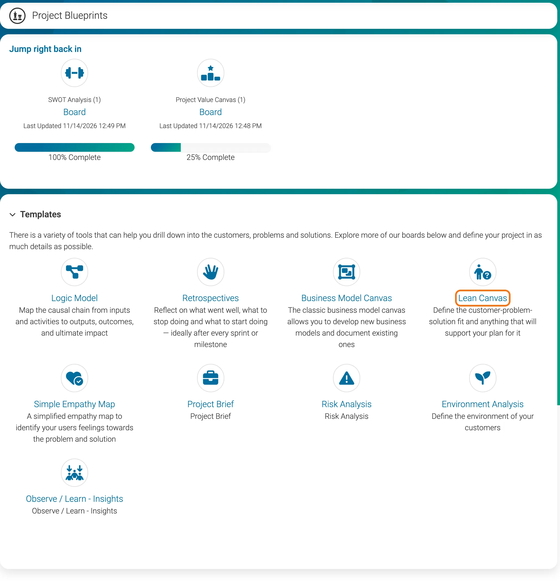
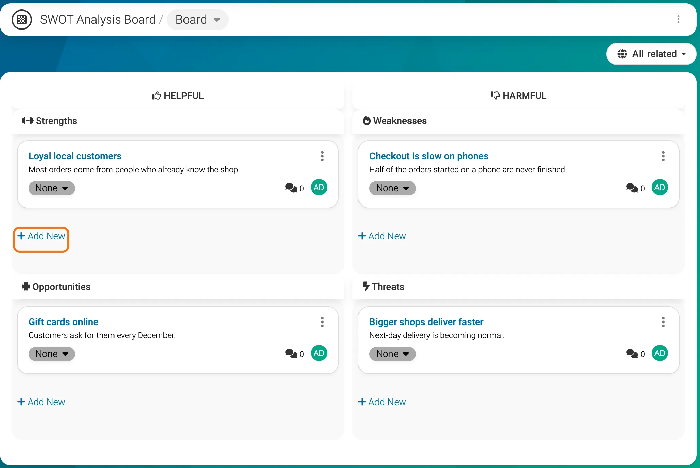
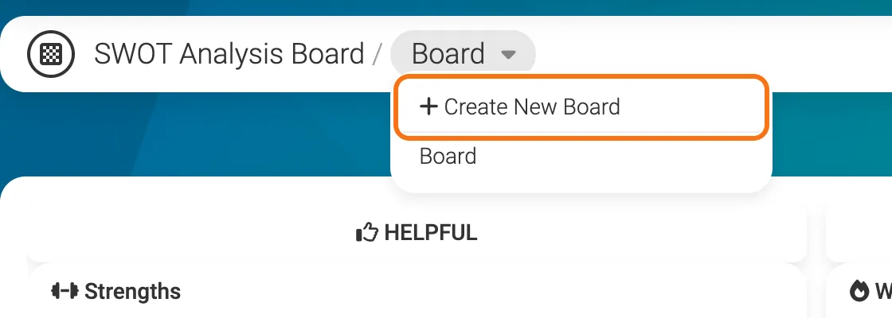
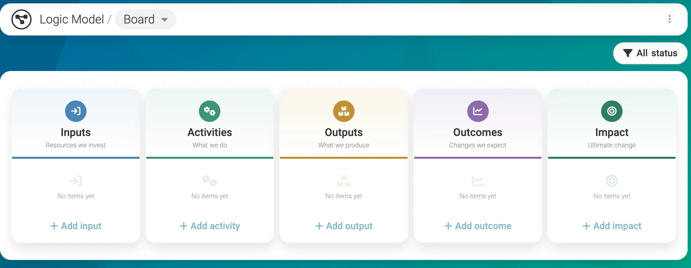

# Blueprints

Blueprints are boards for thinking a project through before and while you work on it: who it's for, what problem it solves, what could go wrong. Each blueprint is a ready-made board with columns that ask the right questions, like a SWOT analysis or a Lean Canvas. You fill it with cards, one idea per card.

## How do I start a blueprint in Leantime?

1. **Open the project**, open **Think** in the left menu and click **Blueprints**.
2. **Click the blueprint you want** under **Templates**. Leantime creates the board and opens it.

   

Blueprints you've already started move up to **Jump right back in**, so you can get back to them in one click.

If you don't know where to start, try the **Project Value Canvas**: it asks who your customer is, what problem you're solving, what your solution is and what benefit it brings.

## Which blueprints are there?

| Blueprint | What it helps you think through |
|---|---|
| **Project Value Canvas** | Your customer, their problem, your solution and its benefit ([how to use it](https://support.leantime.io/en/article/starting-project-definition-using-the-project-value-canvas-1rvdi39/)) |
| **Project Brief** | The short summary everyone can agree on before work starts ([how to use it](https://support.leantime.io/en/article/creating-an-effective-project-brief-with-leantime-13ad5ye/)) |
| **SWOT Analysis** | Strengths, weaknesses, opportunities and threats ([how to use it](https://support.leantime.io/en/article/understanding-swot-analysis-with-leantimes-template-ge81b4/)) |
| **Lean Canvas** | Whether the customer, problem and solution fit together ([how to use it](https://support.leantime.io/en/article/maximizing-project-value-with-leantimes-lean-canvas-template-1l2ke94/)) |
| **Business Model Canvas** | How a product or service creates and earns value ([how to use it](https://support.leantime.io/en/article/the-power-of-the-business-model-canvas-in-leantime-g8js9i/)) |
| **Risk Analysis** | What could go wrong and what you'll do about it ([how to use it](https://support.leantime.io/en/article/conducting-a-risk-analysis-with-leantimes-template-1ffrfj2/)) |
| **Environment Analysis** | The world around your customers ([how to use it](https://support.leantime.io/en/article/understanding-environmental-analysis-with-leantime-18h6w8u/)) |
| **Simple Empathy Map** | How your users feel about the problem and the solution |
| **Observe / Learn – Insights** | What you saw, what you learned and what it means ([how to use it](https://support.leantime.io/en/article/developing-project-insights-with-leantimes-template-1wwystk/)) |
| **Logic Model** | How inputs and activities lead to outputs, outcomes and impact (see [below](#what-about-the-logic-model)) |
| **Retrospectives** | What went well and what to change, after a sprint or milestone (see [Retrospectives](using-leantime/retrospectives.md)) |

## How do I add a card?

1. **Click Add New** in the column the card belongs in.

   

2. **Give it a title** and fill in the rest. What you can fill in depends on the blueprint. A SWOT card has a description and supporting data. A Project Value Canvas card asks for your assumptions, the data behind them and your conclusion, and has a status such as **Draft**, **In review** or **Validated: Valid**.
3. **Click Save.**

After you save, the card can do more:

- **Link a milestone.** Under **Linked Milestone**, create a new milestone or link one you already have. This connects a thought on the board, like "Checkout is slow on phones", to the work that deals with it.
- **Discuss it.** Every card has its own **Discussion** for comments.

The menu at the top right of a board lets you **Edit** its name, **Export** it, **Print** it or **Delete** it. The filter next to it shows only cards with a certain status or relation.

## Can I have more than one board of the same kind?

Yes, for example one SWOT per product or per year. Click the board name next to the blueprint's title and choose **Create New Board**. The same menu switches between boards.

## What about the Logic Model?

The Logic Model maps how your work leads to change: the **Inputs** you invest, the **Activities** you do, the **Outputs** they produce, the **Outcomes** you expect and the **Impact** you're aiming for. Non-profits, NGOs and funded programs often use it to plan and report to funders.

In core Leantime, the Logic Model is a board like the others: you fill each column with cards. The [Leantime Strategies plugin](https://marketplace.leantime.io/product/leantime-strategies/) builds on it with tracking and views, so you can follow your outcomes over time and keep the reason behind your projects in sight.

## What if something goes wrong?

- **I don't see Blueprints in the left menu.** Blueprints may be switched off for this project on the **Modules** tab of **Project Settings** (see [How do I switch features on or off for a project?](using-leantime/managing-projects.md#how-do-i-switch-features-on-or-off-for-a-project)).
- **I can't add or change cards.** That needs the **Editor** role or higher in the project.
- **A template is missing from the list.** You've already started that blueprint. Find it under **Jump right back in**.
