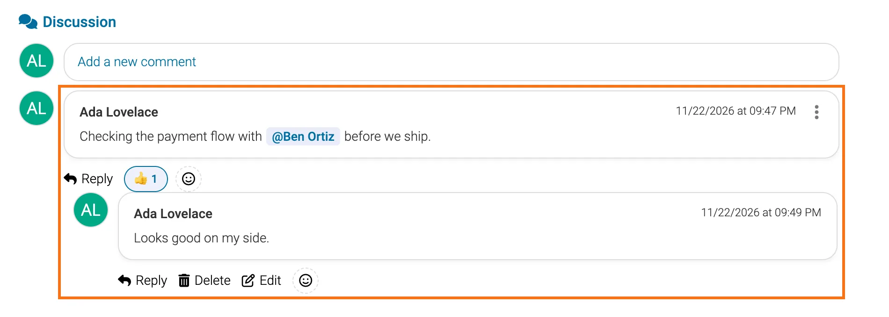

# Comments, @mentions and reactions

Every to-do has a **Discussion** where your team talks about the work, so the conversation stays with the work it's about. This page shows how to comment, reply, @mention someone and react, and how to see what changed on a to-do in its **History**.

## Where can I comment?

- **To-dos:** the **Discussion** below the to-do's form.
- **Docs:** the **Discussion** at the bottom of each doc (see [Docs](using-leantime/docs.md)).
- **Ideas and Blueprint cards:** each card has its own **Discussion** (see [Ideas](using-leantime/idea-management.md) and [Blueprints](using-leantime/blueprints.md)).
- **Projects:** project updates on the **Project Overview** (see [What's on the Project Overview?](using-leantime/managing-projects.md#whats-on-the-project-overview)).

## How do I comment on a to-do?

1. **Open the to-do** and scroll to **Discussion**.
2. **Click Add a new comment** and write. The editor has bold, italic, links, images and lists.
3. **Click Save.**

The newest comment shows at the top. Everyone on the project who follows comments gets a notification (see [Notifications](using-leantime/notifications.md)).

To answer a comment, click **Reply** under it, write, and click **Reply**. Replies stay under the comment they answer.

## How do I @mention someone?

Type **@** and the first letters of their name in a comment, then pick them from the list that opens. Their name shows as a link, like **@Ben Ortiz**.

The person you mention gets "Ada mentioned you in a project" in the bell, under **Mentions**, and by email. @Mentions always reach them, even in a project they've muted. They're told once for each comment or to-do, however often you mention them in it.

@Mentions work in comments, in to-do descriptions, in project descriptions and on Blueprint cards.

## How do I react to a comment?

Click the smiley next to **Reply** and pick 👍, ❤️, 🎉, 😄, 🤔 or 💯. The reaction shows under the comment with a count; hover over it to see who reacted. Click your reaction again to take it back.

## How do I edit or delete a comment?

Open the **⋮** menu on your comment and choose **Edit** or **Delete**. On a reply, **Edit** and **Delete** are next to **Reply**.

You can edit and delete your own comments and replies. Company Managers, Administrators and Owners can also edit or delete other people's comments, though not their replies. Commenters can comment and reply too; Read Only users can only read (see [Roles](using-leantime/user-management.md#roles)).

## Can I turn a comment into a time entry?

Yes, on a to-do in a project with time tracking on. Open the **⋮** menu on the comment and choose **Add to Timesheet**. Leantime opens the to-do's **Time Tracking** tab with the comment as the entry's description; add the hours and save (see [Timesheets](using-leantime/timesheets.md)).

## How do I see what changed on a to-do?

Open the to-do's **History** tab. It lists who changed what and when, newest first: the headline, type, description, project, priority, due date, assignee, Work Start and Work End, planned hours and status.

Comments aren't part of the History; they stay in the **Discussion**.

## Related

- [Notifications](using-leantime/notifications.md)
- [To-Dos](using-leantime/task-management.md)
- [User Management](using-leantime/user-management.md)
