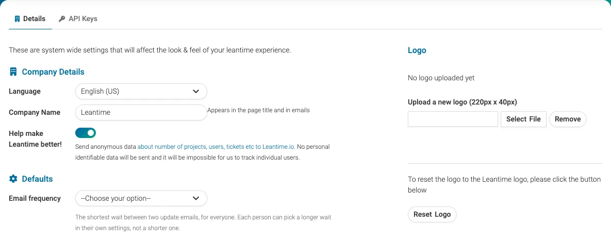
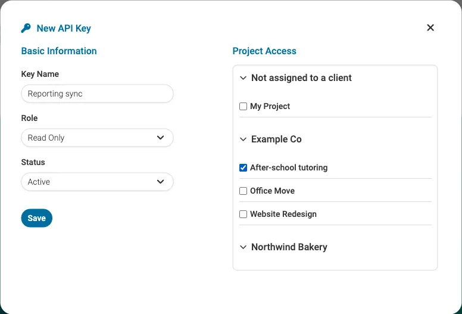

# Company Settings

Company Settings holds what applies to your whole Leantime: its language and name, the logo, defaults for notifications, phone notifications, usage statistics (telemetry) and API keys. Administrators and Owners can open it.



## How do I open Company Settings?

Click **Company** at the top, then **Company Settings** under **Administration** in the left menu. You need the Administrator or Owner role.

The other pages under **Company** are **All Timesheets**, **All Projects**, **All Clients** and [User Management](using-leantime/user-management.md) under **Management**, and **Leantime Apps** ([plugins](installation/using-plugins.md)) and [Integrations](using-leantime/integrations.md) under **Administration**. Some plugins add their own, like [Custom Fields](using-leantime/custom-fields.md), or an **Authentication Settings** tab here from [Advanced Authentication](plugins/advanced-authentication.md).

## What can I set on the Details tab?

| Setting | What it does |
| --- | --- |
| **Language** | The language for everyone who hasn't chosen their own under **My Profile → Settings** |
| **Company Name** | Shown in the browser tab and in emails |
| **Help make Leantime better!** | Sends a daily usage summary to Leantime (see [Telemetry](#telemetry)) |
| **Email frequency** | The shortest wait between two update emails, for everyone. Each person can choose a longer wait, not a shorter one (see [Notifications](using-leantime/notifications.md)) |
| **Send morning summaries** (under **Reminders**, with its own **Save**) | Turns the daily morning summary and to-do reminders on or off for everyone. Leantime 3.17 and later (see [Reminders and the morning summary](using-leantime/reminders.md)) |
| **Default notification types for new users** | Which kinds of changes people hear about until they save their own choice: Tasks & Milestones, Comments, Goals, Ideas, Project Updates, and Boards & Whiteboards |
| **Default notification level** | **All Activity** or **My Work Only**, for people who haven't chosen their own |
| **Mobile push notifications** | On your own server only: send notifications to the Leantime mobile app through Leantime's relay (see [Set up the mobile app](installation/mobile-app-setup.md#how-do-i-turn-on-phone-notifications)) |

Click **Save** at the bottom. **Company Name** and **Language** both need a value, or the other settings aren't saved.

On your own server, the **Language** and **Company Name** saved here win over `LEAN_LANGUAGE` and `LEAN_SITENAME` in your `.env` file.

## How do I change the logo?

1. **On the Details tab, click Select File** under **Upload a new logo (220px x 40px)** and choose an image.
2. **Crop it** to the frame.
3. **Click Save.**

The logo replaces the Leantime logo at the top left of every page. **Reset Logo** brings the Leantime logo back.

## Can I change the company colors?

Not on this page. Each person chooses their own theme and colors under **My Profile → Theme**.

On your own server, set your brand colors as `LEAN_PRIMARY_COLOR` and `LEAN_SECONDARY_COLOR` in your `.env` file (see [Configuration](installation/configuration.md)). People then find them as **Company Colors** under **Color Scheme** in their theme settings.

## How do I create an API key?

API keys let other tools work with your Leantime through its [API](api/usage.md). Each key acts as its own user, with a role and the projects it can reach.

1. **Open the API Keys tab** and click **Generate API Key**.
2. **Enter a Key Name**, so you'll know later what uses it.
3. **Choose a Role.** You can give a key your own role or a lower one. Read Only is enough for tools that only read.
4. **Under Project Access, tick the projects** the key can use.
5. **Click Save**, then **copy the key** that appears. It starts with `lt_`, and this is the only time you see all of it.



Each key shows on the tab with when it was created and last used. Its menu has **Edit Key**, to change its role, projects or **Status** (set **Deactivated** to pause it), and **Delete Key**.

API keys belong to the company. To connect a tool as yourself, with your own access, use a personal access token under **My Profile → Personal Access Tokens** instead.

## Telemetry

If **Help make Leantime better!** is on, your Leantime sends Leantime a usage summary once a day. The summary contains counts and version information. It doesn't contain names, email addresses, project titles or anything people wrote.

**What's in it:**

- **About your installation:** a random ID made for your installation (not linked to your company name), the date, the Leantime version, whether it's open source or Cloud, and the default language.
- **Counts:** users (all, and active in the last 7 and 30 days), projects (and how many are green, yellow, red or without a status), clients, strategies, programs, comments, milestones, to-dos, hours logged, ideas, research and retrospective boards, goals, docs and the cards on each kind of board, reactions on to-dos, and the date of the most recent sign-in.
- **About the server:** the web server and PHP version, the operating system, the database, cache, session and queue drivers, and whether it runs in Docker.
- **Plugins:** the names of the marketplace plugins you've installed, and how many other plugins you have.

**Where it goes:** to `telemetry.leantime.io`, at most once a day, when Leantime's scheduled jobs run or someone opens the dashboard.

**How do I turn it off?** Switch off **Help make Leantime better!** and click **Save**. Leantime sends one last message saying you've opted out, then nothing more. On your own server, `LEAN_ALLOW_TELEMETRY=false` in your `.env` file stops it completely and hides the switch.

## What else is set outside this page?

On your own server, some company-wide settings live in your `.env` file instead:

- **Email (SMTP):** see [Email configuration](installation/email-configuration.md).
- **Sign-in with LDAP or single sign-on:** see [Authentication](installation/authentication-configuration.md).
- **Brand colors:** see [Can I change the company colors?](#can-i-change-the-company-colors)

## What if something goes wrong?

- **Save doesn't change anything:** check that **Company Name** has a value.
- **The colors in `.env` don't show up:** if you set colors in Company Settings in an older version of Leantime, those saved colors still win. Remove them from the database, then clear the cache with the [Leantime CLI](development/commandline.md):

  ```sql
  DELETE FROM zp_settings WHERE `key` IN ('companysettings.primarycolor', 'companysettings.secondarycolor');
  ```

  ```bash
  php bin/leantime cache:clearAll
  ```

- **Phone notifications are on, but nothing arrives:** the relay needs the [Advanced Authentication](plugins/advanced-authentication.md) plugin with an active license. See [Set up the mobile app](installation/mobile-app-setup.md).
- **There's no Help make Leantime better! switch:** `LEAN_ALLOW_TELEMETRY` is set to `false` on your server, so nothing is sent.

## Related

- [User Management](using-leantime/user-management.md)
- [Notifications](using-leantime/notifications.md)
- [Connect to the API](api/usage.md)
- [Configuration](installation/configuration.md)
