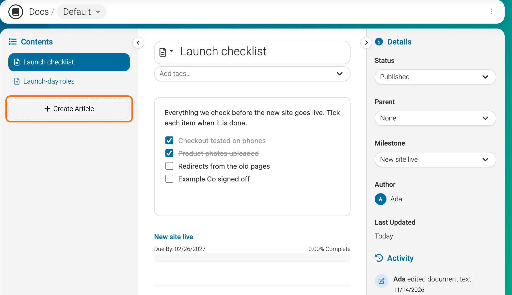
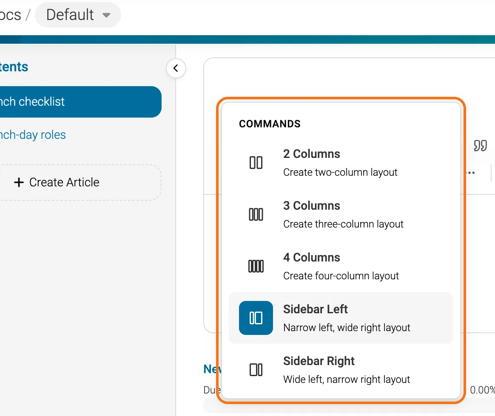
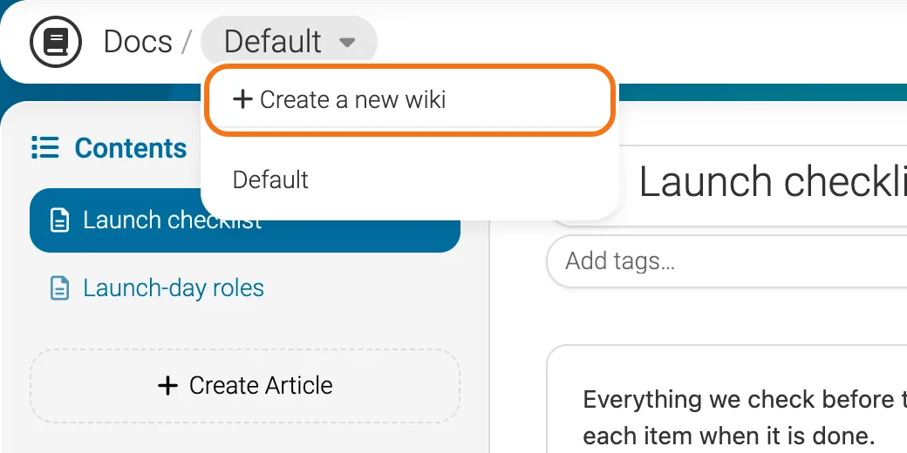
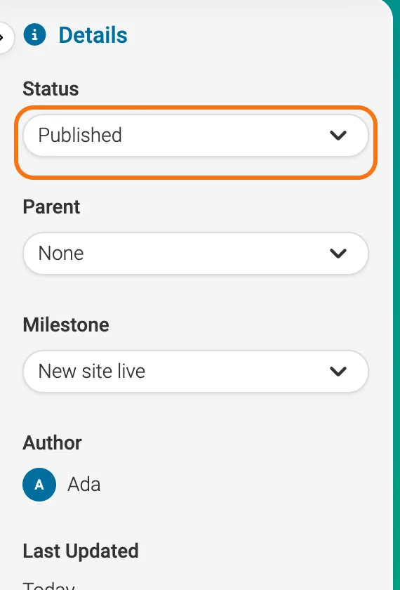

# Docs

Docs are the written pages of a project: checklists, meeting notes, how-tos, decisions, anything the team needs to find again. They live next to the work, so nobody has to remember which drive or chat a note ended up in.

## How do I write a doc in Leantime?

1. **Open the project**, open **Data Room** in the left menu and click **Docs**.
2. **Click Create Article.** A new, empty document opens.

   

3. **Give it a title** at the top. The button left of the title picks an icon for it.
4. **Write.** Leantime saves as you type: **Saving…** and then **Saved** appear under the title.

New documents start as **Drafts**. When it's ready for the team, set **Status** to **Published** under **Details**.

## What can I put in a doc?

Type **/** on an empty line to open the list of things you can add:

- **Headings, lists and checklists.** A **Task List** gives you boxes to tick, handy for a launch or onboarding checklist.
- **Tables, quotes, dividers and collapsible sections**, to keep long pages easy to scan.
- **Columns and sidebars**, to put things side by side.
- **Images, emoji, code blocks and diagrams** (Mermaid), and **maths** (LaTeX).
- **A table of contents** that builds itself from the headings.
- **Embeds** of videos, documents or other content, for example a file or folder in your cloud storage.
- **Templates:** a ready-made outline for **Meeting Notes**, a **Weekly Status Update**, a **Project Outline**, a **Product Requirements Document**, a **Decision Record**, a **User Story**, a **Feature Request**, a **Bug**, or a short **Green**, **Yellow**, **Red** or **Gray Status** note.

The toolbar above the text has the everyday formatting: bold, italic, lists, links, images and tables.

## How do I organize docs?

- **Put a page under another one.** Under **Details**, choose the page it belongs to in **Parent**. The **Contents** list on the left shows pages nested under their parent.
- **Connect a doc to a milestone.** Choose it under **Milestone**. The doc then shows the milestone's due date and progress under its text, so a launch checklist sits right next to how the launch is going.
- **Add tags** under the title to label docs that belong together.
- **Make more than one space.** A project starts with one space called **Default**. To add another, for example one per team or for "Processes" and "Meeting notes", click the space name next to **Docs** and choose **Create a new wiki**.

## Who can see a doc?

- **Published** docs are visible to everyone who can see the project.
- **Drafts** only show in the **Contents** list for the person who wrote them, so the team doesn't come across unfinished pages. A draft isn't private, though: anyone who can see the project can still open it with its link. Don't put anything in a draft that the project team shouldn't read.
- Writing and changing docs needs the **Editor** role or higher in the project.

For notes only you can see, use [Notes](using-leantime/notes.md) instead.

Each doc also keeps an **Activity** list under **Details** (who created it, renamed it or changed the text) and has a **Discussion** at the bottom for comments.

## What if something goes wrong?

- **I don't see Docs in the left menu.** Docs may be switched off for this project on the **Modules** tab of **Project Settings** (see [How do I switch features on or off for a project?](using-leantime/managing-projects.md#how-do-i-switch-features-on-or-off-for-a-project)).
- **A teammate can't find my doc.** Check that its **Status** is **Published**. Drafts don't appear in other people's **Contents** list.
- **"Save failed" appears under the title.** Your last change didn't reach Leantime, often because the connection dropped. Copy anything you just wrote, reload the page and paste it back in.
