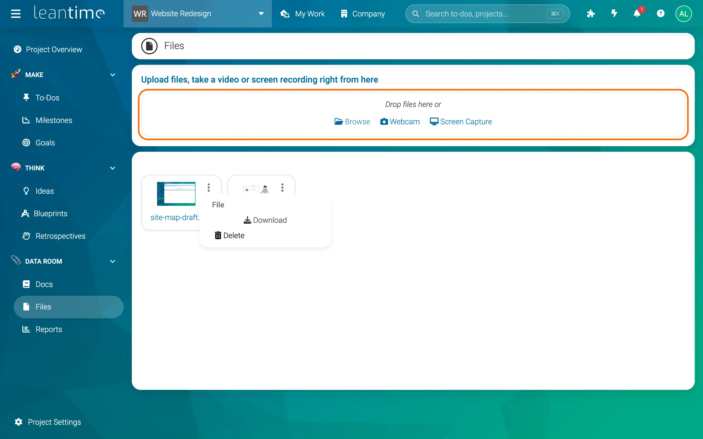

# Files

Every project has a file library for the documents, images and recordings your team shares. Each to-do also has its own files, for what belongs to that piece of work.

## Where are a project's files?

Open the project, then click **Files** under **DATA ROOM** in the left menu. Everyone who can see the project can see and download its files.

## How do I add a file?

On the **Files** page, drag files onto **Drop files here**, or click **Browse** and choose them. They upload right away.

You can also record something without leaving Leantime:

- **Webcam:** take a photo or record a video with your camera.
- **Screen Capture:** record your screen, for example to show a bug or walk someone through a page.

Your browser asks for permission to use the camera or your screen the first time.

**What can't I upload?** For security, Leantime refuses files ending in `.php`, `.phtml`, `.php3`, `.php4`, `.php5`, `.phar`, `.htaccess` or `.shtml`, and SVG images (`.svg`, `.svgz`). It also refuses names that contain one of these in the middle, like `report.php.txt`. Everything else is allowed, up to your server's upload size limit.

## How do I download or delete a file?

Click the **⋮** on the file, then **Download** or **Delete**. Leantime asks you to confirm before it deletes a file, and deleting can't be undone.

## How do I attach a file to a to-do?

Open the to-do and go to its **Files** tab, which shows how many files it has, for example **Files (2)**. Upload the same way as on the Files page.

Files attached to a to-do stay with that to-do. They don't appear in the project's file library, and the library's files don't appear on the to-do.

## Who can do what with files?

| Role | Files |
| --- | --- |
| Read Only | See and download them |
| Commenter | Also upload them |
| Editor and above | Also delete other people's files |

Anyone can delete the files they uploaded themselves, whatever their role, even after it changes to Read Only. See [User Management](using-leantime/user-management.md) for the roles.

## Can I switch off the file library for a project?

Yes. In **Project Settings → Modules**, switch off **Files**. That hides the project's file library for everyone; files attached to to-dos and images in text stay available (see [How do I switch features on or off for a project?](using-leantime/managing-projects.md#how-do-i-switch-features-on-or-off-for-a-project)).

## Where are the files stored?

- **Leantime Cloud:** we store them for you, with the rest of your workspace.
- **Your own server:** in the `userfiles` folder of your Leantime, or in S3-compatible storage if you set that up (see [S3 File Storage](installation/configuration.md#s3-file-storage)). Include them in your [backups](installation/backup-restore.md).

## What if an upload fails?

- **The file is too large.** On your own server, the limit comes from PHP's upload settings; the official Docker image accepts files up to 100 MB. See [I can't upload files](installation/common-issues.md#i-cant-upload-files) and, for Docker, [Uploads fail for large files](installation/docker-troubleshooting.md#uploads-fail-for-large-files).
- **"File type … is not allowed":** the file is one of the types Leantime refuses (see above). Put it in a `.zip` file if you need to share it.
- **Nothing happens on Webcam or Screen Capture:** allow the camera or screen sharing in your browser's site settings, and try again.

## Related

- [Docs](using-leantime/docs.md)
- [To-Dos](using-leantime/task-management.md)
- [Project settings](using-leantime/managing-projects.md)
