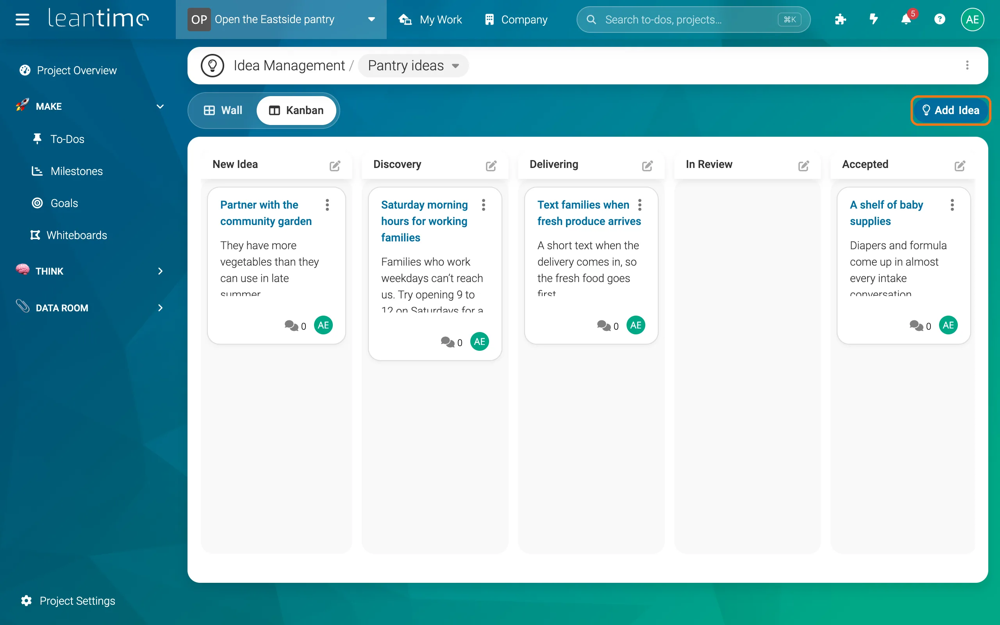

# Ideas

Good ideas turn up in the middle of other work and get lost. The Ideas board in each project gives them a place: write them down, talk them over, and move the promising ones forward until they become real work.

## How do I add an idea?

1. **Open the project** and click **Ideas** in the left menu, under **Think**.
2. **Click Add Idea.**
3. **Give it a short name,** and describe it below. Add tags if they help you find it later.
4. **Click Save & Close,** or **Save** to keep it open.

New ideas start as **New Idea**. Adding and changing ideas needs the Editor role or higher; Commenters can join the discussion.

## How do I move an idea forward?

Each idea has a status, shown as a column in the **Kanban** view:

| Status | Use it for |
| --- | --- |
| **New Idea** | Just written down |
| **Discovery** | Finding out more: is it needed, would it work? |
| **Delivering** | Being worked on |
| **In Review** | Done, and being checked |
| **Accepted** | It worked, and it's part of how you do things now |
| **Deferred** | Not now, maybe later |

Drag a card to another column, or change the status from the chip on the card. A Company Manager can rename the columns with the pencil next to each name.

## How do I turn an idea into work?

Open the idea. Once it's saved, **Linked Milestone** lets you **create and link a new milestone** or **link an existing milestone**. Add the to-dos to that milestone, and the idea stays connected to the work that delivers it.

Use the **Discussion** at the bottom of the idea to talk it over with the team.

## Wall or Kanban?

Switch views at the top of the page:

- **Wall:** all ideas as cards, for browsing and collecting.
- **Kanban:** the ideas sorted into columns by status, for moving them forward.

Leantime opens the view you used last.

## Can I have more than one idea board?

Yes. A board called **Board** is made for you the first time you open Ideas. To start another one, for a different theme or season, click the board name at the top and choose **Create New Board**. Use the **⋮** menu at the top right to rename or delete a board; deleting a board deletes its ideas.

## Related

- [Design thinking](knowledge-base/idea-development.md): generating and testing ideas
- [Milestones](using-leantime/roadmap-planning.md)
- [Blueprints](using-leantime/blueprints.md): boards for thinking through a problem
