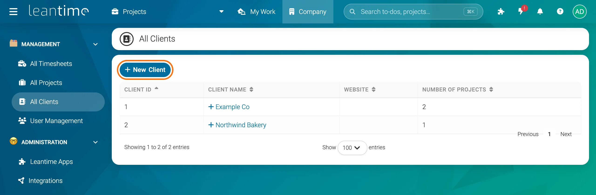
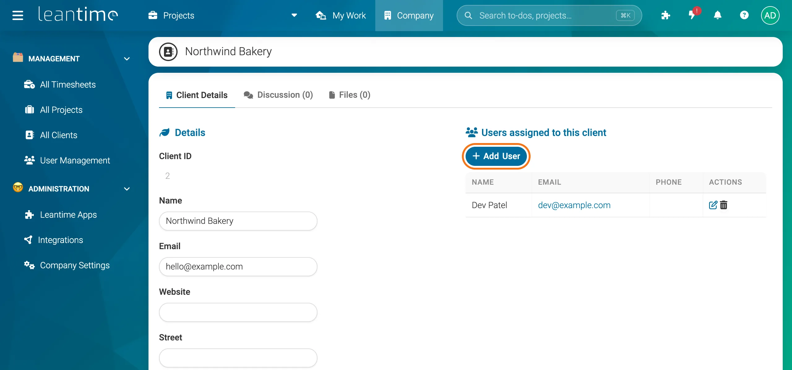

# Clients

A client groups projects and the people who work on them. Agencies and consultants use clients for their customers. Product teams use them for products or departments, such as marketing or operations, which is why Leantime calls the field **Client / Product**. Administrators and Owners manage clients.

## How do I add a client?

1. **Open Company** in the top menu, then **All Clients** under **Management** in the left menu.

   

2. **Click New Client.**
3. **Fill in the client's details.** Only **Name** is required. You can add an email, website, address and phone number.
4. **Click Save.** Leantime opens the client's page.

## How do I connect a project to a client?

Open the project's **Project Settings**, choose the client under **Client / Product** on the **Project Details** tab, and click **Save**. You can also choose the client when you [create the project](using-leantime/managing-projects.md#how-do-i-create-a-project).

Each project belongs to one client. **All Clients** shows how many projects each client has.

## How do I give a client's people access to their projects?

People who belong to a client can see that client's projects when a project's **Who can access this project?** setting is **Everyone assigned to this client**. This is a good way to let a customer follow their own projects without seeing anyone else's.

To add someone to a client:

1. **Open the client** from **All Clients**.
2. **Click Add User** under **Users assigned to this client.** The new user form opens with the client already chosen.
3. **Fill in the person's name, email and role, and click Invite User.** Leantime emails them a link to set their password.

You can also change an existing user's client in **Company → User Management** (see [User Management](using-leantime/user-management.md)).

> **Tip:** For a customer who should only read and comment, give them the **Commenter** or **Read Only** role.

## What else is on a client's page?

- **Client Details:** the client's contact details and the users assigned to it.
- **Discussion:** comments about the client, for your team.
- **Files:** files that belong to the client, such as contracts.

## How do I delete a client?

Open the client and click **Delete** at the bottom of the page. Leantime won't delete a client while its projects still have to-dos ("Client has to-dos & projects assigned"). Move those projects to another client, or delete them, first.

## What if something goes wrong?

- **I don't see All Clients.** Managing clients needs the Administrator or Owner role.
- **A client's user can't see a project.** Check that the project belongs to their client and that **Who can access this project?** is **Everyone assigned to this client**, or add them to the project's **Team** tab.
