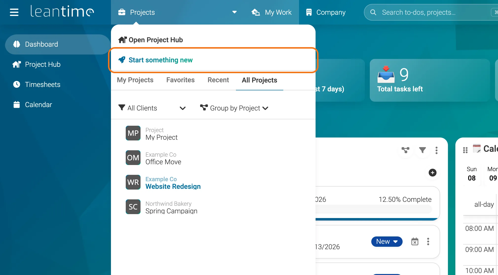
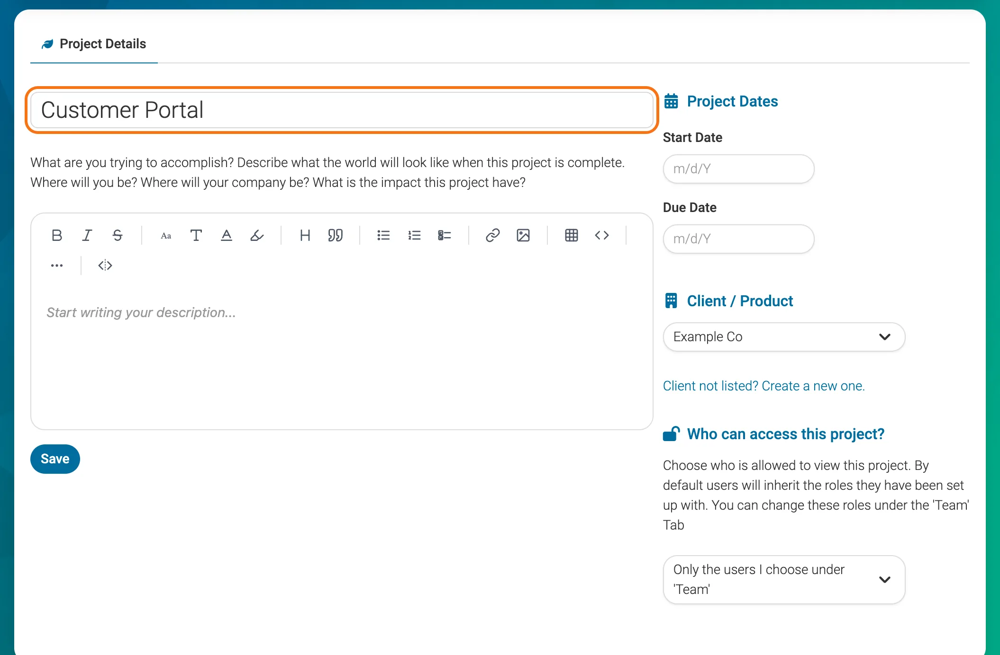
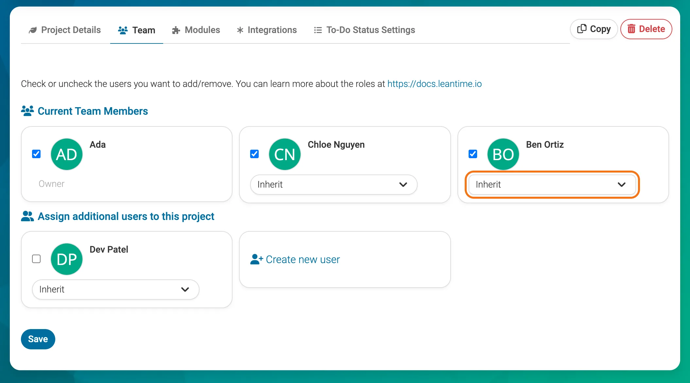
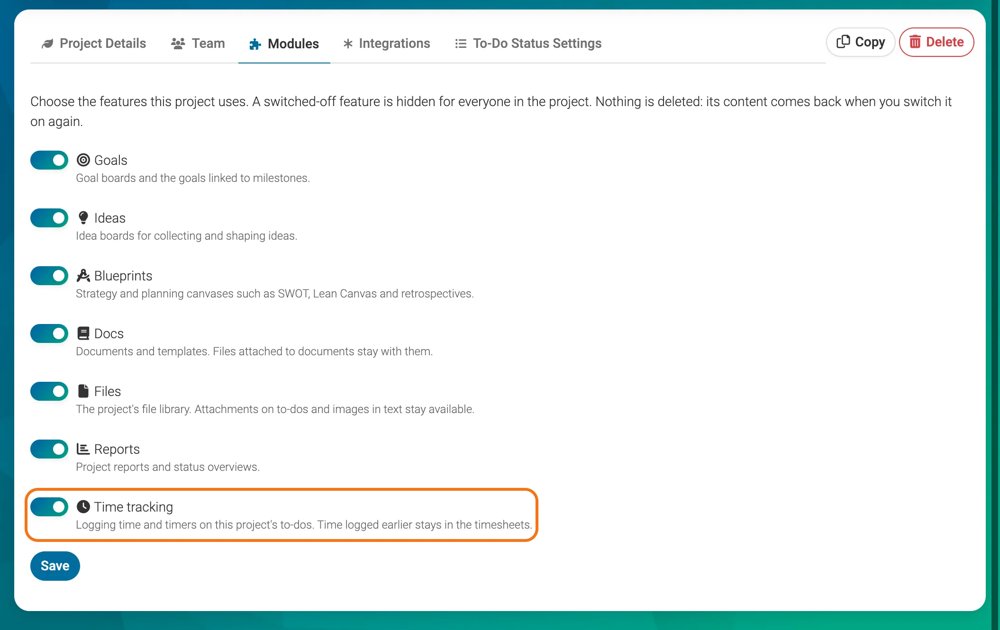
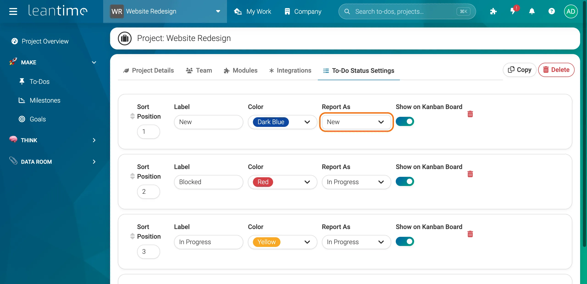
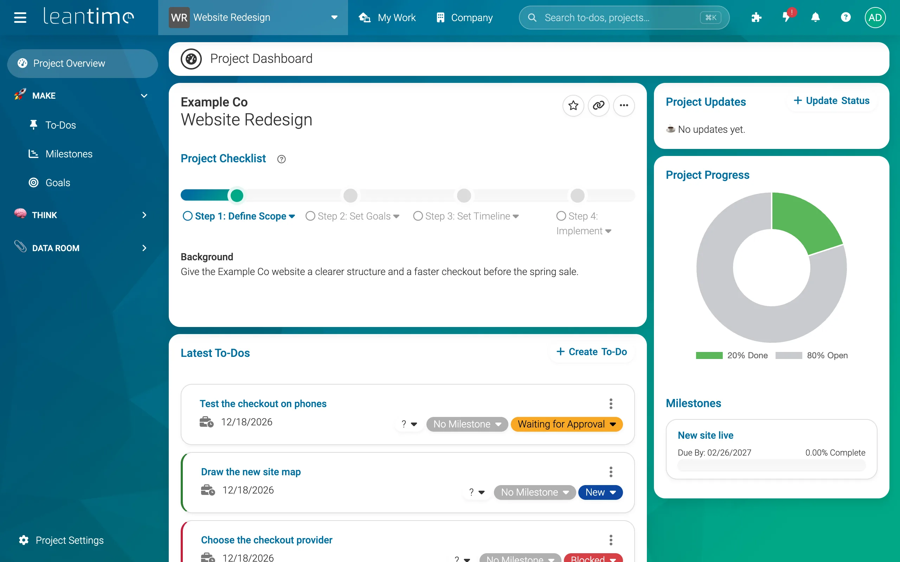
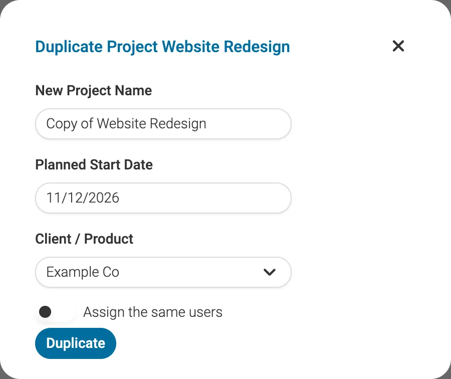

# Projects

A project holds your to-dos, milestones, goals and docs, and the people who work on them. Managers, Administrators and Owners can create projects and change their settings. Everyone else works in the projects they're part of.

## How do I create a project?

1. **Open the Projects menu** at the top of the screen and click **Start something new**.

   

2. **Type the project's name** in the title field.
3. **Describe what the project is for** in the box below it. Everyone on the project sees this on the Project Overview, so a sentence or two about the goal helps.
4. **Optional: set the dates and client.** Fill in **Start Date** and **Due Date**, and choose the **Client / Product** the project belongs to (see [Clients](using-leantime/managing-clients.md)).
5. **Choose who can access the project** (see [Who can see a project?](#who-can-see-a-project)).
6. **Click Save.**

   

Leantime opens the project's settings next, so you can add your team.

## Who can see a project?

You choose this under **Who can access this project?** when you create the project, and on the **Project Details** tab of its settings:

| Option | Who can see the project |
|---|---|
| **Only the users I choose under 'Team'** | Only the people you add on the **Team** tab |
| **Everyone assigned to this client** | Everyone who belongs to the project's client, plus the team |
| **Everyone in this organization** | Everyone with an account in your Leantime |

Administrators and Owners can always see every project.

## How do I add people to a project?

1. **Open the project** and click **Project Settings** at the bottom of the left menu.
2. **Open the Team tab.** Current team members are at the top. Everyone else is under **Assign additional users to this project**.
3. **Tick the people you want to add.** Untick someone to remove them from the project.
4. **Choose each person's role for this project.** **Inherit** gives them the role they have everywhere in Leantime. To change it for this project only, pick **Read Only**, **Commenter**, **Editor** or **Manager**.
5. **Click Save.**

Administrators and Owners keep their role in every project, so they don't have a role menu here. To invite someone who doesn't have an account yet, click **Create new user** (see [User Management](using-leantime/user-management.md)).

## How do I switch features on or off for a project?

Each project can hide the features it doesn't use, so the menu only shows what the team needs.

1. **Open Project Settings** and go to the **Modules** tab.
2. **Switch features on or off:** Goals, Ideas, Blueprints, Docs, Files, Reports and Time tracking.
3. **Click Save.**

A switched-off feature is hidden for everyone in the project, whatever their role. Nothing is deleted: its content comes back when you switch it on again.

- **Files** off hides the project's file library. Files attached to to-dos and images in text stay available.
- **Time tracking** off means nobody can log time on this project's to-dos. Time logged earlier stays in the timesheets.
- **To-Dos, Milestones, the Project Overview and comments** are always on.

Some plugins add their own switches to this list.

## How do I change the to-do statuses?

Every project has its own list of statuses, the columns you see on the to-do board.

1. **Open Project Settings** and go to the **To-Do Status Settings** tab.
2. **Change a status:** its **Label**, its **Color**, its order (**Sort Position**), and whether it appears as a column (**Show on Kanban Board**).
3. **Set Report As** for each status: **New**, **In Progress**, **Done** or **Don't Include in Reports**. This decides how to-dos in that status count in progress bars and reports.
4. **To add a status,** click **Add Status** at the bottom. Then click **Save**.

The **Archived** status can't be renamed or removed.

## Where do I find my projects?

- **The Projects menu** at the top lists your projects under **My Projects**, **Favorites**, **Recent** and **All Projects**. You can filter it by client and group it.
- **My Work → Project Hub** shows your favorite projects and every project you're assigned to, with their progress.
- **Company → All Projects** lists every project in a table, closed ones included, for Managers, Administrators and Owners. The **Project Status** column shows which are closed.

To make a project a favorite, click the star on its Project Overview.

## What's on the Project Overview?

The Project Overview is each project's start page. You get there by picking the project in the Projects menu.

- **Project Checklist:** suggested steps to set up the project well.
- **Background:** the description from the project's settings.
- **Latest To-Dos**, with **Create To-Do** to add one.
- **Project Updates:** short status notes for the team. Click **Update Status** to post one.
- **Project Progress** and **Milestones:** how much is done.

## How do I copy a project?

Copying is useful when you run the same kind of project again, like a yearly event or a client onboarding.

1. **Open Project Settings** and click **Copy** at the top right.
2. **Fill in the new project's details:** **New Project Name**, **Planned Start Date** and **Client / Product**.
3. **Optional: switch on Assign the same users** to add the same team, with the same project roles.
4. **Click Duplicate.**

The copy gets the project's to-dos and milestones, its Ideas, Goals, Blueprints and Docs, its to-do statuses and its module switches. Dates move so that the copy starts on the new start date. Comments, files and logged time aren't copied.

## Should I close or delete a finished project?

**Close it**, unless you're sure you'll never need it again.

- **To close a project,** open **Project Settings**, set **Project Status** to **Closed** on the **Project Details** tab, and click **Save**. The project leaves the Projects menu and the Project Hub, and everything in it stays. To open it again, find it under **Company → All Projects** and set its **Project Status** back to **Active**.
- **To delete a project,** open **Project Settings**, click **Delete** at the top right, and confirm with **Yes, delete!**. Leantime deletes the project and all its to-dos, and you can't undo it. [Back up your database](installation/backup-restore.md) first if you might need anything from it.

## What if something goes wrong?

- **I don't see Project Settings or Start something new.** Creating projects and changing their settings needs the Manager role or higher. Ask an Administrator.
- **A teammate can't see the project.** Check that they're ticked on the **Team** tab, or change **Who can access this project?**. See also [Why can't my user see certain projects?](installation/frequently-asked-questions.md#why-cant-my-user-see-certain-projects)
- **A feature disappeared from a project's menu.** Someone may have switched it off on the **Modules** tab. Switching it on again brings everything back.
