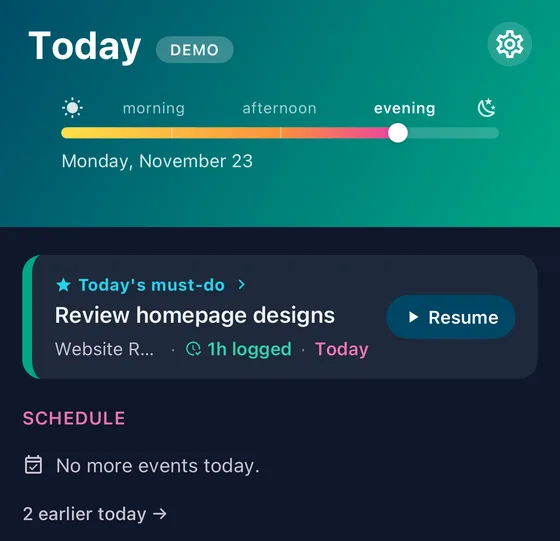
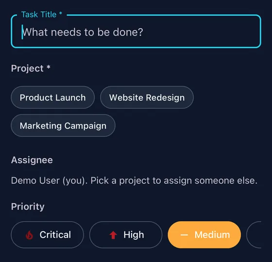
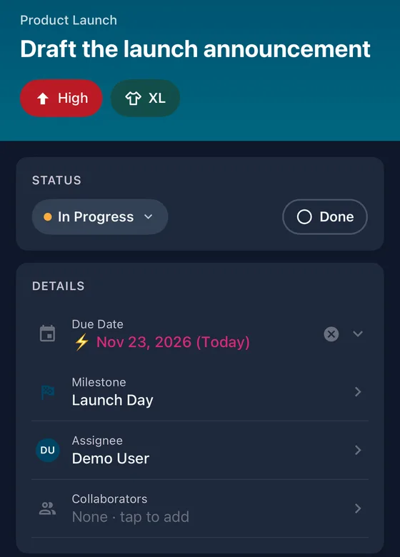
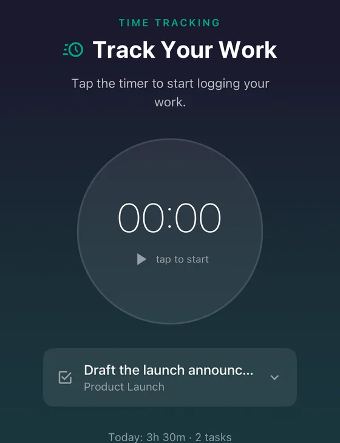
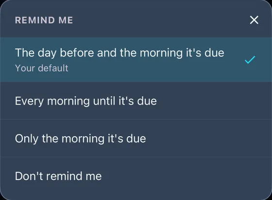
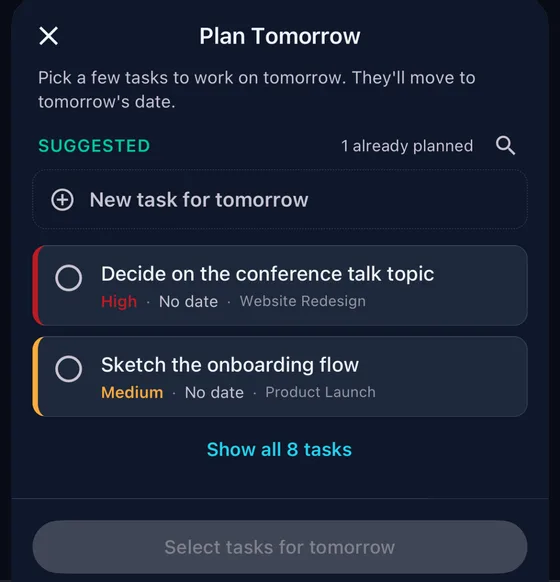

# Everyday tasks in the Leantime app

The Leantime app is built for your own day: what to do now, what's next, and the time you spend. This page walks through the things you'll do most, from the first look in the morning to logging time and planning tomorrow.

To install the app and connect it to your workspace, see [Leantime on your phone](using-leantime/mobile-app.md). To look around first, tap **Explore the demo** on the first screen: every screenshot here comes from it, with its sample data.

The app has five tabs at the bottom: **Today**, **Tasks**, **Now**, **Notes** and **You**. In the app, to-dos are called tasks.

## How do I start my day?

Open **Today**. At the top, a bar runs from a sun to a moon across your day, split into **morning** (until noon), **afternoon** (until 6 pm) and **evening**. The white dot is now. The bar's color follows the sun: yellow in the morning, orange in the afternoon, pink at sunset and violet at night. It's there for time blindness: one glance tells you how much of the day has passed, without reading a clock. If you've set an evening plan-tomorrow reminder, a small amber tick marks it.

Below it, Today shows:

- **Today's must-do**, or **Choose today's must-do** until you pick one (see the next question).
- **Last worked on:** the task you worked on last. **Resume** starts the timer on it again (it says **Continue** while the timer is still running).

Then, in this order unless you change it:

- **Schedule:** today's calendar events.
- **Quick Wins:** up to three small tasks (size XS or smaller) due in the next seven days, overdue ones included. Tap the shuffle button for others.
- **Due Today** and **Tomorrow**.
- **Tasks to Consider:** up to three tasks with no due date that are Critical or High priority, or were added in the last seven days.
- **Overdue**, folded until you tap it.

On the Quick Wins, Due Today and Tasks to Consider cards, swipe left and tap **Start** to start working on a task, or swipe right and tap **Done** to finish it.

To change the order or hide sections, tap the gear at the top right (**Customize Today**). Changes save as you make them, and **Reset to default** brings back the original layout.

## How do I choose my one thing for today?

Tap **Choose today's must-do** on Today. The app asks **What's your one thing today?**: the must-do that moves your work forward.

1. Pick one of the suggestions. The app offers up to three, from what's due today, what you were working on, what's coming up and what's been waiting. If yesterday's one thing is still open, it comes first.
2. Or, under **Something else?**, use **Choose from all tasks** or **Add a new task**. With Leantime 3.17 or later, **See everything coming up** shows the days ahead first.
3. Tap **That's today**. (The button reads **Choose your one thing** until you've picked, and **Still the plan** if you open the screen again and keep the same task.)

Your choice becomes due today and sits at the top of Today as **Today's must-do**. Tap **Start** on the card to start working on it (later it says **Resume**, or **Continue** while the timer runs). Tap the card to open the task. To change your one thing, tap **★ Today's must-do** at the top of the card.

The first time you confirm, if your phone doesn't allow Leantime notifications yet, the app asks **Want a nudge each morning?** The nudge opens this screen at the start of your work day; with Leantime 3.17 or later it only comes when something is coming up. Tap **Turn on**, or **Not now**. If you've already said no to notifications on your iPhone, the button is **Open Settings** instead, so you can allow them there.

## How do I add a task?

1. Open **Tasks** and tap **+**.
2. Type what needs to be done, and pick the **Project**. Both are required.
3. Optional: **Priority**, **Effort** (a T-shirt size from XS to XL), **Due Date** and a **Description**. The task is assigned to you; pick a project first to assign it to someone else.
4. Tap **Create Task**.

## How do I update or finish a task?

Tap the task to open it.

- **Finish it:** tap **Done**. Tap it again to reopen the task.
- **Change the status:** tap the status, for example **In Progress**, and pick another one from your project's statuses.
- **Change the details:** tap the priority or effort at the top, or **Due Date**, **Milestone**, **Assignee** or **Collaborators**. **Edit** changes the description. Subtasks are below; tap one to tick it off.
- **Comment:** scroll down to **Comments**, write your comment and tap send. Tap **React** under a comment to react to it.
- **Files:** attached files are listed under the comments. Tap one to open it in your browser; add files in the browser.

The task saves each change right away. If a change can't be saved, the app puts the old value back and tells you.

## How do I find my tasks?

**Tasks** lists your open tasks from every project, grouped into Overdue, Today and later. Tasks you only collaborate on are in their own **Collaborating** group. The chips at the top narrow the list: **All**, **Quick Wins**, **Today**, **Tomorrow**, **This Week**, **Overdue** and **Done**.

At the top right, the magnifier searches your tasks, and the arrows change the order.

To finish a task without opening it, swipe it right and tap **Done**. Tap **Undo** within about five seconds if you didn't mean to.

To see a project's tasks, including other people's, open **You → Your Projects** and tap the project. Group its tasks **By status** or **By person**; tap the active one again to reverse the order. Tap the star next to a project to keep it at the top of Your Projects.

## How do I track my time?

There are three ways, and they all end up in your Leantime timesheet.

**Start Work on a task.** Open the task and tap **Start Work** (under **Time Logged**). The **Now** tab opens on **Track** with that task, and the clock runs. A task that's still **New** moves to **In Progress** (switch this off under **Settings → Auto-Promote on Start Work**). Tap the timer to pause or resume. When you're done, tap **Stop & log** to log the time to the task.

**Use the Now tab.** **Now** has three modes at the top:

- **Timer** counts down a set time: 15, 25, 45 or 60 minutes, or anything from 5 to 120 minutes in steps of 5 with **−** and **+**. When it ends, the time is logged to the task you picked. To finish early, tap **Stop & log**, or **Discard** to log nothing.
- **Track** counts up for as long as you work. Less than a minute isn't logged. A session of 8 hours or more asks first, in case you forgot to stop: **Log it**, **Fix the hours** or **Discard**.
- **Breathe** guides four rounds of box breathing: in, hold, out and hold, four seconds each. Use it for a pause between tasks.

Pick the task under the timer. With no task, the time is logged as general time.

No connection? Logged time is kept on your phone and sent when Leantime can be reached again.

**Log time afterwards.** On a task, tap **Log Time** under **Time Logged**. Or open **You → Time** and tap **Log Time**, where you can also pick **General work (no task)**. Enter the time in hours (1 is one hour, 0.5 is 30 minutes), an optional description, and **Billable** or **Non-billable**, then tap **Log Time**.

**You → Time** shows your week: hours per day, and today's entries, which you can delete. The arrows move between weeks; tap a day's bar to see that day's entries. **Punch In** asks which task you're working on and starts the clock; tap it again to punch out.

## How do I get reminded about a task?

This needs Leantime 3.17 or later, which has built-in reminders. On an older server, the menu below isn't there.

Open the task, tap **⋮** at the top right, then **Remind me**. The task needs a due date first: without one, the app says **Add a due date to get reminders.** Choose when:

- **The day before and the morning it's due**: the default, until you choose another under **How often tasks remind you** (see [How do reminders work?](using-leantime/mobile-app.md#how-do-reminders-work))
- **Every morning until it's due**
- **Only the morning it's due**
- **Don't remind me**

Reminders arrive in your **morning summary**: what's coming up, once a day by push, email and in your inbox. To see the whole summary, open **Coming up**, from **See everything coming up** on the one-thing screen or from the summary at the top of your **Inbox**. It lists what's due today, tomorrow, later this week and later, from tasks and milestones to projects. Tap a task to open it. **Change in Settings** at the bottom sets when the summary arrives (see [How do reminders work?](using-leantime/mobile-app.md#how-do-reminders-work)).

## How do I plan tomorrow?

On Today, tap the question in the **Tomorrow** section, like **What will you work on tomorrow?** (or **Plan more for tomorrow** when tomorrow already has tasks). The app suggests a few tasks; tick the ones you want to work on tomorrow, or tap **New task for tomorrow**. **Show all … tasks** and the magnifier find others. Tap **Add … to tomorrow** at the bottom: the tasks you picked move to tomorrow's date.

## How do I take a note?

Notes are kept in notebooks. The first time, tap **Create Notebook** to make one.

Then tap **+**, then **New Note**. Choose the notebook, give the note a title, write, and add tags if you like. Tap **Create**. **+** also offers **New Notebook**.

The chips at the top filter by notebook or tag, and the magnifier searches your notes. Swipe a note right and tap **Pin** to keep it at the top, or swipe left and tap **Delete**. Press and hold a note to pin, share, duplicate, move or delete it; press and hold a notebook to rename it, change its color or delete it.

On a self-hosted server, Notes needs the [Notes](https://marketplace.leantime.io/product/leantime-notes/) plugin; without it the app tells you so. On Leantime Cloud, Notes is there with nothing to set up.

## How do I keep up with what changed?

Open **You → Inbox**: comments, @mentions and updates on your tasks, newest first. Tap one to open it, or swipe it right and tap **Read** or **Unread**. **Mark all read** asks before it marks everything. To get them as phone notifications instead, see [Can I get notifications on my phone?](using-leantime/mobile-app.md#can-i-get-notifications-on-my-phone)

## How do I see my calendar?

Open **You → Calendar**: a month at a time, with your tasks and the calendars you've connected in Leantime. Tap a day to see its tasks and events below the month, and **Today** to jump back. To connect another calendar, tap **Manage**: it opens Leantime in your browser, where calendars are connected (see [Calendars](using-leantime/calendars.md)).

## Which settings can I change?

Open **You → Settings**. From top to bottom:

- **Account:** **Open on Web** opens your workspace in the browser.
- **Privacy & Security:**
  - **Face ID / Touch ID** (on Android, **Biometric Unlock**), on phones that have it: ask for it when the app opens.
  - **Privacy Blur:** hide what's on screen when the app is in the background or the app switcher.
  - **Share Usage Data:** see [Leantime on your phone](using-leantime/mobile-app.md#how-do-i-delete-my-account-or-my-data).
- **Appearance → Theme:** Light, Dark or System Default (follows your phone).
- **Notifications** and **Reminders:** see [Can I get notifications on my phone?](using-leantime/mobile-app.md#can-i-get-notifications-on-my-phone) and [How do reminders work?](using-leantime/mobile-app.md#how-do-reminders-work)
- **Sounds & Haptics:**
  - **Haptic Feedback:** small vibrations when you tap or finish something. **Only for meaningful moments** keeps them for the important ones.
  - **Encouraging Messages:** switch off for plain messages, like "Marked … complete".
- **Focus Timer:**
  - **Timer Length:** the length the **Now** timer starts at.
  - **Auto-Promote on Start Work:** moves a New task to In Progress when you start working on it. On by default.
- **About:** **Help & Support** opens these docs.

**Sign Out** and **Delete Account** are at the bottom.

The sparkle at the top of **You** shows what's new in the app, with a dot when there's something you haven't read.

## Related

- [Leantime on your phone](using-leantime/mobile-app.md): install, connect, notifications and troubleshooting
- [Time tracking](using-leantime/timesheets.md)
- [Notes](using-leantime/notes.md)
