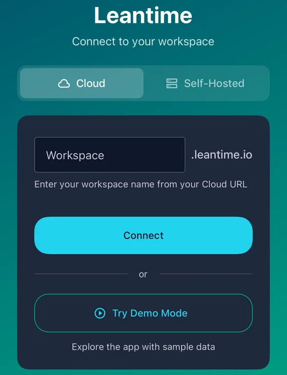
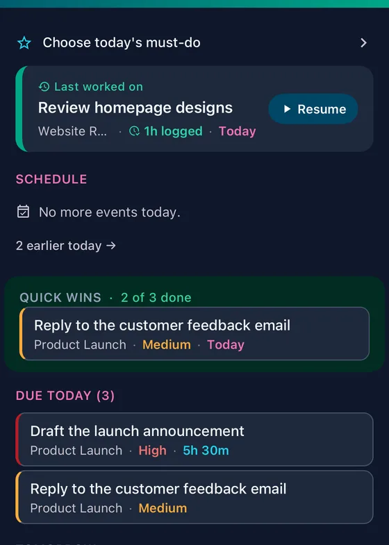
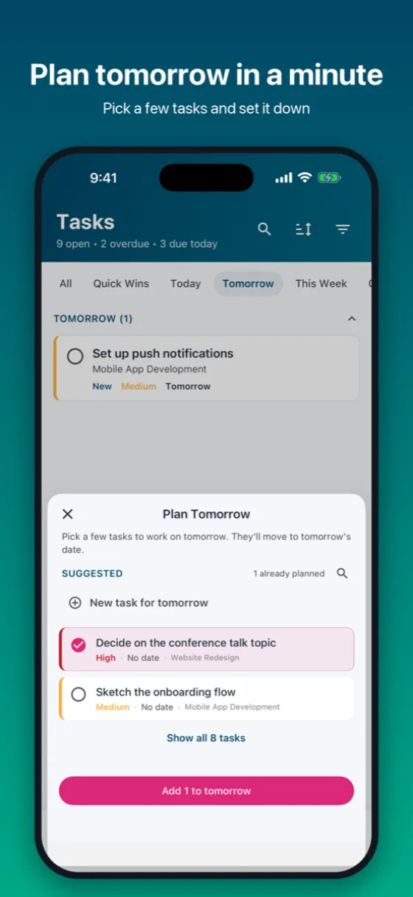
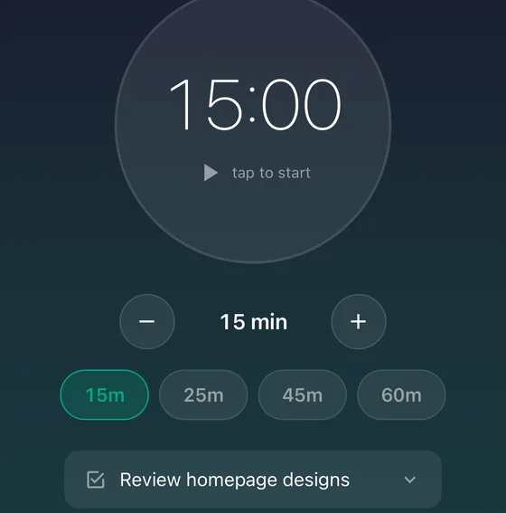

# Leantime on your phone

Leantime Mobile is the free app for iPhone and Android that connects to the Leantime workspace you already have. On Leantime Cloud you sign in with your workspace name. On a self-hosted server, the server needs the [Advanced Authentication](https://marketplace.leantime.io/product/advanced-auth/) plugin: without it, the app can't sign in.

The app is for your own day, not for setting up projects: see what's due, plan tomorrow, focus on one to-do, track time and keep notes. Project setup and administration stay in the browser.

## How do I get the Leantime mobile app?

- **iPhone:** [Leantime Mobile on the App Store](https://apps.apple.com/app/leantime-mobile/id6773767264). In the EU, the app isn't in the App Store yet: join the [TestFlight beta](https://testflight.apple.com/join/nHF3AGwx) instead. Install Apple's free TestFlight app first, then open the link on your iPhone. TestFlight builds expire after 90 days and update as new versions come out.
- **Android:** [Leantime Mobile on Google Play](https://play.google.com/store/apps/details?id=io.leantime.mobile).

The app is for phones; tablet layouts come later. It's free. On Leantime Cloud it works with your plan at no extra cost, trials included. On a self-hosted server it needs the Advanced Authentication plugin, a paid plugin from the marketplace.

**Just looking?** Tap **Try Demo Mode** on the first screen. It opens a sample workspace, with no account or server needed.

## How do I connect the app to Leantime Cloud?

1. **Choose Cloud** on the Connect screen.
2. **Enter your workspace name:** only the part before `.leantime.io`. If your workspace is `acme.leantime.io`, enter `acme`.
3. **Sign in** with the email and password you use in the browser.
4. **Enter your code** if your account uses two-factor authentication. Codes change every 30 seconds, so use the current one.

Everything in the app works on Leantime Cloud, with no plugins or setup.

## How do I connect the app to my self-hosted Leantime?

Your server needs three things first:

- **Leantime 3.9.5 or later.** To check, click the **?** (help) icon in the top right of Leantime; the version is at the bottom, under **System**.
- **The [Advanced Authentication](https://marketplace.leantime.io/product/advanced-auth/) plugin, installed and enabled.** It signs the app in with its own token, so the app never stores your password, and access can be revoked without changing it. Your Leantime administrator can [install it](installation/plugin-installation.md).
- **HTTPS with a certificate from a public authority,** such as Let's Encrypt, at an address your phone can reach. Self-signed certificates don't work.

Then, in the app:

1. **Choose Self-Hosted** on the Connect screen.
2. **Enter the full address** you use in the browser, including `https://` and any port or folder, for example `https://leantime.example.com` or `https://example.com/leantime`.
3. **Sign in** with your Leantime email and password, or with your company login (see the next section).
4. **Enter your code** if your account uses two-factor authentication.

**Quick test:** open the same address in your phone's browser. If Leantime's login page loads and you can sign in there, your phone can reach the server. If the app still can't sign in, the server may be missing Advanced Authentication or dropping the app's sign-in token; see [What does the app's error message mean?](#what-does-the-apps-error-message-mean).

The **Notes** tab also needs the [Notes](https://marketplace.leantime.io/product/leantime-notes/) plugin on your server. Without it, the app tells you instead of showing an empty tab.

## Can I sign in with my company login (SSO)?

Yes, on a self-hosted server with Leantime 3.10.2 or later and Advanced Authentication. The app's sign-in screen shows a button for each login your server offers:

- **Sign in with SSO** when your server uses Leantime's built-in OpenID Connect login (see [Authentication](installation/authentication-configuration.md)), for example with Keycloak, Okta, Microsoft Entra ID or Authentik.
- **A button per provider** set up in Advanced Authentication 1.4.0 or later, such as Google, Microsoft or GitHub.

Tap the button, sign in on your company's page the way you always do, and you're sent back to the app. SAML 2.0 logins don't work in the app yet.

**Leantime in a folder?** If your Leantime runs in a folder, like `https://example.com/leantime`, the **Sign in with SSO** button opens the address without the folder and fails. Run Leantime on its own domain or subdomain for built-in SSO in the app, or use an Advanced Authentication provider button, which includes the folder. If your account also uses Leantime's two-factor codes, the app asks for the code after the company login; this needs Leantime 3.13.0 and app version 1.1.0 or later.

**For administrators:** there's nothing extra to register with your login provider, because the app uses the same callback address as the browser. If a sign-in wall sits in front of Leantime, see [What does the app's error message mean?](#what-does-the-apps-error-message-mean).

## What can I do in the app?

- **Today:** what's due, what you worked on last, quick wins and your schedule for the day.
- **Tasks:** your to-dos from every project. Add, update and finish them, and log time.
- **Now:** a timer for one to-do. Count up while you work, or count down a set length (Pomodoro style). Pause, resume, then stop and log the time to the to-do, even if you only worked for five minutes. It also offers short moments to breathe.
- **Notes:** your notes, kept with your projects.
- **You:** your calendar, timesheet, inbox and settings, and **Progress**: a view of where you stand right now and a weekly reflection of what you closed and helped with. Progress is only in the app and is just for you.
- **Plan tomorrow:** pick a few to-dos for the next day. They move to tomorrow's date.

What you can change follows your [role](using-leantime/user-management.md) in the workspace:

| Role | In the app |
| --- | --- |
| Read Only | See your to-dos, calendar and notes |
| Commenter | Also comment and react |
| Editor and above | Everything: create and edit to-dos, track time, log work |

If the app says your role can't do something, ask your workspace administrator.

## How do reminders work?

Turn them on under **Settings → Reminders**:

- **Morning cue:** a gentle start to the day, at the time you choose.
- **Plan tomorrow:** an evening nudge to pick tomorrow's to-dos.

The app also tells you when a focus timer ends. The first time, your phone asks whether Leantime may send notifications. If you said no, turn them on again in your phone's settings, under **Notifications → Leantime**.

## What does the app's error message mean?

Find the sentence the app showed you. The last column is for your Leantime administrator.

| The app says | What's usually going on | For your administrator |
| --- | --- | --- |
| Mobile access isn't available on this Leantime instance yet. | The server is Leantime, but mobile sign-in isn't turned on. | Install and enable Advanced Authentication. If it was on before, check it's still enabled and its license is current. |
| This Leantime instance is older than the app supports. | The server runs a version older than 3.9.5. | [Update Leantime](installation/upgrade-guide.md). |
| That URL responded, but it doesn't look like Leantime. | Something else answered: another site, a holding page, or a sign-in wall in front of Leantime. | If a sign-in wall is in front, let everything under `/advancedAuth/`, `/api/`, `/oidc/` and `/status` through to Leantime. If Leantime is in a folder, put the folder in front, for example `/leantime/api/`. |
| Something in front of your server is asking for a sign-in the app can't complete. | A gatekeeper such as Cloudflare Access, Authelia, basic auth or a bot check answers before Leantime. | Exempt the paths above, or give phones a direct route to Leantime. |
| Your phone doesn't trust this server's certificate. | The certificate is self-signed or from a private authority. | Use a certificate from a public authority such as Let's Encrypt. |
| We couldn't reach that address. | The name didn't resolve, the connection was refused, or it timed out. | Check the address, port and firewall. If Leantime is only on the office network, the app works only there (or over the VPN). |
| You signed in, but the server is rejecting the app's requests. | Something between the phone and PHP drops the app's sign-in token. | Pass the `Authorization` header through to PHP. On Apache with PHP-FPM, add `SetEnvIf Authorization "(.*)" HTTP_AUTHORIZATION=$1` or `CGIPassAuth On`. Behind a reverse proxy, make sure it forwards the `Authorization` header. Then sign out of the app and back in. |
| Too many sign-in attempts right now. | The server limits sign-ins per minute, and people behind one office address count together. | Wait a minute. If it happens often, raise the limit (`LEAN_RATELIMIT_AUTH`). |

### Problems without their own message

| What's going on | What to do |
| --- | --- |
| A full address in the Cloud box, or a workspace name in the Self-Hosted box | Cloud: type only the part before `.leantime.io`. Self-hosted: switch to **Self-Hosted** and type the whole address. |
| The address redirects (adds `www`, switches to `https`, adds a folder) | Use the address your browser ends up on. |
| You only sign in with a company login and never set a password | Use **Sign in with SSO** or your provider's button. If there's none, ask your administrator. |
| The two-factor code is right but fails | A clock is off: check that your phone sets its time automatically, and ask your administrator to sync the server time (NTP). |
| The app worked, then stopped after a server change | Advanced Authentication was turned off, its license lapsed, or a proxy setting changed. |

## How do I delete my account or my data?

- **Workspace owners:** **Settings → Delete Account** opens your workspace's deletion page in the browser.
- **Everyone else:** your account belongs to your workspace. Ask its owner to remove you. Signing out of the app clears everything it stored on your phone.
- **Usage data:** the app collects pseudonymous usage data (which screens and features are used, never your content). Turn it off under **Settings → Privacy & Security → Share Usage Data**, or email support@leantime.io to have it deleted.

## Still stuck?

On the TestFlight beta, you can send feedback from inside TestFlight: take a screenshot in the app and add a note. Or email mobile@leantime.io with:

- the exact sentence the app showed,
- your Leantime version, or that you're on Leantime Cloud,
- whether the same address loads in your phone's browser on the same network,
- whether anything sits in front of Leantime, like a reverse proxy, a VPN or a company sign-in page,
- a screenshot of the screen with the message.
