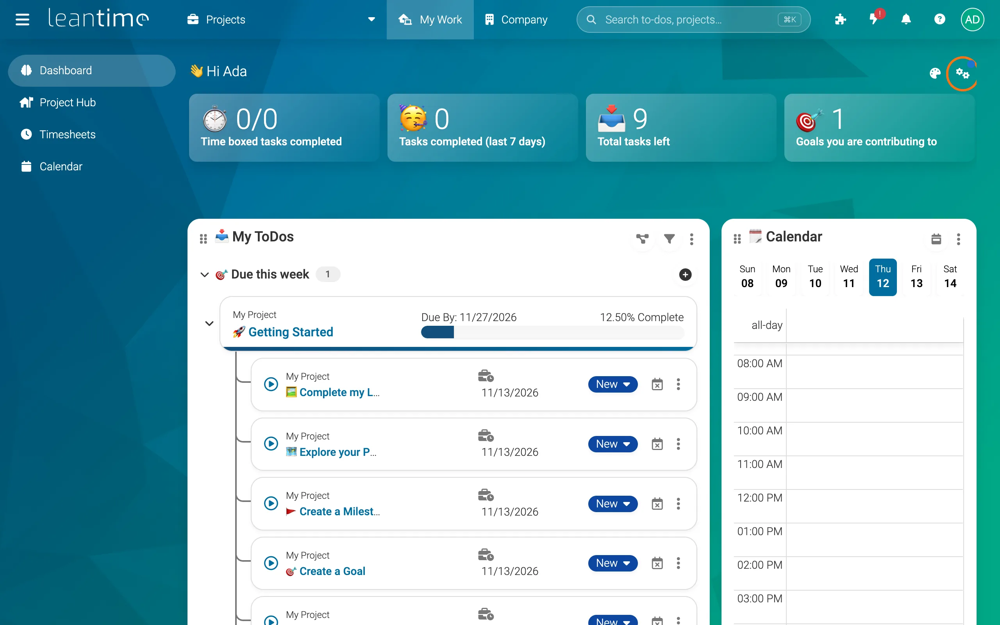
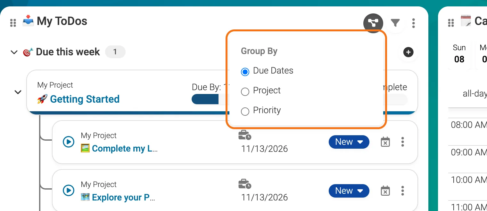
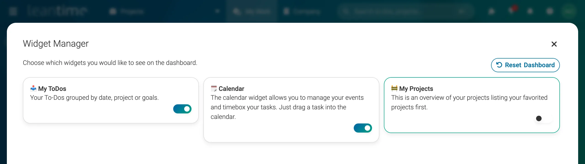

# My Work Dashboard

My Work is your personal start page: your to-dos from every project, your calendar and a few numbers about your week, in one place. Open it with **My Work** in the top menu. Everyone has their own, and you can choose what's on it.

## What do the numbers at the top mean?

- **Time boxed tasks completed:** of the to-dos you planned on your calendar for today, how many are done.
- **Tasks completed (last 7 days):** to-dos you finished this week.
- **Total tasks left:** your open to-dos across all projects.
- **Goals you are contributing to:** goals that your to-dos help reach.

## How do I use the My ToDos widget?

My ToDos lists the to-dos assigned to you, from every project.

- **Group them** with the group button at the top of the widget: by **Due Dates**, **Project** or **Priority**.
- **Show one project** with the filter button next to it.
- **Change a to-do's status** with the colored status button on the to-do.
- **Edit, move, add a subtask, log time or delete** from the **⋮** menu on the to-do.
- **Add a to-do** with the **+** button next to a group.

## How do I plan my day with the Calendar widget?

Drag a to-do from My ToDos onto a time in the Calendar widget. This blocks time for it (time boxing), and it counts toward **Time boxed tasks completed**. Switch between **Month**, **Week**, **Day** and **List** with the calendar button at the top of the widget.

For more on calendars, see [Calendars](using-leantime/calendars.md).

## How do I add, remove or move widgets?

1. **Click Update Dashboard**, the gear button at the top right of My Work.
2. **Switch widgets on or off** in the Widget Manager: **My ToDos**, **Calendar** and **My Projects** (your projects, favorites first). Some plugins add more widgets.
3. **Close the Widget Manager.**

To move a widget, drag it by the dotted handle at its top left. To hide one or fit it to its content, use the **⋮** menu at its top right. **Reset Dashboard** in the Widget Manager puts everything back the way it started.

The palette button next to Update Dashboard changes your theme and colors.

## What else is under My Work?

The left menu has your other personal pages:

- **Project Hub:** your favorite projects and every project you're assigned to (see [Projects](using-leantime/managing-projects.md#where-do-i-find-my-projects)).
- **Timesheets:** the time you've logged (see [Timesheets](using-leantime/timesheets.md)).
- **Calendar:** your full calendar.
