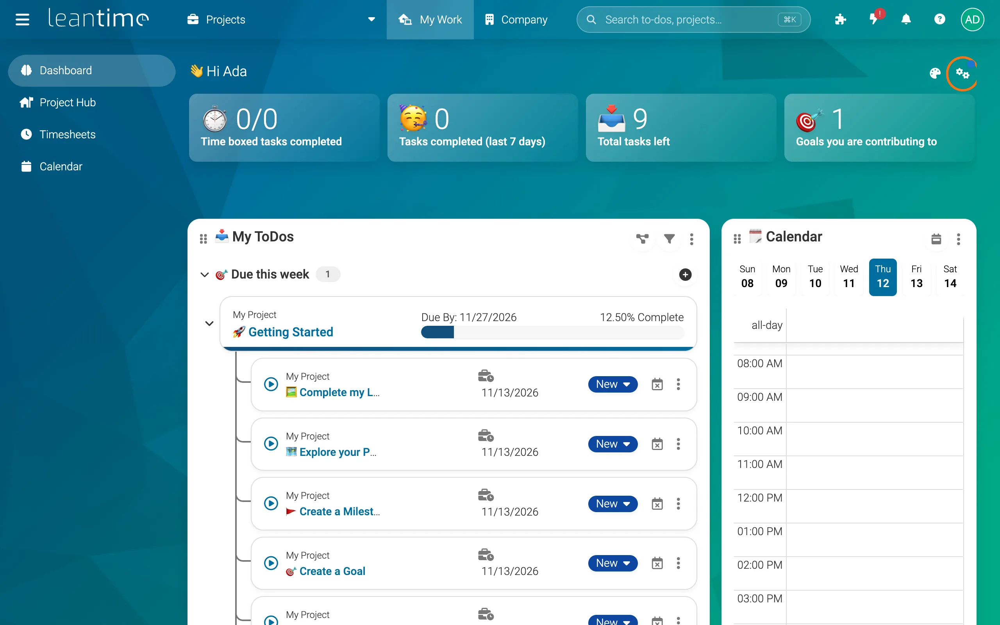
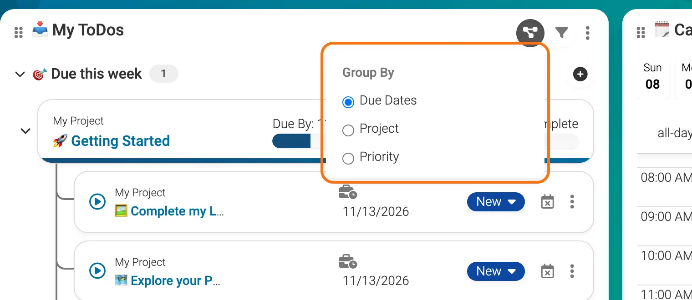
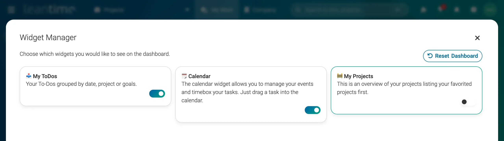
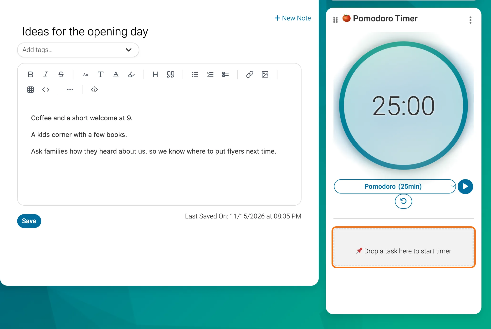

# My Work Dashboard

My Work is your personal start page: your to-dos from every project, your calendar and a few numbers about your week, in one place. Open it with **My Work** in the top menu. Everyone has their own, and you can choose what's on it.

## What do the numbers at the top mean?

- **Time boxed tasks completed:** of the to-dos you planned on your calendar for today, how many are done.
- **Tasks completed (last 7 days):** to-dos you finished this week.
- **Total tasks left:** your open to-dos across all projects.
- **Goals you are contributing to:** goals that your to-dos help reach.

## Where do I see all my to-dos in Leantime?

My ToDos lists the to-dos assigned to you, from every project.

- **Group them** with the group button at the top of the widget: by **Due Dates**, **Project** or **Priority**.
- **Show one project** with the filter button next to it.
- **Change a to-do's status** with the colored status button on the to-do.
- **Edit, move, add a subtask, log time or delete** from the **⋮** menu on the to-do.
- **Start a timer** with the play button on the to-do, and stop it the same way (see [Time tracking](using-leantime/timesheets.md)).
- **Add a to-do** with the **+** button next to a group.

## How do I plan my day with the Calendar widget?

Drag a to-do from My ToDos onto a time in the Calendar widget. This blocks time for it (time boxing), and it counts toward **Time boxed tasks completed**. Switch between **Month**, **Week**, **Day** and **List** with the calendar button at the top of the widget.

For more on calendars, see [Calendars](using-leantime/calendars.md).

## How do I add, remove or move widgets?

1. **Click Update Dashboard**, the gear button at the top right of My Work.
2. **Switch widgets on or off** in the Widget Manager: **My ToDos**, **Calendar** and **My Projects** (your projects, favorites first). Some plugins add more widgets, like the [Pomodoro timer](#how-do-i-use-the-pomodoro-timer), [Notes](using-leantime/notes.md) and, on Leantime Cloud, the [Daily Intention](#how-do-i-set-a-daily-intention).
3. **Close the Widget Manager.**

To move a widget, drag it by the dotted handle at its top left. To hide one or fit it to its content, use the **⋮** menu at its top right. **Reset Dashboard** in the Widget Manager puts everything back the way it started.

The palette button next to Update Dashboard changes your theme and colors.

## How do I use the Pomodoro timer?

The Pomodoro technique is simple: work on one thing for 25 minutes, then take a short break. The **Pomodoro Timer** widget puts the timer on My Work, and can log the time to the to-do you're working on.

The timer comes with the Pomodoro plugin. On Leantime Cloud it's already on; on your own server, see [Pomodoro timer](plugins/pomodoro.md) to install it.

1. **Find the Pomodoro Timer box** on My Work. If it isn't there, switch it on in the Widget Manager (see [How do I add, remove or move widgets?](#how-do-i-add-remove-or-move-widgets)).
2. **Choose the length:** **Pomodoro (25min)**, **Short Break (5min)**, **Long Break (15min)**, or **Custom** for your own number of minutes.
3. **Click play.**

The countdown also shows in your browser tab, so you can see it from another tab. When the time is up, a soft alarm plays. Pause and reset are next to the play button.

The timer doesn't move on to the break by itself: choose **Short Break** or **Long Break** when you're ready for one.

**Just Breath** is a short breathing exercise, for a moment's calm between sessions.

### Can it log my time to a to-do?

Yes. Drag a to-do from **My ToDos** on the dashboard onto **Drop a task here to start timer**. Now play also starts the to-do's time tracking, and pause stops it, so your focus time ends up on the to-do's timesheet. Click pause when you stop working, so the time on the to-do stays right.

Without a to-do dropped in, the timer just counts down and logs nothing. Logging time needs time tracking to be on for the project (see [Timesheets and time tracking](using-leantime/timesheets.md)).

## How do I set a daily intention?

A plan to "work on the report tomorrow" is easy to put off. A plan that says when you'll start and what you'll do first is much easier to follow. The **Daily Intention** widget helps you make that kind of plan for your to-dos. It's on Leantime Cloud only (see [Daily Intentions](plugins/daily-intentions.md) for why it works).

1. **Find the Daily Intention box** on My Work. If it isn't there, switch it on in the Widget Manager (see [How do I add, remove or move widgets?](#how-do-i-add-remove-or-move-widgets)).
2. **Find the card for the day.** There's one card each for yesterday, today and the next three days; today's card stands out. Scroll sideways to see the others.
3. **Fill in the sentence.** Each card reads like a plan, for example "1 day from now, I will work on *pick a task* *before* *when* by *describe what you will be doing*":
   - **pick a task:** one of your to-dos.
   - **before:** choose **before**, **after**, **at** or **during**.
   - **when:** choose **breakfast**, **start of work day**, **lunch**, **end of work day** or **dinner**.
   - **describe what you will be doing:** type the first step, in your own words.

Your intention saves as you go; there's no Save button. A finished card reads like this: "1 day from now, I will work on *the grant report* *after* *lunch* by *opening last year's report and copying the outline*."

Yesterday's card says "I worked on", so you can look back at what you planned.

### How do I write an intention that works?

- **Make the first step small and concrete.** "Open the budget sheet and fill in March" is easier to start than "work on the budget".
- **Tie it to something that happens anyway.** Lunch or the start of your work day is a cue you won't miss. The plan becomes: when that moment comes, I start.
- **Plan the evening before.** Deciding the night before means the morning starts with a decision already made. In one sleep study, people who wrote down their tasks for the next few days fell asleep faster than people who wrote about what they'd already done.
- **Think about what could get in the way.** If mornings get taken over by email, plan for after lunch instead, or plan what you'll do when the interruption comes.
- **One or two a day is enough.** Intentions help most for the to-dos you keep putting off.

## What else is under My Work?

The left menu has your other personal pages:

- **Project Hub:** your projects as cards, with progress and status, and your favorites at the top (see [What's on the Project Hub?](using-leantime/managing-projects.md#whats-on-the-project-hub)).
- **Timesheets:** the time you've logged, a week at a time (see [Time tracking](using-leantime/timesheets.md)).
- **Calendar:** your full calendar.
- **Notes:** your private notes, with the Notes plugin (see [Notes](using-leantime/notes.md)).
