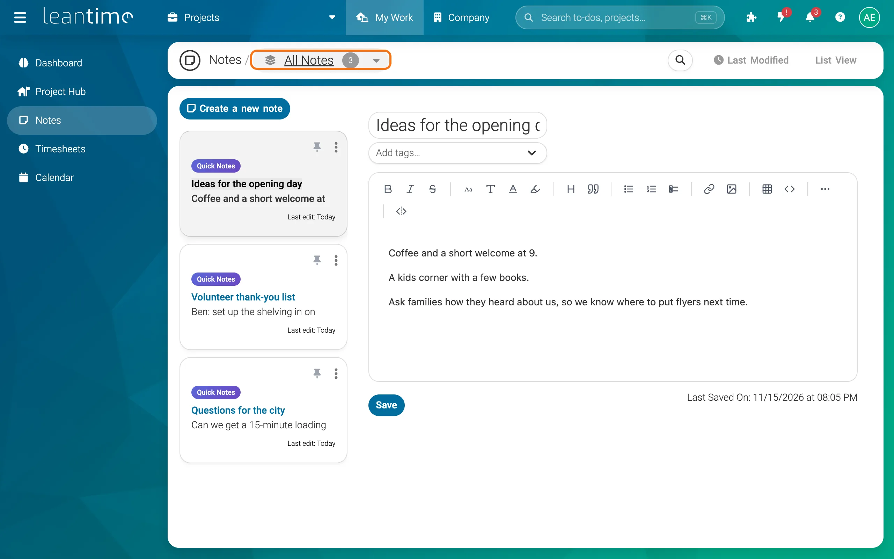

# Notes

Not everything belongs in a project yet: a question for the city, ideas for an opening day, a list of people to thank. The Notes plugin gives you a private place for them, next to your work in Leantime, so they don't end up on sticky notes or in another app.

Notes come with the [Notes](plugins/notes.md) plugin. On Leantime Cloud it's already on; on your own server, see [Notes](plugins/notes.md) to install it.

## How do I write a note?

1. **Click My Work** at the top of the page, then **Notes** in the left menu.
2. **Click Create a new note.**
3. **Give it a title**, add tags if you like, and write.
4. **Click Save.** "Last Saved On" under the note shows when it was saved.

The **Notes** box on your [My Work dashboard](using-leantime/my-work-dashboard.md) works the same way: click **New Note** there to start one without leaving the dashboard.

Notes is there for people with the Editor role or higher.

## Who can see my notes?

Only you. Notes and notebooks belong to the person who wrote them, and there's no way to share them. For writing your team should see, use the project's [Docs](using-leantime/docs.md).

## How do I organize my notes?

- **Notebooks:** click the notebook name next to **Notes** at the top of the page to switch notebooks, see **All Notes**, or **Create New Notebook** with a title and a color. Your first notebook, **Quick Notes**, is made for you. Deleting a notebook also deletes the notes in it.
- **Pin to top:** pinned notes stay at the top of the list. Use the pin on a note, or its **⋮** menu.
- **Sort:** by last change, date created or title.
- **Search:** use the 🔍 button on the Notes page. The search box at the top of every page finds your notes too.
- **Grid View** or **List View:** switch at the top right.

## Related

- [Notes: install and set up](plugins/notes.md)
- [My Work Dashboard](using-leantime/my-work-dashboard.md)
- [Docs](using-leantime/docs.md)
- [Pomodoro timer](using-leantime/my-work-dashboard.md#how-do-i-use-the-pomodoro-timer)
- [All plugins](installation/using-plugins.md)
